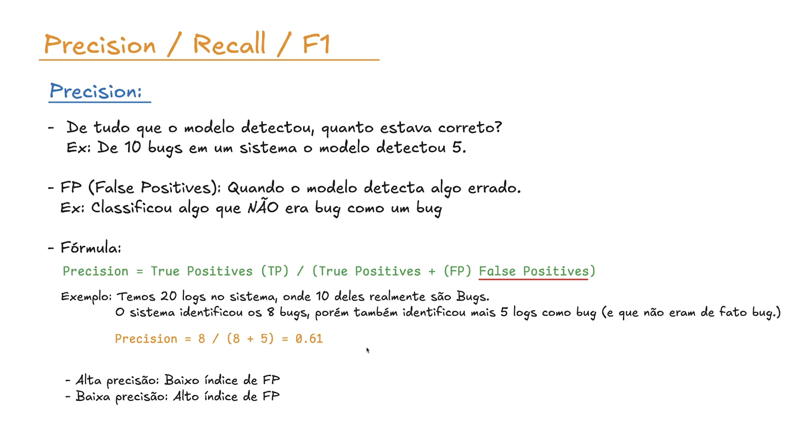

## Precision
Precision mede a proporção de acertos entre os itens que o modelo marcou como positivos. Em um cenário de classificação de bugs, isso significa responder à pergunta: entre tudo que o prompt chamou de bug, quanto realmente era bug. Essa métrica importa porque um sistema pode parecer ativo e “encontrar muitos problemas”, mas ainda assim gerar pouco valor se boa parte desses alertas estiver errada. Em Prompt Engineering, precision permite comparar prompts pela confiabilidade dos positivos que eles retornam.

## True Positives e False Positives
True positive é o caso em que o modelo marca um item como bug e essa marcação está correta. False positive é o caso em que o modelo acusa bug onde não existe bug. Essa distinção é central porque precision penaliza diretamente alarmes indevidos: quanto mais false positives o prompt produz, menor tende a ser sua precision. Em operação, isso afeta a confiança da equipe no sistema, já que alertas incorretos consomem tempo de triagem e reduzem a credibilidade da automação.

## Fórmula e leitura operacional
A fórmula de precision é `true positives / (true positives + false positives)`. O denominador contém apenas os itens que o modelo retornou como positivos, porque a métrica quer medir a qualidade dessas marcações, não a cobertura total do conjunto. Por isso, precision deve ser lida como confiabilidade dos positivos retornados. Se um prompt tem precision alta, a chance de um item marcado como bug realmente ser bug é maior.

## Exemplo com logs e bugs
Considere 20 logs, dos quais 10 realmente correspondem a bugs. Se o sistema identifica 8 bugs corretamente, ele produziu 8 true positives; se também marca mais 5 logs normais como bug, ele adiciona 5 false positives. A precision fica `8 / (8 + 5) = 8 / 13 = 0,61`, ou 61%. Isso significa que, entre os itens que o sistema acusou como bug, apenas 61% estavam corretos.

## O que precision não mede sozinha
Retomando o cenário de logs e bugs, um prompt pode ter boa precision mesmo deixando passar vários bugs reais. Isso acontece porque precision não mede quantos positivos existentes foram encontrados, mas apenas a qualidade dos positivos retornados. É aqui que recall entra como complemento e será reutilizado para interpretar o trade-off entre “acusar com confiança” e “cobrir mais casos”. Olhar apenas para precision pode favorecer prompts conservadores demais.

## Relação entre prompt e métrica
Mudanças de prompt deslocam o comportamento do modelo e, com isso, alteram precision, recall e F1. Um prompt mais agressivo, que tenta sinalizar qualquer indício de erro, tende a aumentar o número de positivos retornados, mas pode elevar os false positives e derrubar a precision. Já um prompt mais restritivo pode devolver menos alertas, porém com maior confiabilidade. A avaliação comparativa existe justamente para medir esse efeito em vez de depender de impressão subjetiva.

---

> Complemento de estudo revisado em 19/11/2026.

## Leitura da imagem e exemplo completo

O quadro usa 20 logs, 10 bugs reais, 8 acertos e 5 alarmes indevidos. A matriz completa é
`TP=8, FP=5, FN=2, TN=5`: precision = `8/13 ≈ 0,6154`, recall = `8/10 = 0,8` e
F1 = `16/23 ≈ 0,6957`. O `0,61` da imagem é uma aproximação; com arredondamento a duas
casas, seria `0,62`.

Encontrar 5 de 10 bugs, frase introdutória do quadro, descreve cobertura. Para calcular
precision ainda falta saber quantos alertas eram falsos. Não confunda precision com taxa de
falsos positivos: esta última usa `FP/(FP+TN)`.

### Como usar no code review

Defina antes o que conta como um acerto: categoria correta, severidade correta, trecho correto,
ou a combinação desses atributos. Uma previsão só pode ser considerada TP segundo a regra
escolhida. Registre também a quantidade de alertas, porque precision de 100% com um único
alerta é evidência diferente de 100% com centenas deles.
