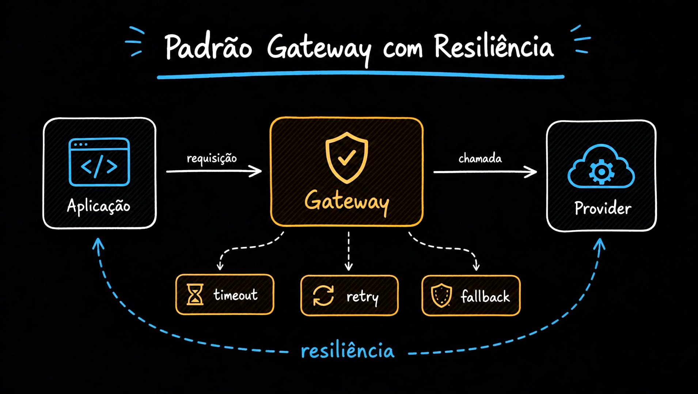
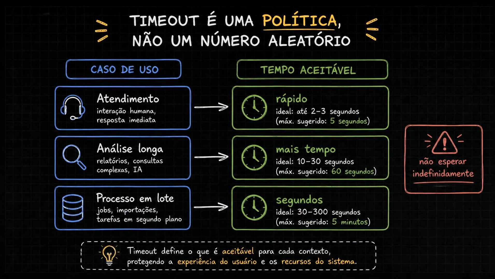
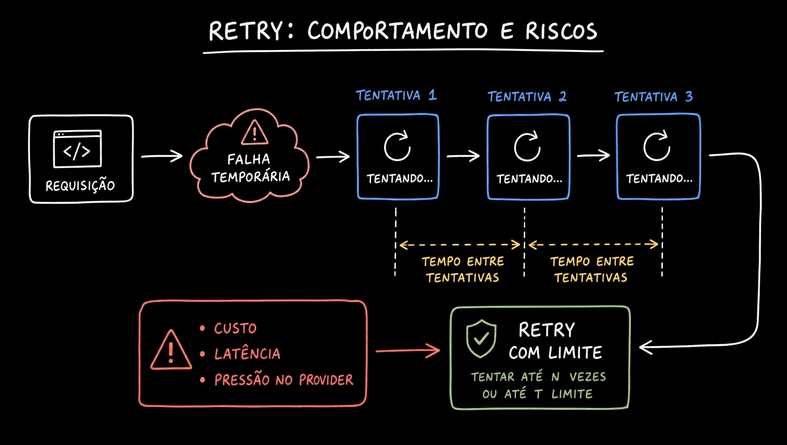
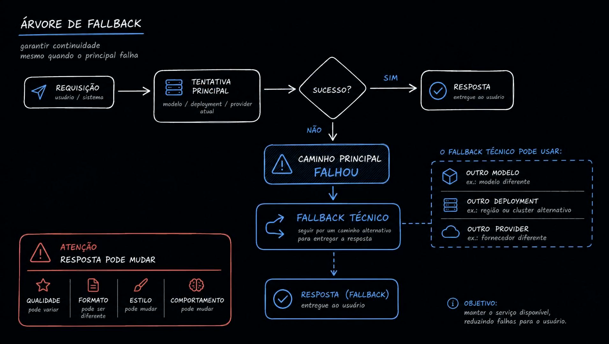
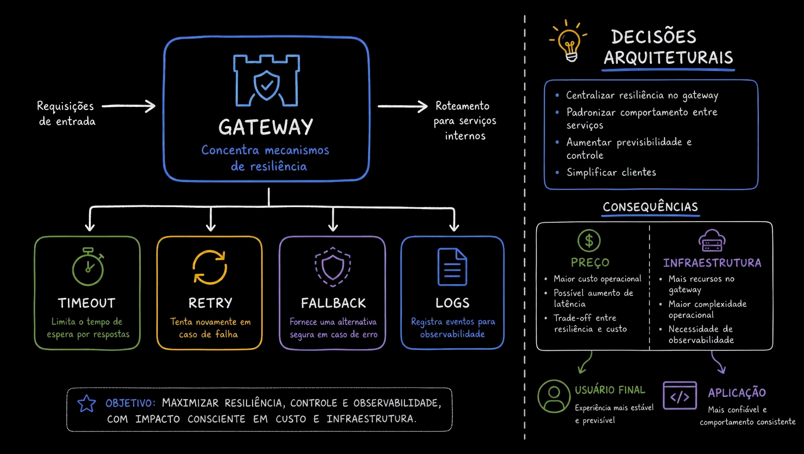
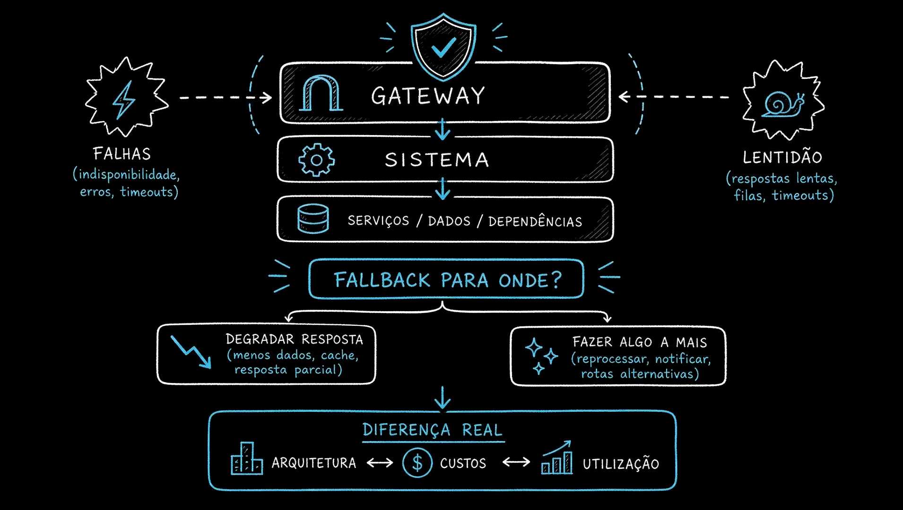

# Aula 13 — Resiliência - timeout, retry e fallback

[Índice do módulo](../README.md)

> Curso: **AI Gateways** · Duração: `04:29`

## Resumo

Esta aula mostra o gateway como ponto natural para concentrar resiliência. Quando a chamada de IA fica lenta ou falha, a aplicação não deveria carregar sozinha toda a complexidade de timeout, retry e fallback.

Resiliência aqui não significa “sempre insistir”. Significa definir comportamento previsível por contexto.

## 1. Gateway resiliente



O padrão apresentado é:

```text
Aplicação -> Gateway -> Provider
```

O gateway concentra timeout, retry e fallback. A aplicação continua com um contrato simples e o comportamento operacional fica padronizado.

## 2. Timeout como política



Timeout não é número aleatório. Ele depende do caso de uso:

- interação humana: idealmente poucos segundos;
- análise longa ou relatório: dezenas de segundos podem fazer sentido;
- batch/background job: pode tolerar mais tempo.

Esperar indefinidamente prejudica UX e consome recursos do sistema.

## 3. Retry com limite



Retry ajuda em falhas temporárias, mas tem preço:

- aumenta custo;
- aumenta latência;
- aumenta pressão sobre provider;
- pode piorar um incidente se for agressivo demais.

Por isso, retry precisa de limite de tentativas e janela de tempo.

## 4. Fallback técnico



Quando o caminho principal falha, o gateway pode tentar uma alternativa:

- outro modelo;
- outro deployment;
- outra região;
- outro provider.

O cuidado é que o fallback pode mudar qualidade, formato, estilo ou comportamento da resposta. Nem todo fallback é equivalente.

## 5. Decisões concentradas no gateway



Centralizar resiliência simplifica clientes e torna o comportamento entre serviços mais consistente. Em troca, aumenta a responsabilidade operacional do gateway.

Custos possíveis:

- maior latência;
- mais chamadas;
- mais infraestrutura;
- mais necessidade de observabilidade.

## 6. Fallback para onde?



A pergunta importante não é apenas “tem fallback?”, mas “fallback para onde?”.

Algumas opções:

- degradar resposta;
- usar cache;
- responder parcialmente;
- reprocessar depois;
- notificar usuário;
- acionar rota alternativa.

## Ideia-chave

Timeout, retry e fallback são decisões de produto e arquitetura. O gateway ajuda a aplicar essas decisões de forma padronizada e observável.

## Complemento — Deadline global e classificação de falhas

Some todas as etapas: conexão, tentativa do primário, backoff, novas tentativas, fallback e entrega ao cliente. Um timeout de tentativa não é necessariamente o prazo total da operação. O cliente e a infraestrutura precisam permitir o orçamento escolhido; esperar mais no provider não recupera uma request já encerrada pelo ingress.

Retry funciona melhor para falhas temporárias. Credenciais inválidas, parâmetro incompatível e entrada incorreta pedem correção, não insistência automática. Em rate limit, respeite a indicação de espera quando disponível e evite sincronizar todos os consumidores.

Também conte retries do SDK. Se cliente, proxy e provider SDK repetirem de forma independente, o total de tentativas pode crescer muito. A [política do módulo](../README.md#resiliência-com-orçamento-ponta-a-ponta) traz um exemplo numérico e a referência dos defaults.

Timeout não prova que a geração remota parou. Antes de repetir ações com efeitos externos, use idempotência e reconciliação. Se um stream já publicou texto, não concatene uma nova resposta de outro modelo sem sinalizar reinício.

---

> Complemento revisado em 19/11/2026. Exemplos propostos não são medições da aula.

## Aprofundamento: contrato de tentativa e resultado

Os seis quadros apresentam concentração de políticas, tempos por caso de uso, retry limitado,
árvore de fallback e suas consequências. As faixas de segundos do slide 02 são sugestões
didáticas, não SLOs medidos ou limites universais de APIs.

### Orçamento proposto para estudo

Suponha um deadline total de 8 segundos. Reserve até 3 para a primeira tentativa, até 0,5
para espera e até 3 para o backup, preservando 1,5 para validação e entrega. Esses valores
ilustram distribuição de orçamento; não são configuração já presente nos demos. Uma nova
tentativa só deve iniciar se ainda houver tempo útil no prazo total.

Conte separadamente: falha de transporte, resposta de formato inválido e resposta válida
porém incorreta no domínio. Falhar tecnicamente pode justificar outra rota; mudar apenas
para obter uma resposta sem avaliar equivalência pode esconder uma regressão de qualidade.
A [documentação de fallback do LiteLLM](https://docs.litellm.ai/docs/proxy/reliability)
é referência para a mecânica do proxy, mas a aplicação continua responsável pelo contrato.

Como exercício, simule atraso, limite de requisição, erro de credencial e interrupção de stream.
Registre destino efetivo, tentativas e deadline consumido. Use dependências controladas para
os cenários; o material desta revisão não executou chamadas pagas nem valida todos os providers.
