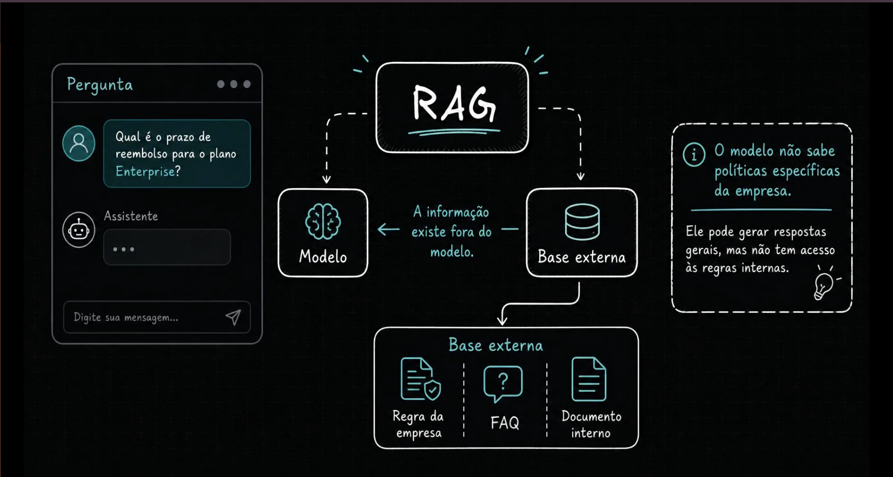
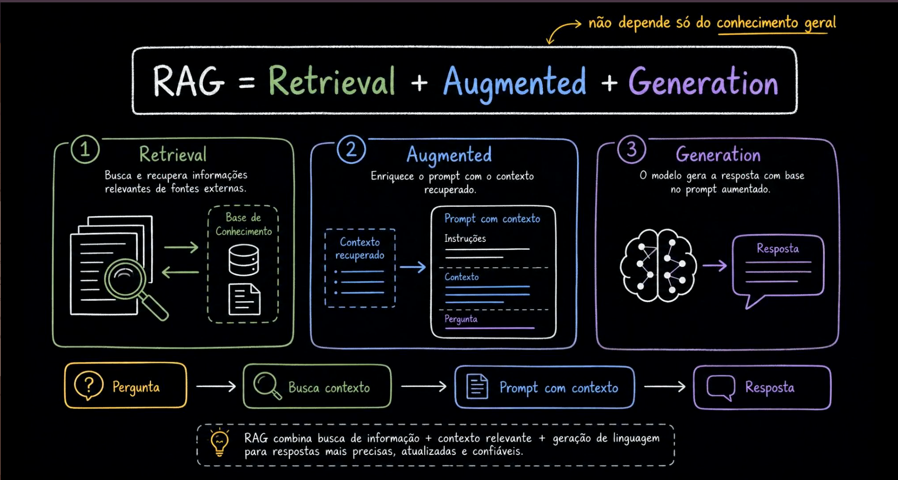
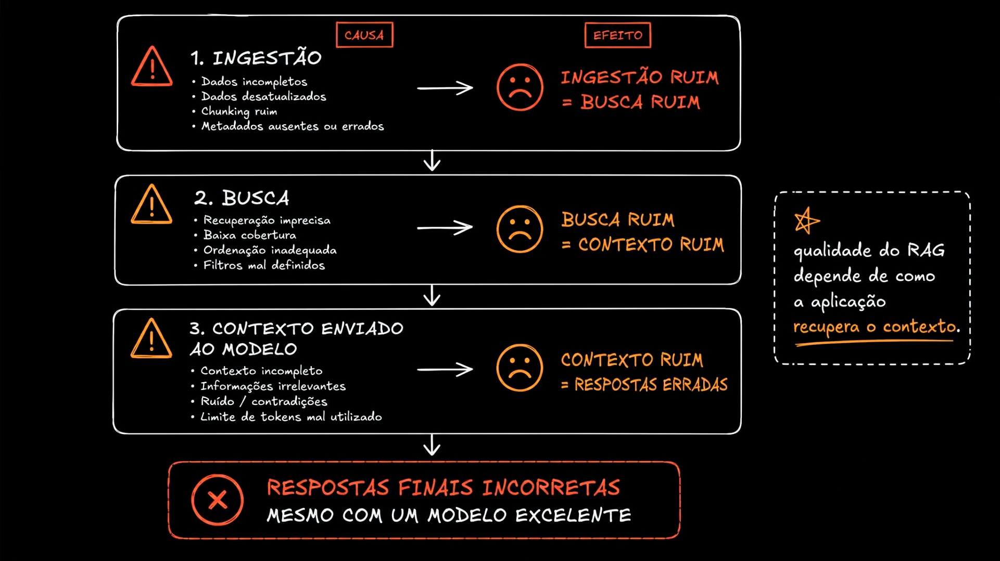
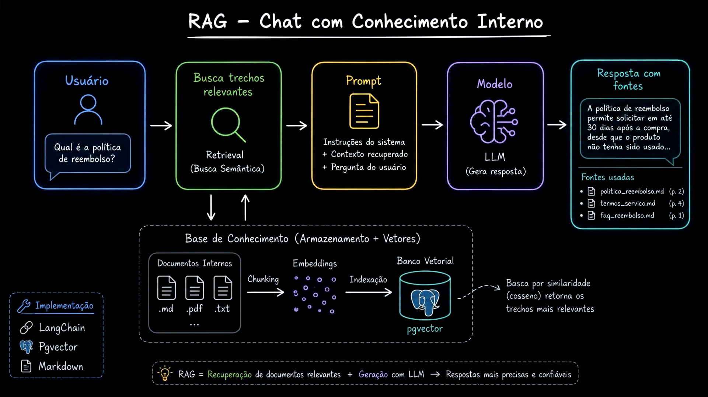
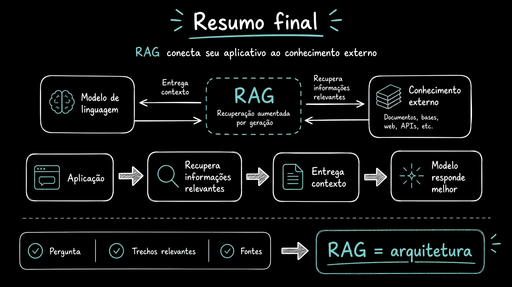

# Aula 01 — O que é RAG

[Índice do módulo](../README.md)

> Curso: **RAG** · Duração: `05:50`

## Resumo

Esta aula apresenta o conceito de **RAG** (*Retrieval-Augmented Generation* — Geração Aumentada por Recuperação) sob a ótica de arquitetura de software. O ponto de partida é simples: modelos de linguagem possuem excelente capacidade de compreensão e síntese textual, mas **não conhecem regras internas, políticas privadas ou documentos atualizados da empresa**.

Em vez de tratar RAG apenas como uma chamada extra ao banco vetorial, a aula mostra que ele é um **sistema de três estágios acoplados** (ingestão, recuperação e montagem de contexto para geração), no qual uma falha nas etapas anteriores compromete a resposta mesmo quando o modelo de linguagem é excelente.

## Índice

| # | Imagem | Assunto |
|---|---|---|
| 01 | [O limite do conhecimento interno do modelo](#01--o-limite-do-conhecimento-interno-do-modelo) | Perguntas sobre regras privadas exigem uma base externa |
| 02 | [RAG = Retrieval + Augmented + Generation](#02--rag--retrieval--augmented--generation) | Os três passos fundamentais do fluxo |
| 03 | [Cadeia de causa e efeito na qualidade do RAG](#03--cadeia-de-causa-e-efeito-na-qualidade-do-rag) | Ingestão ruim → busca ruim → contexto ruim → resposta errada |
| 04 | [Arquitetura de um Chat com Conhecimento Interno](#04--arquitetura-de-um-chat-com-conhecimento-interno) | Do documento Markdown ao pgvector e à resposta com fontes |
| 05 | [Resumo final: RAG é arquitetura](#05--resumo-final-rag-é-arquitetura) | Conexão entre aplicação, conhecimento externo e modelo |

---

## 01 — O limite do conhecimento interno do modelo



O primeiro quadro mostra um usuário perguntando no chat:

> *"Qual é o prazo de reembolso para o plano Enterprise?"*

O modelo sozinho consegue produzir texto fluente e respostas gerais sobre como empresas costumam operar, mas **não tem acesso às políticas específicas da organização**. Essa informação vive fora dos pesos do modelo, em uma **base externa** composta por:

- regras da empresa;
- FAQs;
- documentos internos (políticas comerciais, contratos, SLAs).

O papel do RAG é justamente construir a ponte entre a pergunta do usuário, a base externa onde a informação oficial reside e o modelo que redige a resposta.

---

## 02 — RAG = Retrieval + Augmented + Generation



O segundo diagrama decompõe a sigla **RAG** nas três responsabilidades que a aplicação precisa orquestrar para não depender apenas do conhecimento geral do modelo:

1. **Retrieval (Recuperação):** diante da pergunta, a aplicação busca e recupera informações relevantes em fontes externas (a Base de Conhecimento).
2. **Augmented (Aumento/Enriquecimento):** a aplicação monta um **prompt aumentado**, combinando:
   - instruções do sistema (como responder, limites e regras de recusa);
   - contexto recuperado (os trechos vindos da busca);
   - pergunta do usuário.
3. **Generation (Geração):** o modelo gera a resposta fundamentada no prompt aumentado recebido.

```text
Pergunta -> Busca contexto -> Prompt com contexto -> Resposta
```

A síntese do quadro destaca o objetivo arquitetural: combinar **busca de informação + contexto relevante + geração de linguagem** para obter respostas mais precisas, atualizadas e confiáveis.

---

## 03 — Cadeia de causa e efeito na qualidade do RAG



Este é o slide mais importante para diagnóstico de sistemas RAG em produção. Ele demonstra que **a qualidade do RAG depende de como a aplicação prepara e recupera o contexto**, em uma cadeia de causa e efeito:

| Etapa | Causas de falha | Efeito direto |
|---|---|---|
| **1. Ingestão** | Dados incompletos, dados desatualizados, chunking ruim, metadados ausentes ou errados | **Ingestão ruim = Busca ruim** |
| **2. Busca** | Recuperação imprecisa, baixa cobertura (*recall*), ordenação inadequada, filtros mal definidos | **Busca ruim = Contexto ruim** |
| **3. Contexto enviado ao modelo** | Contexto incompleto, informações irrelevantes, ruído/contradições, limite de tokens mal utilizado | **Contexto ruim = Respostas erradas** |

> **Conclusão do diagrama:** *"Respostas finais incorretas mesmo com um modelo excelente."*

Trocar para um LLM maior ou mais caro não corrige um pipeline que cortou uma tabela de SLA ao meio no chunking, deixou documentos obsoletos no índice ou filtrou fora o documento correto antes da geração.

---

## 04 — Arquitetura de um Chat com Conhecimento Interno



O quarto print antecipa a arquitetura concreta que será construída ao longo do módulo:

- **Fluxo online (consulta):**
  1. **Usuário** faz a pergunta (*"Qual é a política de reembolso?"*).
  2. **Busca trechos relevantes** (*Retrieval / Busca Semântica*) consulta a base vetorial.
  3. **Prompt** reúne `Instruções do sistema + Contexto recuperado + Pergunta do usuário`.
  4. **Modelo (LLM)** gera a resposta fundamentada.
  5. **Resposta com fontes** entrega o texto final acompanhado dos arquivos e páginas/seções utilizadas (`politica_reembolso.md`, `termos_servico.md`, `faq_reembolso.md`).
- **Fluxo offline/preparação (Base de Conhecimento):**
  - **Documentos internos** (`.md`, `.pdf`, `.txt`) passam por **Chunking**, geração de **Embeddings** e **Indexação** em um **Banco Vetorial (`pgvector`)**, onde a busca por similaridade (como cosseno) retorna os trechos mais relevantes.
- **Stack de implementação destacada:** `LangChain`, `Pgvector` e `Markdown`.

---

## 05 — Resumo final: RAG é arquitetura



O fechamento consolida a visão do módulo:

- **RAG conecta seu aplicativo ao conhecimento externo** (documentos, bases, web, APIs).
- A responsabilidade da **aplicação** é recuperar informações relevantes e entregar o contexto certo para que o modelo responda melhor.
- Quando combinamos **Pergunta + Trechos relevantes + Fontes**, deixamos de fazer apenas "engenharia de prompt" isolada e passamos a desenhar arquitetura: **RAG = arquitetura**.

---

## Ponte com o projeto prático

No projeto [`mba-ia-rag`](../mba-ia-rag/README.md), exatamente essa separação entre preparação da base e resposta com fontes é materializada em módulos independentes:

- **Base externa em Markdown:** [`knowledge_base/`](../mba-ia-rag/knowledge_base/) (incluindo [`commercial-policy.md`](../mba-ia-rag/knowledge_base/commercial-policy.md), onde está a política de reembolso e cancelamento do plano Enterprise citada na imagem `01.png`).
- **Ingestão e chunking:** [`app/ingest.py`](../mba-ia-rag/app/ingest.py).
- **Indexação no PostgreSQL com `pgvector`:** [`app/index.py`](../mba-ia-rag/app/index.py).
- **Recuperação, seleção e geração com fontes auditáveis:** [`app/retrieve.py`](../mba-ia-rag/app/retrieve.py), [`app/query_planner.py`](../mba-ia-rag/app/query_planner.py), [`app/rerank.py`](../mba-ia-rag/app/rerank.py) e [`app/rag_pipeline.py`](../mba-ia-rag/app/rag_pipeline.py).

## Ideia-chave

RAG não é uma propriedade mágica do modelo de linguagem; é um pipeline arquitetural em que a qualidade da resposta final é limitada pela qualidade da ingestão, da busca e da seleção de contexto.

## Complemento de estudo

Separe sempre dois momentos operacionais em um sistema RAG:

1. **Tempo de ingestão/indexação (assíncrono ao usuário):** onde decisões de limpeza de dados, recorte de chunks, metadados e versionamento determinam se a evidência poderá ou não ser encontrada.
2. **Tempo de consulta (no caminho crítico de latência):** onde a pergunta do usuário precisa ser transformada em uma busca eficaz, filtrada conforme permissões e convertida em um contexto enxuto e verificável.

Quando uma resposta do RAG sai errada em produção, o diagnóstico nunca deve começar alterando o prompt de geração às cegas: primeiro inspecione **quais chunks foram recuperados** e se o documento correto estava sequer indexado.

## Pergunta de revisão

Se um usuário recebe uma resposta incorreta sobre o prazo de reembolso do plano Enterprise em um sistema com RAG, quais três camadas (antes mesmo de culpar o modelo gerador) você deve auditar em ordem para localizar a causa-raiz?
