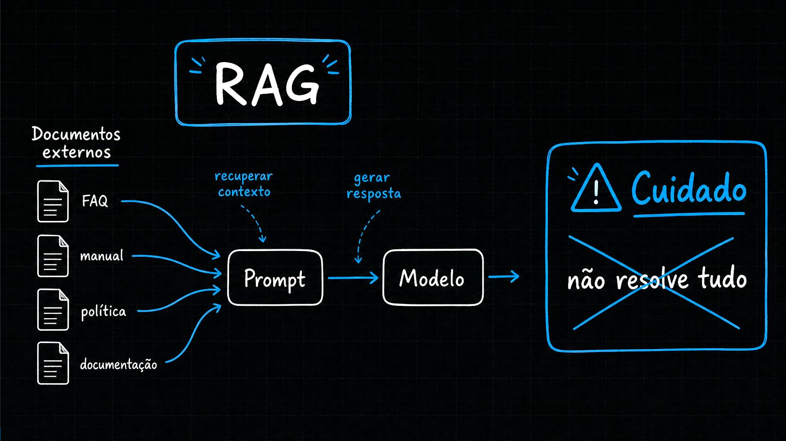
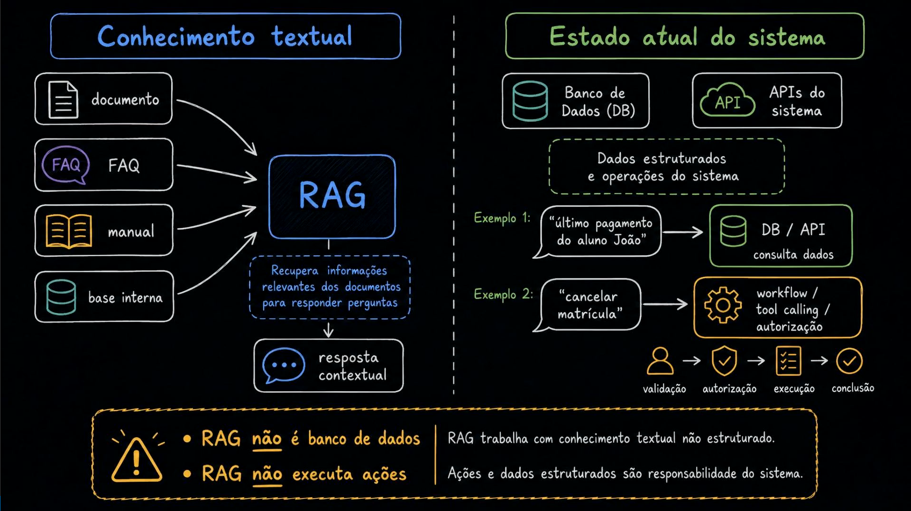
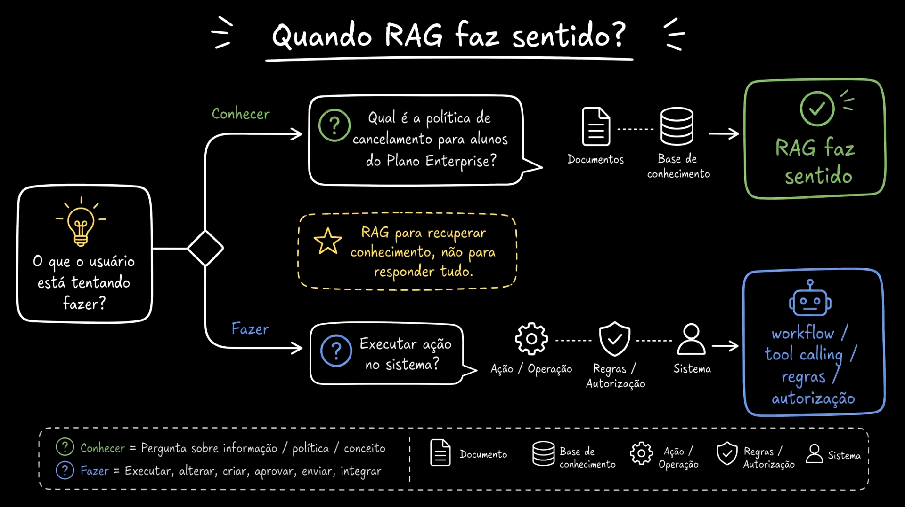
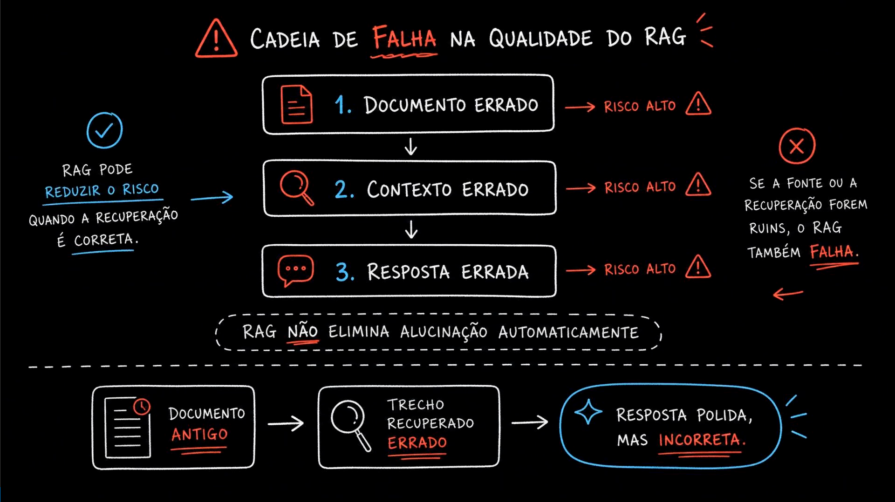
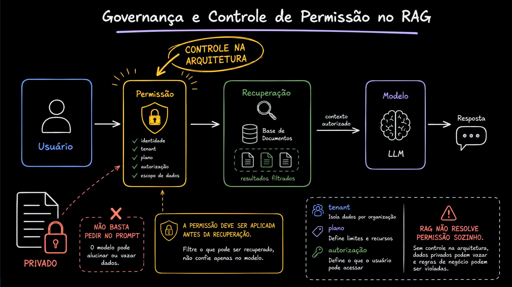
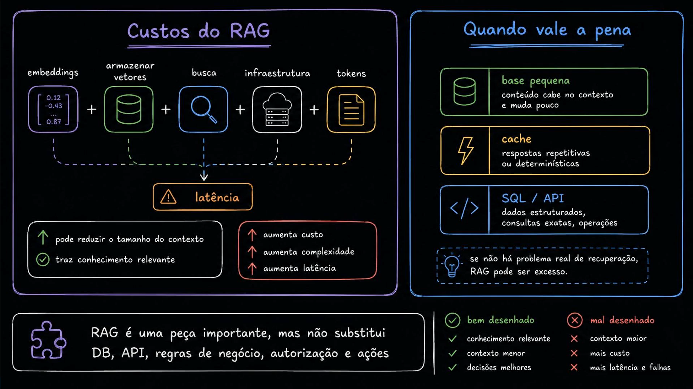

# Aula 02 — O que RAG não resolve

[Índice do módulo](../README.md)

> Curso: **RAG** · Duração: `06:24`

## Resumo

Depois de entender o que é RAG, o passo arquitetural mais importante é saber **onde não usá-lo** e quais problemas ele **não resolve sozinho**. Esta aula estabelece as fronteiras entre conhecimento textual não estruturado, estado transacional do sistema, execução de ações, controle de acesso e custo operacional.

Tratar RAG como substituto de banco de dados relacional, API de negócio ou camada de autorização é um erro clássico de arquitetura que gera respostas incorretas, vazamento de dados e latência desnecessária.

## Índice

| # | Imagem | Assunto |
|---|---|---|
| 01 | [Alerta inicial: RAG não resolve tudo](#01--alerta-inicial-rag-não-resolve-tudo) | Limite da recuperação de contexto textual |
| 02 | [Conhecimento textual vs Estado atual do sistema](#02--conhecimento-textual-vs-estado-atual-do-sistema) | RAG não é banco de dados transacional nem executor de ações |
| 03 | [Quando RAG faz sentido: Conhecer vs Fazer](#03--quando-rag-faz-sentido-conhecer-vs-fazer) | Perguntas conceituais/políticas vs operações de negócio |
| 04 | [Cadeia de falha e alucinação com documento antigo](#04--cadeia-de-falha-e-alucinação-com-documento-antigo) | RAG não elimina alucinação automaticamente |
| 05 | [Governança e controle de permissão no RAG](#05--governança-e-controle-de-permissão-no-rag) | Permissão aplica-se na arquitetura antes da recuperação, nunca só no prompt |
| 06 | [Custos do RAG e quando vale a pena](#06--custos-do-rag-e-quando-vale-a pena) | Componentes de custo/latência e alternativas mais simples |

---

## 01 — Alerta inicial: RAG não resolve tudo



O primeiro slide resume o fluxo básico — documentos externos (`FAQ`, `manual`, `política`, `documentação`) alimentam o `Prompt` com contexto recuperado para o `Modelo` gerar a resposta — e introduz o alerta central da aula: **Cuidado: RAG não resolve tudo**.

Adicionar um banco vetorial na frente de um LLM não transforma o modelo em fonte de verdade transacional, não garante que os documentos recuperados estejam atualizados e não cria governança de acesso por conta própria.

---

## 02 — Conhecimento textual vs Estado atual do sistema



O segundo diagrama traça uma linha divisória clara entre dois mundos na arquitetura:

| Dimensão | Conhecimento textual (RAG) | Estado atual do sistema (DB / APIs) |
|---|---|---|
| **Fontes** | Documento, FAQ, manual, base interna | Banco de Dados (DB), APIs do sistema |
| **Natureza** | Conhecimento textual não estruturado | Dados estruturados e operações do sistema |
| **Objetivo** | Recuperar informações relevantes dos documentos para produzir resposta contextual | Consultar registros exatos em tempo real ou executar fluxos de negócio |
| **Exemplos** | *"Como funciona a política de reembolso?"* | Exemplo 1: *"último pagamento do aluno João"* → `DB / API` (consulta dados)<br>Exemplo 2: *"cancelar matrícula"* → `workflow / tool calling / autorização` (`validação → autorização → execução → conclusão`) |

> **Regras de ouro do slide:**
> - **RAG não é banco de dados:** RAG trabalha com conhecimento textual não estruturado.
> - **RAG não executa ações:** ações e dados estruturados são responsabilidade do sistema.

---

## 03 — Quando RAG faz sentido: Conhecer vs Fazer



Para decidir a arquitetura correta diante da intenção do usuário, a aula propõe a pergunta: **"O que o usuário está tentando fazer?"**

- **Caminho 1 — Conhecer** (*Pergunta sobre informação, política ou conceito*):
  - Exemplo: *"Qual é a política de cancelamento para alunos do Plano Enterprise?"*
  - Caminho arquitetural: `Documentos` → `Base de conhecimento` → **RAG faz sentido**.
- **Caminho 2 — Fazer** (*Executar, alterar, criar, aprovar, enviar, integrar*):
  - Exemplo: *"Executar ação no sistema?"*
  - Caminho arquitetural: `Ação / Operação` → `Regras / Autorização` → `Sistema` → **workflow / tool calling / regras / autorização**.

RAG serve para recuperar conhecimento documental, não para executar efeitos colaterais no domínio.

---

## 04 — Cadeia de falha e alucinação com documento antigo



Um mito frequente é afirmar que *"RAG acaba com alucinações"*. O quarto print desmonta essa ideia:

- RAG **pode reduzir o risco** quando a recuperação é correta.
- Porém, se a fonte ou a recuperação forem ruins, o RAG também falha:
  1. `Documento errado` (risco alto) →
  2. `Contexto errado` (risco alto) →
  3. `Resposta errada` (risco alto).

Na parte inferior do quadro, aparece o caso clássico de produção:

```text
Documento antigo -> Trecho recuperado errado -> Resposta polida, mas incorreta
```

Quando um documento defasado entra no prompt como evidência, o modelo gera uma resposta bem escrita, confiante e totalmente aderente ao contexto recebido — mas **errada perante a regra vigente da empresa**.

---

## 05 — Governança e controle de permissão no RAG



O quinto diagrama trata de segurança e isolamento de dados:

```text
Usuário -> Permissão (identidade, tenant, plano, autorização, escopo de dados)
        -> Recuperação (Base de Documentos -> resultados filtrados)
        -> contexto autorizado -> Modelo (LLM) -> Resposta
```

Os dois avisos de segurança são mandatórios para qualquer sistema corporativo:

1. **Não basta pedir no prompt:** colocar documentos privados no prompt e pedir *"não mostre dados de outros clientes"* é inseguro; o modelo pode alucinar, confundir trechos ou sofrer *prompt injection* e vazar dados.
2. **A permissão deve ser aplicada antes da recuperação:** filtre o que pode ser recuperado diretamente na consulta ao banco vetorial (`tenant`, `plano`, `autorização`, `escopo de dados`). Um trecho não autorizado jamais deve chegar ao prompt do LLM.

---

## 06 — Custos do RAG e quando vale a pena



O último slide coloca na balança os custos arquiteturais e operacionais de introduzir RAG:

- **Componentes que somam custo e latência:**
  `embeddings` + `armazenar vetores` + `busca` + `infraestrutura` + `tokens` → impacto direto em **latência**, **custo** e **complexidade**.
- **Quando outras soluções são mais adequadas:**
  - **Base pequena:** se o conteúdo cabe com folga no contexto e muda pouco, enviá-lo direto (com *prompt caching*) pode ser mais simples.
  - **Cache:** para respostas repetitivas ou determinísticas (veja o [Módulo 05 — Cache](../05-cache/README.md)).
  - **SQL / API:** para dados estruturados, consultas exatas e operações.
- **Balanço final:**
  - **Bem desenhado:** conhecimento relevante, contexto menor, decisões melhores.
  - **Mal desenhado:** contexto maior, mais custo, mais latência e falhas.

---

## Ponte com o projeto prático

No projeto [`mba-ia-rag`](../mba-ia-rag/README.md), três mecanismos implementam diretamente os cuidados desta aula:

1. **Separação entre filtros de segurança e filtros sugeridos pelo modelo:** em [`app/query_planner.py`](../mba-ia-rag/app/query_planner.py), `SAFE_FILTERS = {"tenant": "fcai", "product": "fcai-cloud", "status": "published"}` é fixado pela aplicação e aplicado no banco antes da busca vetorial; o modelo nunca decide sobre `tenant`, `product` ou `status` (prevenindo que documentos `draft` ou de outro tenant vazem).
2. **Governança de versionamento e reindexação:** [`app/manifest.py`](../mba-ia-rag/app/manifest.py) e [`app/index.py`](../mba-ia-rag/app/index.py) removem chunks antigos quando um documento muda, evitando que versões antigas continuem sendo recuperadas.
3. **Recusa explícita quando não há evidência:** se os chunks recuperados não sustentam a resposta, [`app/rerank.py`](../mba-ia-rag/app/rerank.py) e [`app/rag_pipeline.py`](../mba-ia-rag/app/rag_pipeline.py) interrompem ou recusam a resposta em vez de chutar.

## Ideia-chave

RAG resolve recuperação de conhecimento textual não estruturado; estado transacional pertence a bancos de dados e APIs, ações pertencem a workflows/tools com validação, e controle de acesso deve ser imposto pela aplicação **antes** do retrieval.

## Complemento de estudo

Em sistemas reais, uma mesma conversa frequentemente combina essas peças:

- O usuário pergunta *"Qual é a política de reembolso e se minha última fatura ainda está dentro do prazo?"*.
- A **regra de negócio documental** (*política de reembolso*) vem do **RAG**.
- A **data da última fatura do usuário autenticado** vem de uma **consulta SQL/API** filtrada pelo `user_id` da sessão autenticada.
- Se o usuário pedir *"Então solicite o reembolso agora"*, a execução passa por uma **tool/workflow transacional** com validação determinística no backend.

Misturar essas responsabilidades indexando linhas de faturas em chunks vetoriais destrói precisão numérica, cria atraso de sincronização e aumenta a superfície de vazamento de dados.

## Pergunta de revisão

Por que incluir `tenant_id` apenas como instrução no prompt do sistema (*"responda apenas sobre a empresa X"*) não é um controle de segurança válido em um sistema RAG multi-tenant?
