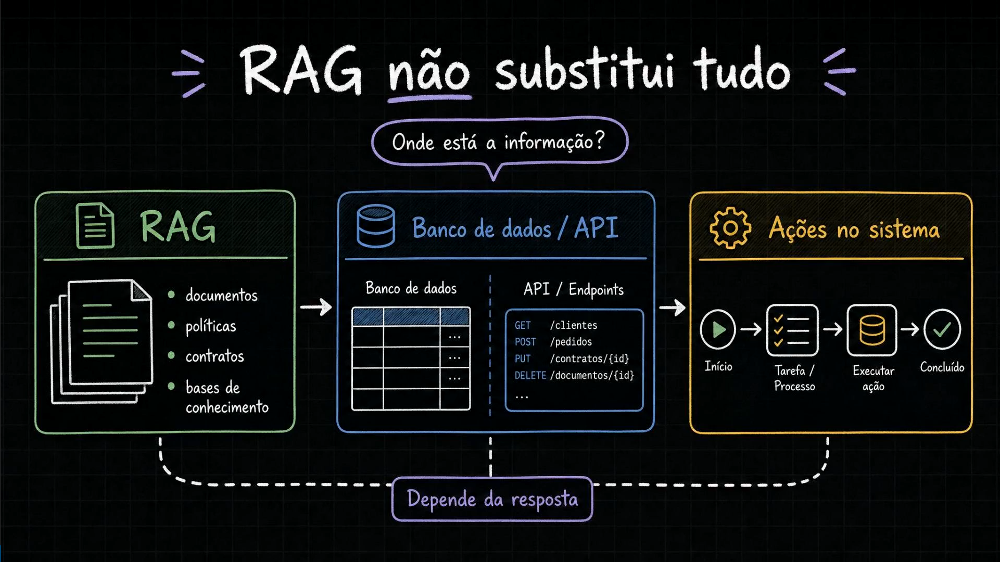
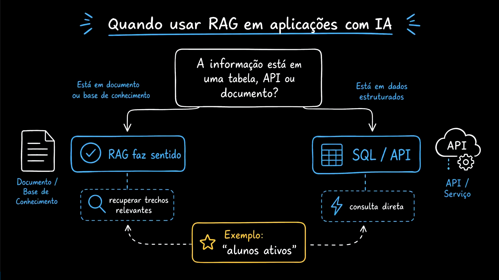
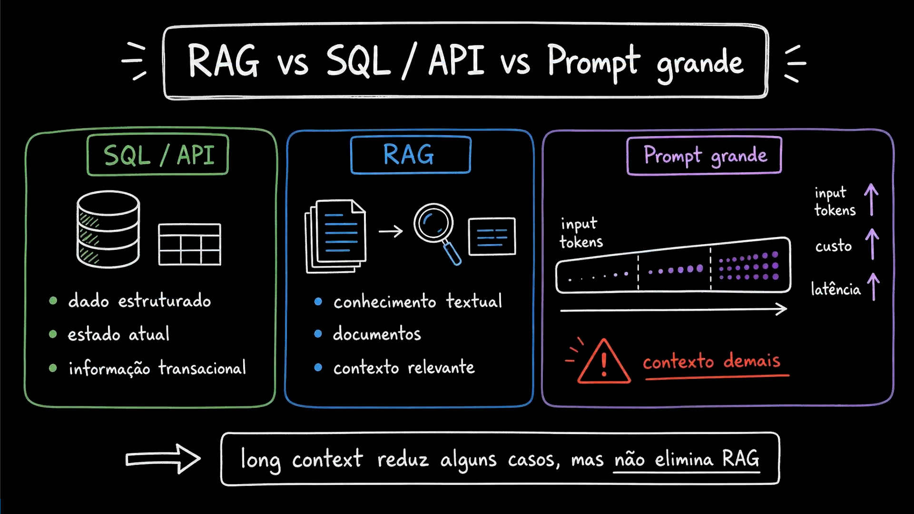
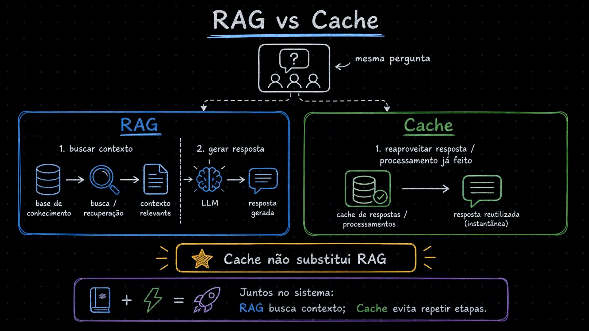
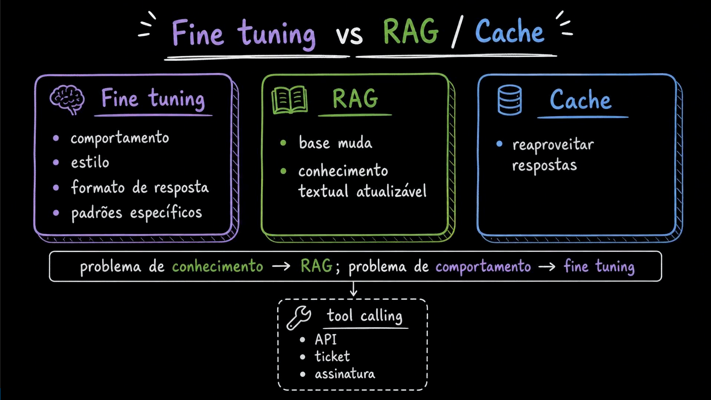
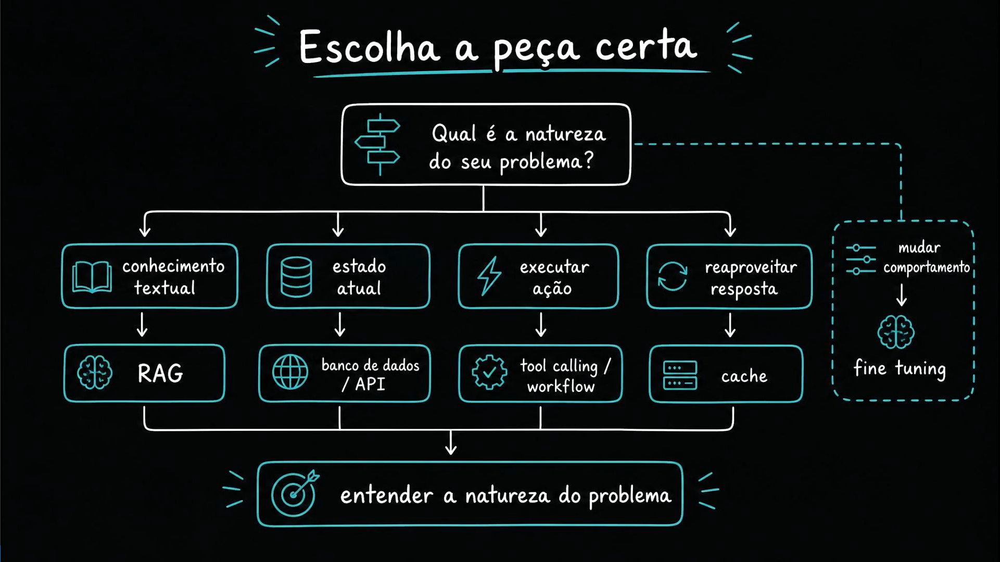
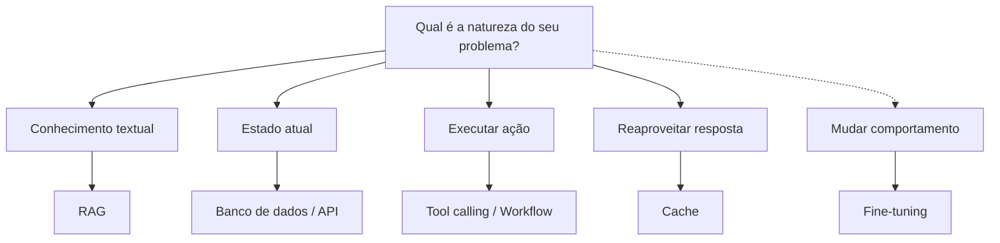

# Aula 03 — RAG vs outras estratégias arquiteturais

[Índice do módulo](../README.md)

> Curso: **RAG** · Duração: `06:09`

## Resumo

Esta aula posiciona o RAG ao lado das demais estratégias arquiteturais para aplicações com IA: **consultas diretas (SQL/API)**, **ações no sistema (Tool Calling / Workflows)**, **Prompt grande (Long Context)**, **Cache** e **Fine-tuning**.

O objetivo é evitar o anti-padrão de usar RAG como solução única para qualquer necessidade de dados ou comportamento, fornecendo um guia de decisão baseado na **natureza do problema**.

## Índice

| # | Imagem | Assunto |
|---|---|---|
| 01 | [RAG não substitui tudo: onde está a informação?](#01--rag-não-substitui-tudo-onde-está-a-informação) | Documentos vs Banco de dados/API vs Ações no sistema |
| 02 | [Quando usar RAG vs SQL/API](#02--quando-usar-rag-vs-sqlapi) | Decisão pela origem e formato da informação |
| 03 | [RAG vs SQL/API vs Prompt grande](#03--rag-vs-sqlapi-vs-prompt-grande) | Por que janelas de contexto grandes não eliminam o RAG |
| 04 | [RAG vs Cache](#04--rag-vs-cache) | Buscar evidência para gerar resposta vs reaproveitar processamento |
| 05 | [Fine-tuning vs RAG / Cache / Tool Calling](#05--fine-tuning-vs-rag--cache--tool-calling) | Problema de comportamento vs problema de conhecimento |
| 06 | [Escolha a peça certa pela natureza do problema](#06--escolha-a-peça-certa-pela-natureza-do-problema) | Árvore de decisão arquitetural completa |

---

## 01 — RAG não substitui tudo: onde está a informação?

O primeiro diagrama organiza o ecossistema em três frentes complementares a partir da pergunta **"Onde está a informação?"**:

1. **RAG:** voltado para `documentos`, `políticas`, `contratos` e `bases de conhecimento`.
2. **Banco de dados / API:** voltado para tabelas relacionais e endpoints estruturados (`GET /clientes`, `POST /pedidos`, `PUT /contratos/{id}`, `DELETE /documentos/{id}`).
3. **Ações no sistema:** fluxos operacionais (`Início → Tarefa / Processo → Executar ação → Concluído`).

A escolha não é por preferência tecnológica, mas pelo tipo de resposta ou efeito que a requisição exige.

---

## 02 — Quando usar RAG vs SQL/API

O segundo print transforma a distinção em uma regra prática de roteamento arquitetural:

- **Pergunta-guia:** *"A informação está em uma tabela, API ou documento?"*
  - **Está em documento ou base de conhecimento** → **RAG faz sentido** (*recuperar trechos relevantes*).
  - **Está em dados estruturados** → **SQL / API** (*consulta direta* ao banco ou serviço).

O exemplo destacado no slide (**"alunos ativos"**) ilustra bem a ambiguidade:
- Se a pergunta for *"O que nossa política considera como um aluno ativo?"*, a resposta está em um **documento de regras** (RAG).
- Se a pergunta for *"Quantos alunos ativos temos hoje?"*, a resposta é uma agregação exata sobre registros transacionais (**SQL / API**). Tentar contar registros via busca vetorial de chunks leva a respostas incompletas e erradas.

---

## 03 — RAG vs SQL/API vs Prompt grande

Com o surgimento de modelos que aceitam centenas de milhares ou milhões de tokens de entrada (*long context*), surge a dúvida: *"Por que não colocar todos os documentos direto no prompt e eliminar o RAG?"*

O terceiro quadro compara as três abordagens:

| Estratégia | Foco | Limite principal |
|---|---|---|
| **SQL / API** | Dado estruturado, estado atual, informação transacional | Não interpreta texto livre nem responde dúvidas conceituais abertas |
| **RAG** | Conhecimento textual, documentos, seleção de contexto relevante | Exige pipeline de ingestão, índice e calibragem de retrieval |
| **Prompt grande** | Enviar documentos inteiros direto na chamada | Crescimento de `input tokens ↑`, `custo ↑`, `latência ↑` e degradação por **contexto demais** |

> **Conclusão do slide:** *"Long context reduz alguns casos, mas não elimina RAG."*

Mesmo quando a base cabe na janela máxima do modelo, enviar dezenas ou centenas de documentos em toda pergunta multiplica o custo por requisição, aumenta o tempo até o primeiro token (TTFT) e dilui a atenção do modelo com informação irrelevante (*lost in the middle*).

---

## 04 — RAG vs Cache

Este slide conecta diretamente o módulo atual ao [Módulo 05 — Cache](../05-cache/README.md) (especialmente à [Aula 12 — Cache semântico não é RAG](../05-cache/12-semantic-cache-is-not-rag/README.md)):

- **RAG:** diante de uma pergunta, executa `1. buscar contexto` (base de conhecimento → busca/recuperação → contexto relevante) e `2. gerar resposta` (LLM → resposta gerada).
- **Cache:** diante de uma pergunta repetida ou equivalente, executa `1. reaproveitar resposta / processamento já feito` (cache de respostas/processamentos → resposta reutilizada instantânea).

> **Cache não substitui RAG — eles trabalham juntos no sistema:**
> **RAG** busca contexto para perguntas que precisam de inferência sobre documentos; **Cache** evita repetir etapas (seja cacheando a resposta final, os embeddings da busca ou o prefixo do prompt no provider).

---

## 05 — Fine-tuning vs RAG / Cache / Tool Calling

Outra confusão recorrente no mercado é tentar usar *fine-tuning* para ensinar fatos dinâmicos da empresa ao modelo. O quinto diagrama separa claramente os papéis:

| Técnica | Quando usar | Características |
|---|---|---|
| **Fine-tuning** | **Problema de comportamento** | Ajusta comportamento, estilo, tom, formato de resposta e padrões específicos |
| **RAG** | **Problema de conhecimento** | Lida com base que muda e conhecimento textual atualizável, permitindo citar fontes e atualizar fatos sem retreinar o modelo |
| **Cache** | **Economia e latência** | Reaproveita respostas e processamentos anteriores válidos |
| **Tool calling** | **Integração operacional** | Interage com API, ticket, assinatura e sistemas externos em tempo real |

---

## 06 — Escolha a peça certa pela natureza do problema

O fechamento da aula entrega o mapa de decisão arquitetural completo a partir da pergunta **"Qual é a natureza do seu problema?"**:

Entender a natureza do problema antes de escolher a ferramenta evita arquiteturas caras e frágeis.

---

## Ponte com o projeto prático

O projeto [`mba-ia-rag`](../mba-ia-rag/README.md) inclui utilitários dedicados para experimentar na prática a diferença entre essas estratégias:

- **Modelo puro (sem contexto externo):** [`app/chat.py`](../mba-ia-rag/app/chat.py) (será explorado na [Aula 07](../07-asking-the-model-without-rag/README.md)).
- **Prompt grande / Documento inteiro no prompt:** [`app/context_chat.py`](../mba-ia-rag/app/context_chat.py) (será explorado na [Aula 08](../08-putting-the-entire-document-in-the-prompt-and-understanding-the-limit/README.md)).
- **Pipeline RAG completo com seleção de contexto:** [`app/rag_pipeline.py`](../mba-ia-rag/app/rag_pipeline.py) e [`app/rag_chat.py`](../mba-ia-rag/app/rag_chat.py).

## Ideia-chave

Problema de conhecimento textual dinâmico resolve-se com **RAG**; problema de estado atual resolve-se com **SQL/API**; problema de ação resolve-se com **Tool Calling/Workflow**; problema de repetição resolve-se com **Cache**; e problema de forma/comportamento resolve-se com **Prompting estruturado ou Fine-tuning**.

## Complemento de estudo

Quando comparar **Prompt grande (Long Context)** vs **RAG**, avalie quatro variáveis quantitativas do seu caso de uso:

1. **Tamanho total do acervo vs tamanho relevante por pergunta:** se a base tem 500 páginas, mas cada pergunta precisa de apenas 2 parágrafos, enviar 500 páginas em toda chamada desperdiça mais de 99% dos tokens de entrada.
2. **Frequência de mudança:** em um prompt fixo com *Prompt Caching* do provider (visto na [Aula 22 de Cache](../05-cache/22-how-openai-anthropic-and-gemini-handle-prompt-caching/README.md)), uma base pequena e estática pode ter desconto de tokens; porém, se a base é grande ou requer seleção por cliente/assunto, o RAG reduz drasticamente o contexto enviado.
3. **Rastreabilidade de fontes:** o RAG recupera `chunk_id`s específicos com metadados (`source_file`, `section`, `version`), facilitando auditar exatamente quais trechos sustentaram a resposta.
4. **Latência p95:** o tempo de *prefill* do LLM cresce com o número de tokens no prompt; recuperar apenas os `top_k` trechos mais relevantes mantém a geração rápida e previsível.

## Exercício

Classifique qual combinação de estratégias (`RAG`, `SQL/API`, `Tool Calling`, `Cache`, `Fine-tuning`) deve atender a cada requisito abaixo em uma plataforma SaaS:

1. Responder quais cláusulas de multa contratual se aplicam ao plano Enterprise.
2. Consultar se a fatura do mês atual do cliente logado está paga ou vencida.
3. Emitir segunda via de boleto quando solicitado no chat.
4. Evitar recalcular a resposta para a pergunta *"Quais são os canais oficiais de suporte?"* feita 2.000 vezes por dia.
