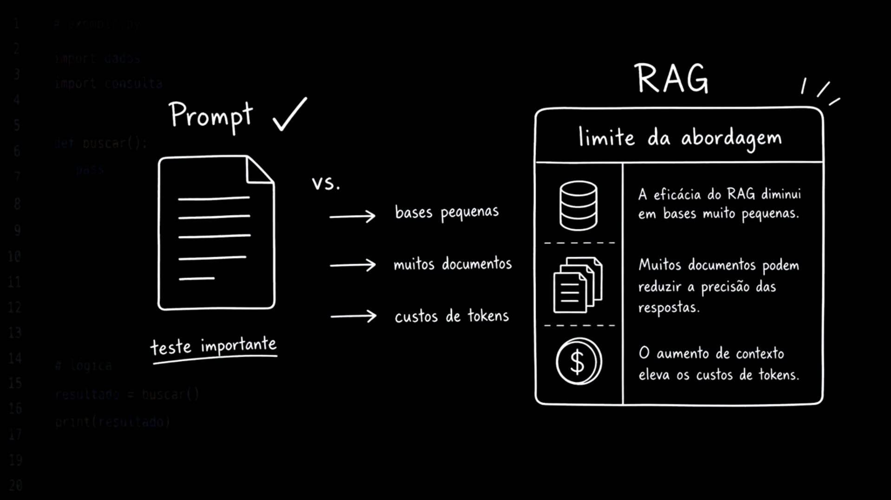
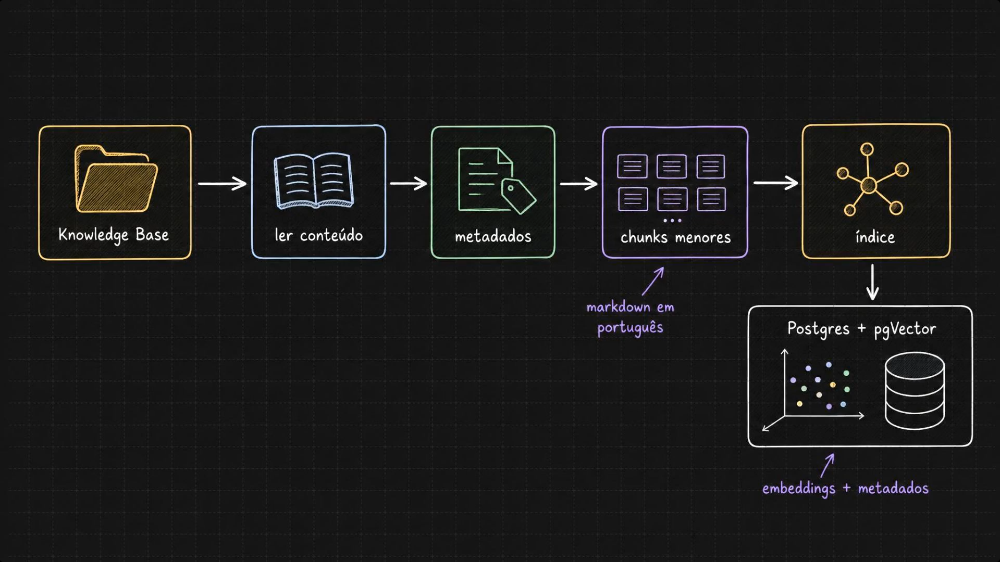
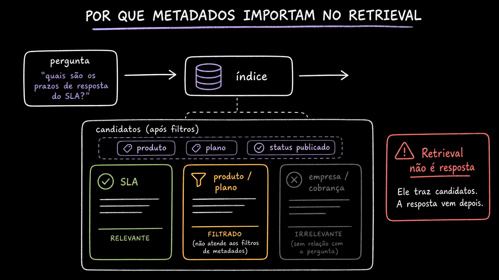
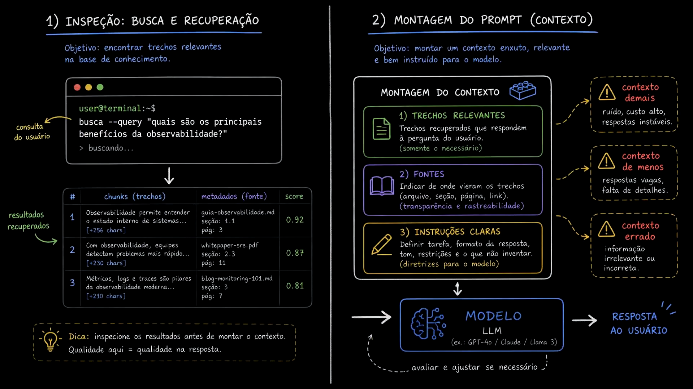
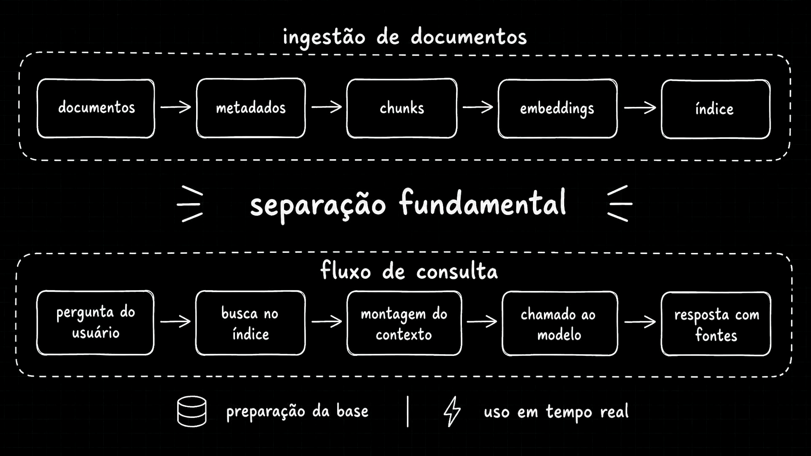

# Aula 09 — Arquitetura do RAG - ingestão, índice, retrieval e geração

[Índice do módulo](../README.md)

> Curso: **RAG** · Duração: `05:39`

Depois de testar o envio de um documento inteiro diretamente no prompt (Aula 08) e esbarrar nos limites de volume, precisão e custo de tokens, esta aula apresenta a arquitetura completa de um sistema RAG (*Retrieval-Augmented Generation*). O foco é decompor o pipeline nas suas etapas essenciais e estabelecer a separação arquitetural entre o que acontece **antes** da pergunta (preparação da base) e o que acontece **em tempo real** (fluxo de consulta).

## Resumo

Colocar documentos inteiros no prompt funciona como teste rápido em bases minúsculas, mas não escala quando a base cresce. O RAG resolve esse limite dividindo o problema em dois fluxos independentes:

1. **Ingestão e indexação (preparação da base):** lê os documentos da base de conhecimento, extrai e valida metadados, quebra o conteúdo em unidades menores (*chunks*), gera vetores semânticos (*embeddings*) e armazena tudo em um índice vetorial (Postgres + `pgvector`).
2. **Retrieval e geração (uso em tempo real):** recebe a pergunta do usuário, consulta o índice combinando busca vetorial e filtros de metadados para trazer trechos candidatos, monta um prompt enxuto com instruções claras e chama o LLM para responder com rastreabilidade de fontes.

## Índice

| # | Imagem | Assunto |
|---|---|---|
| 01 | [Prompt inteiro vs limites de escala](#01--prompt-inteiro-vs-limites-de-escala-e-o-papel-do-rag) | Comparação entre documento no prompt, tamanho da base, precisão e custo de tokens |
| 02 | [Pipeline de ingestão e indexação no pgvector](#02--pipeline-de-ingestão-e-indexação-no-pgvector) | Da Knowledge Base em Markdown aos chunks, embeddings e metadados no Postgres |
| 03 | [Por que metadados importam no retrieval](#03--por-que-metadados-importam-no-retrieval) | Filtragem por produto, plano e status antes da seleção de candidatos |
| 04 | [Inspeção da busca e montagem do prompt](#04--inspeção-da-busca-e-montagem-do-prompt-contexto) | Avaliação dos trechos recuperados, estrutura do contexto e riscos de excesso, falta ou erro |
| 05 | [Separação fundamental: ingestão vs consulta](#05--separação-fundamental-ingestão-de-documentos-vs-fluxo-de-consulta) | Desacoplamento entre preparação offline da base e execução em tempo real |

## 01 — Prompt inteiro vs limites de escala e o papel do RAG



O primeiro quadro retoma o experimento da aula anterior (`Prompt ✓` — `teste importante`) e o confronta com três dimensões críticas sob o quadro **RAG — limite da abordagem**:

- **Bases pequenas:** *"A eficácia do RAG diminui em bases muito pequenas."* Se toda a base de conhecimento resume-se a um único documento curto e estático, montar um pipeline de chunking, embeddings e banco vetorial adiciona complexidade operacional sem ganho real sobre o envio direto no prompt.
- **Muitos documentos:** *"Muitos documentos podem reduzir a precisão das respostas."* Injetar dezenas de arquivos no prompt degrada a atenção do modelo (*lost in the middle*) ou ultrapassa a janela de contexto; por outro lado, em uma base grande, o RAG precisa de bons recortes e filtros para não recuperar trechos ruidosos.
- **Custos de tokens (`$`):** *"O aumento de contexto eleva os custos de tokens."* Enviar a base inteira a cada pergunta multiplica o consumo de tokens de entrada e a latência de prefill, tornando a operação financeiramente inviável em escala.

### Leitura arquitetural

O RAG não substitui o prompt; ele torna a montagem do prompt **seletiva**. Em vez de pagar por toda a biblioteca a cada requisição, a aplicação busca apenas os parágrafos relevantes para aquela pergunta específica.

## 02 — Pipeline de ingestão e indexação no pgvector



O diagrama apresenta a esteira de preparação dos dados que alimenta o RAG no projeto prático:

```text
Knowledge Base -> ler conteúdo -> metadados -> chunks menores (markdown em português)
  -> índice -> Postgres + pgVector (embeddings + metadados)
```

Cada etapa cumpre uma responsabilidade isolada:

1. **Knowledge Base:** diretório com os arquivos-fonte padronizados.
2. **Ler conteúdo:** carregamento e validação estrutural dos arquivos.
3. **Metadados:** extração de atributos de governança e domínio (como `tenant`, `product`, `plan`, `doc_type`, `version`, `status`).
4. **Chunks menores:** divisão dos documentos em Markdown em português em unidades semânticas menores.
5. **Índice (`Postgres + pgVector`):** geração dos vetores numéricos (*embeddings*) e persistência conjunta do vetor, do texto do chunk e dos seus metadados no banco.

### Leitura arquitetural

Um índice de RAG em produção nunca guarda apenas vetores "soltos". Ele armazena o par **representação vetorial + metadados estruturados**, permitindo combinar similaridade semântica com predicados exatos de banco de dados.

## 03 — Por que metadados importam no retrieval



O slide mostra o caminho de uma pergunta real do domínio (`"quais são os prazos de resposta do SLA?"`) ao atingir o `índice`. Ao buscar `candidatos (após filtros)` com as restrições `produto`, `plano` e `status publicado`, o sistema distingue três situações:

- **Relevante (`SLA`, em verde):** atende aos filtros de metadados e possui alta similaridade semântica com os prazos de resposta do SLA.
- **Filtrado (`produto / plano`, em laranja):** poderia até conter palavras parecidas, mas **não atende aos filtros de metadados** (por exemplo, pertence a outro produto, a outro plano ou está com status rascunho/arquivado) e é eliminado antes de ir ao modelo.
- **Irrelevante (`empresa / cobrança`, em cinza):** passa pelos filtros básicos da empresa, mas não tem relação semântica com a pergunta sobre prazos de SLA.

No canto direito, um aviso destaca uma regra de ouro:

> **Retrieval não é resposta.** Ele traz candidatos. A resposta vem depois.

### Leitura arquitetural

A busca vetorial pura mede proximidade geométrica entre embeddings, mas não sabe diferenciar um documento publicado de um rascunho, nem o plano `starter` do `enterprise`. Os metadados atuam como um filtro determinístico (`WHERE`), garantindo isolamento, governança e redução do espaço de busca antes ou durante o cálculo de similaridade.

## 04 — Inspeção da busca e montagem do prompt (contexto)



O painel divide o trabalho de recuperação e geração em dois momentos complementares:

### 1) Inspeção: busca e recuperação

O objetivo é encontrar trechos relevantes na base de conhecimento e **inspecioná-los isoladamente** antes de envolver o LLM gerador. O exemplo mostra uma consulta de terminal (`busca --query "quais são os principais benefícios da observabilidade?"`) retornando uma tabela auditável:

| # | Chunks (trechos) | Metadados (fonte) | Score |
|---|---|---|---|
| `1` | `Observabilidade permite entender o estado interno de sistemas... [+256 chars]` | `guia-observabilidade.md` · seção: `1.1` · pág: `3` | `0.92` |
| `2` | `Com observabilidade, equipes detectam problemas mais rápido... [+230 chars]` | `whitepaper-sre.pdf` · seção: `2.3` · pág: `11` | `0.87` |
| `3` | `Métricas, logs e traces são pilares da observabilidade moderna... [+210 chars]` | `blog-monitoring-101.md` · seção: `3` · pág: `7` | `0.81` |

A nota de rodapé sintetiza a prática de engenharia: *"Dica: inspecione os resultados antes de montar o contexto. Qualidade aqui = qualidade na resposta."*

### 2) Montagem do prompt (contexto)

Com bons candidatos em mãos, o objetivo passa a ser montar um contexto enxuto, relevante e bem instruído para o `MODELO LLM` (`GPT-4o / Claude / Llama 3`), composto por três blocos:

1. **Trechos relevantes:** somente os fragmentos recuperados necessários para sustentar a resposta.
2. **Fontes:** identificação explícita da origem de cada trecho (arquivo, seção, página, link) para transparência e rastreabilidade.
3. **Instruções claras:** diretrizes para o modelo definindo tarefa, formato de saída, tom, restrições e a regra explícita de **não inventar** informações fora do contexto.

À direita, três alertas mostram o que acontece quando a montagem do contexto falha:

- **Contexto demais:** gera ruído, custo alto e respostas instáveis.
- **Contexto de menos:** gera respostas vagas e falta de detalhes.
- **Contexto errado:** entrega informação irrelevante ou induz resposta incorreta.

## 05 — Separação fundamental: ingestão de documentos vs fluxo de consulta



O último slide consolida a visão arquitetural separando o sistema em dois pipelines distintos:

```text
[Ingestão de documentos — preparação da base]
documentos -> metadados -> chunks -> embeddings -> índice

================ SEPARAÇÃO FUNDAMENTAL ================

[Fluxo de consulta — uso em tempo real]
pergunta do usuário -> busca no índice -> montagem do contexto -> chamado ao modelo -> resposta com fontes
```

### Leitura arquitetural

Essa separação é o que torna o RAG viável em produção:

- **Preparação da base (assíncrona / batch / orientada a eventos):** roda apenas quando documentos são criados, editados ou removidos. Não chama o modelo de chat — consome apenas processamento local de texto e o modelo de embeddings.
- **Uso em tempo real (síncrono / baixa latência):** a requisição do usuário **nunca** lê a pasta de arquivos nem reindexa documentos em runtime; ela apenas consulta o índice já pronto no Postgres, monta o prompt e gera a resposta.

## Ponte com o projeto prático

No repositório [`mba-ia-rag`](../mba-ia-rag/README.md), essa arquitetura se traduz em módulos Python independentes dentro de `app/`, refletindo exatamente os dois lados da separação fundamental:

- **Linha de base (sem RAG e documento inteiro):**
  - [`app/chat.py`](../mba-ia-rag/app/chat.py): pergunta direto ao LLM sem contexto (visto na Aula 07).
  - [`app/context_chat.py`](../mba-ia-rag/app/context_chat.py): injeta um arquivo `.md` inteiro no prompt, evidenciando o limite discutido em [`01.png`](#01--prompt-inteiro-vs-limites-de-escala-e-o-papel-do-rag) (visto na Aula 08).
- **Pipeline de preparação da base (offline):**
  - [`app/ingest.py`](../mba-ia-rag/app/ingest.py): lê os Markdown de [`knowledge_base/`](../mba-ia-rag/knowledge_base/), valida os metadados obrigatórios do front matter, divide por cabeçalhos e tamanho, e grava `data/chunks.jsonl`.
  - [`app/index.py`](../mba-ia-rag/app/index.py) e [`app/manifest.py`](../mba-ia-rag/app/manifest.py): geram os embeddings e sincronizam os chunks na tabela `fcai_knowledge_base` do Postgres + `pgvector` de forma incremental.
- **Inspeção de retrieval e fluxo de consulta (online):**
  - [`app/retrieve.py`](../mba-ia-rag/app/retrieve.py): implementa a **inspeção isolada** mostrada em [`04.png`](#04--inspeção-da-busca-e-montagem-do-prompt-contexto), imprimindo score, `chunk_id`, metadados e trecho recuperado sem gastar chamadas do modelo de chat.
  - [`app/rag_pipeline.py`](../mba-ia-rag/app/rag_pipeline.py), [`app/rag_chat.py`](../mba-ia-rag/app/rag_chat.py) e [`app/api.py`](../mba-ia-rag/app/api.py): executam o fluxo em tempo real (evoluído nas aulas seguintes com [`app/query_planner.py`](../mba-ia-rag/app/query_planner.py) e [`app/rerank.py`](../mba-ia-rag/app/rerank.py)), garantindo que a API HTTP e o chat de terminal apenas consultem o índice existente.

## Ideia-chave

RAG não é "plugar um PDF no prompt": é uma arquitetura dividida entre um **pipeline de dados** (ingestão, chunking, metadados e indexação vetorial) e um **pipeline de inferência** (busca filtrada, seleção de evidências, montagem de contexto e geração controlada com fontes).

## Complemento de estudo: onde cada etapa pode falhar

Quando uma resposta com RAG sai errada em produção, misturar ingestão, busca e geração em um único script impede diagnosticar a causa raiz. Separar os estágios permite auditar cada fronteira:

| Etapa | Falha típica | Sintoma observável | Como diagnosticar |
|---|---|---|---|
| **Ingestão / Chunking** | Quebra no meio de uma tabela ou seção sem contexto | O trecho existe no documento, mas o chunk recuperado fica truncado ou ambíguo | Inspecionar `data/chunks.jsonl` gerado pelo `app.ingest` |
| **Metadados / Filtros** | Metadado ausente ou filtro restritivo demais | A busca retorna zero candidatos ou ignora o documento certo | Testar `app.retrieve` variando `--doc-type` e `--plan` |
| **Embeddings / Busca** | Pergunta vaga ou jargão literal perdido na vetorização | Chunks de outros tópicos aparecem com score próximo ao ideal | Comparar scores no `app.retrieve` e usar Query Planner / cabeçalho de contexto |
| **Montagem / Geração** | Prompt frouxo ou excesso de candidatos irrelevantes | O modelo mistura regras de planos diferentes ou inventa fontes | Inspecionar `--show-prompt` e `--debug` no `app.rag_chat` |

## Pergunta de revisão

Por que executar ingestão e geração de embeddings dentro da rota `POST /chat` a cada pergunta do usuário violaria a arquitetura de um sistema RAG em produção, e quais seriam os impactos diretos em latência, custo e concorrência?
