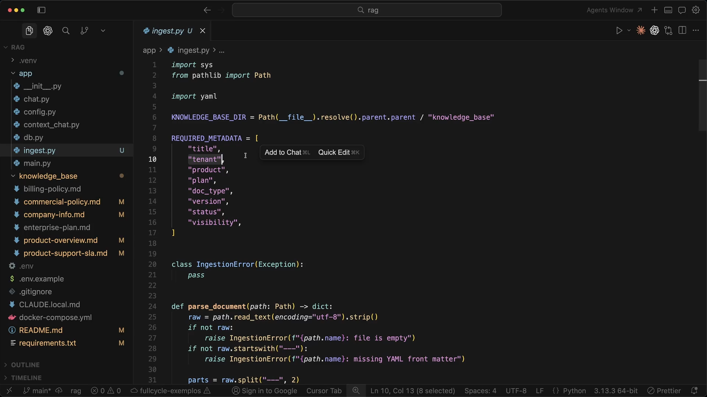
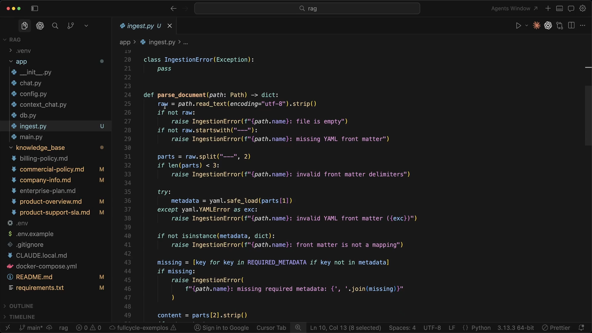
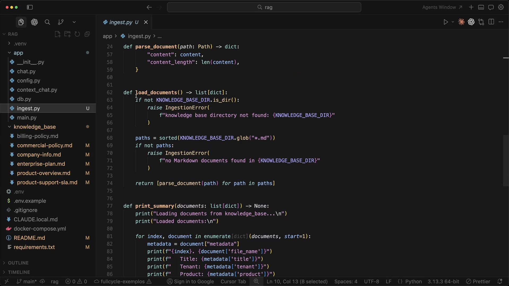
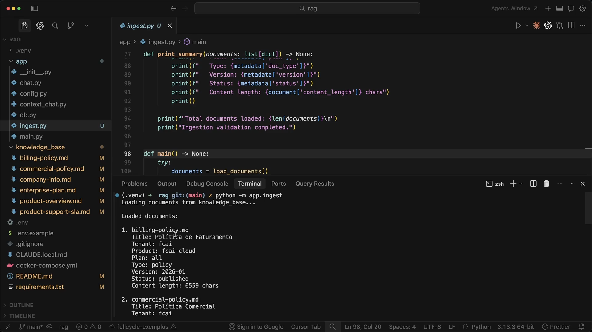

# Aula 10 — Pipeline de ingestão inicial

[Índice do módulo](../README.md)

> Curso: **RAG** · Duração: `06:17`

Esta aula constrói a primeira versão executável do pipeline de ingestão (`app/ingest.py`). Antes de quebrar textos em chunks ou chamar qualquer modelo de embedding, o primeiro passo de engenharia é garantir que a base de conhecimento seja lida de forma determinística e que **nenhum documento sem contrato válido de metadados** entre no pipeline.

## Resumo

Um pipeline de RAG confiável começa por um portão de validação (*fail-fast*) na leitura dos documentos-fonte. Nesta primeira etapa, o script `app/ingest.py`:

1. Localiza o diretório `knowledge_base/` e lista os arquivos `.md` em ordem determinística (`sorted`).
2. Extrai o cabeçalho YAML (*front matter*) e o separa do corpo do documento Markdown.
3. Valida rigorosamente a sintaxe do YAML, a presença dos **8 metadados obrigatórios** (`title`, `tenant`, `product`, `plan`, `doc_type`, `version`, `status`, `visibility`) e se o corpo do texto não está vazio.
4. Exibe no terminal o resumo estruturado de cada documento carregado ou interrompe a execução com uma mensagem clara (`IngestionError`) ao primeiro sinal de inconsistência.

## Índice

| # | Imagem | Assunto |
|---|---|---|
| 01 | [Contrato de metadados e início do parser](#01--contrato-de-metadados-obrigatórios-e-início-do-parser) | `KNOWLEDGE_BASE_DIR`, `REQUIRED_METADATA`, `IngestionError` e validação inicial |
| 02 | [Extração e validação do front matter YAML](#02--extração-e-validação-do-front-matter-yaml) | Split de delimitadores `---`, `yaml.safe_load` e checagem de campos faltantes |
| 03 | [Carregamento da base e listagem de documentos](#03--carregamento-da-base-e-impressão-do-resumo) | Funções `load_documents()` e `print_summary()` |
| 04 | [Execução no terminal (`python -m app.ingest`)](#04--execução-no-terminal-e-validação-dos-documentos) | Função `main()` e saída da validação sobre a `knowledge_base` |

## 01 — Contrato de metadados obrigatórios e início do parser



O primeiro print mostra o topo da versão inicial de `app/ingest.py` (linhas 1 a 31) e a árvore de arquivos do projeto à esquerda:

```python
KNOWLEDGE_BASE_DIR = Path(__file__).resolve().parent.parent / "knowledge_base"

REQUIRED_METADATA = [
    "title",
    "tenant",
    "product",
    "plan",
    "doc_type",
    "version",
    "status",
    "visibility",
]

class IngestionError(Exception):
    pass
```

Em seguida, começa a função `parse_document(path: Path) -> dict`:

- Lê o arquivo em UTF-8 removendo espaços nas extremidades (`raw = path.read_text(encoding="utf-8").strip()`).
- Rejeita arquivos vazios (`if not raw: raise IngestionError(f"{path.name}: file is empty")`).
- Exige que o arquivo comece com o delimitador de front matter (`if not raw.startswith("---"): raise IngestionError(f"{path.name}: missing YAML front matter")`).

### Leitura técnica

Definir `REQUIRED_METADATA` como constante explícita transforma os metadados em **contrato de schema**. Se um autor esquecer de preencher `plan` ou `status` em um novo Markdown, o problema é barrado imediatamente na ingestão — e não semanas depois, quando um documento sumir silenciosamente dos filtros do retrieval.

## 02 — Extração e validação do front matter YAML



O segundo print detalha o restante das validações dentro de `parse_document(path: Path) -> dict` (linhas 24 a 49):

```python
parts = raw.split("---", 2)
if len(parts) < 3:
    raise IngestionError(f"{path.name}: invalid front matter delimiters")

try:
    metadata = yaml.safe_load(parts[1])
except yaml.YAMLError as exc:
    raise IngestionError(f"{path.name}: invalid YAML front matter ({exc})")

if not isinstance(metadata, dict):
    raise IngestionError(f"{path.name}: front matter is not a mapping")

missing = [key for key in REQUIRED_METADATA if key not in metadata]
if missing:
    raise IngestionError(
        f"{path.name}: missing required metadata: {', '.join(missing)}"
    )

content = parts[2].strip()
```

A função trata quatro modos de falha distintos na estrutura do arquivo:

1. **Delimitadores incompletos (`len(parts) < 3`):** o arquivo abriu `---` no topo, mas não fechou o bloco YAML com o segundo `---`.
2. **YAML malformado (`yaml.YAMLError`):** erro de indentação ou sintaxe no cabeçalho. O uso de `yaml.safe_load` evita execução arbitrária de objetos Python.
3. **Tipo incorreto (`not isinstance(metadata, dict)`):** um front matter contendo apenas uma string solta ou lista (ou vazio, resultando em `None`) não é um mapeamento chave-valor válido.
4. **Chaves obrigatórias ausentes (`missing`):** lista exatamente quais campos de `REQUIRED_METADATA` faltaram no arquivo, facilitando a correção rápida pelo autor.

## 03 — Carregamento da base e impressão do resumo



O terceiro print mostra o fechamento do dicionário retornado por `parse_document` (incluindo `"content"` e `"content_length": len(content)`) e as funções `load_documents()` e `print_summary()` (linhas 57 a 86):

```python
def load_documents() -> list[dict]:
    if not KNOWLEDGE_BASE_DIR.is_dir():
        raise IngestionError(
            f"knowledge base directory not found: {KNOWLEDGE_BASE_DIR}"
        )

    paths = sorted(KNOWLEDGE_BASE_DIR.glob("*.md"))
    if not paths:
        raise IngestionError(
            f"no Markdown documents found in {KNOWLEDGE_BASE_DIR}"
        )

    return [parse_document(path) for path in paths]
```

Destaques de implementação:

- **`sorted(KNOWLEDGE_BASE_DIR.glob("*.md"))`:** `Path.glob()` não garante ordem alfabética entre sistemas operacionais e sistemas de arquivos. Ordenar os caminhos garante que a ingestão seja **determinística e reprodutível** em qualquer máquina ou container.
- **Verificação de diretório e de pasta vazia:** evita que um erro de caminho relativo faça o pipeline concluir com "0 documentos processados" fingindo sucesso.
- **`print_summary(documents)`:** percorre os documentos carregados com `enumerate(documents, start=1)` para exibir os metadados extraídos de cada arquivo.

## 04 — Execução no terminal e validação dos documentos



O quarto print exibe o final de `print_summary`, a definição de `main()` e o terminal integrado executando o módulo:

```bash
python -m app.ingest
```

Saída observada no terminal:

```text
Loading documents from knowledge_base...

Loaded documents:

1. billing-policy.md
   Title: Política de Faturamento
   Tenant: fcai
   Product: fcai-cloud
   Plan: all
   Type: policy
   Version: 2026-01
   Status: published
   Content length: 6559 chars

2. commercial-policy.md
   Title: Política Comercial
   Tenant: fcai
...
```

Ao final da listagem, o script imprime `Total documents loaded: ...` e `Ingestion validation completed.`. Caso qualquer arquivo viole uma regra, o bloco `try / except IngestionError` em `main()` captura o erro, imprime o motivo em `stderr` e encerra o processo com código de saída diferente de zero (`SystemExit(1)`).

## Ponte com o projeto prático

Comparar o snapshot desta aula com o código consolidado do projeto em [`mba-ia-rag/app/ingest.py`](../mba-ia-rag/app/ingest.py) mostra como o pipeline evolui ao longo do módulo sem perder nenhuma das validações criadas aqui:

| Aspecto | Aula 10 (ingestão inicial) | Código consolidado (`mba-ia-rag/app/ingest.py`) |
|---|---|---|
| **Parser de Front Matter** | Manual com `raw.split("---", 2)` e `yaml.safe_load` (`PyYAML`) | Biblioteca `python-frontmatter` (`frontmatter.loads`), introduzida na Aula 12 |
| **Validações (`IngestionError`)** | Arquivo vazio, front matter ausente/inválido, `REQUIRED_METADATA` e corpo vazio | **Idênticas** (mantidas em `load_document(path: Path) -> frontmatter.Post`) |
| **Documentos em `knowledge_base/`** | 6 arquivos `.md` na árvore lateral do print | 8 arquivos `.md` (com a adição de [`pro-plan.md`](../mba-ia-rag/knowledge_base/pro-plan.md) e [`starter-plan.md`](../mba-ia-rag/knowledge_base/starter-plan.md)) |
| **Saída do script** | Apenas validação e resumo no stdout (`print_summary`) | Divide em chunks, adiciona cabeçalho de contexto, calcula `document_hash` ([`app/manifest.py`](../mba-ia-rag/app/manifest.py)) e salva em `data/chunks.jsonl` |

Em [`mba-ia-rag/knowledge_base/billing-policy.md`](../mba-ia-rag/knowledge_base/billing-policy.md), podemos conferir o exato arquivo listado como item `1.` no terminal da imagem [`04.png`](#04--execução-no-terminal-e-validação-dos-documentos), cujo cabeçalho YAML contém os 8 campos validados:

```yaml
---
title: Política de Faturamento
tenant: fcai
product: fcai-cloud
plan: all
doc_type: policy
version: 2026-01
status: published
visibility: internal
---
```

## Ideia-chave

A qualidade do retrieval depende da qualidade da ingestão: validar estrutura, codificação e metadados obrigatórios na entrada (*fail-fast*) impede que documentos corrompidos ou sem escopo contaminem o índice vetorial.

## Complemento de estudo: validação estrutural vs validação de domínio

A versão construída nesta aula garante a **presença** das chaves (`key in REQUIRED_METADATA`), mas em sistemas de produção vale distinguir dois níveis de validação na ingestão:

1. **Validação sintática e estrutural (implementada em `ingest.py`):** garante que o arquivo existe, não está vazio, possui YAML válido, contém todas as chaves obrigatórias e possui corpo de texto.
2. **Validação semântica / de vocabulário controlado:** garante que os *valores* de campos como `doc_type`, `plan` e `status` pertençam a um conjunto conhecido (`plan in {"starter", "pro", "enterprise", "all"}`).
   - No projeto prático completo, essa garantia complementar aparece em [`app/query_planner.py`](../mba-ia-rag/app/query_planner.py) por meio da função `ensure_planner_covers_index()`, que cruza os valores distintos indexados no banco com os `Literal`s conhecidos pelo Query Planner.

## Exercício

1. Abra um dos arquivos em [`mba-ia-rag/knowledge_base/`](../mba-ia-rag/knowledge_base/), remova temporariamente a linha `plan: ...` do front matter e execute `python -m app.ingest`. Observe a mensagem de `IngestionError` e o código de retorno do processo.
2. Na versão manual de `parse_document` mostrada em [`02.png`](#02--extração-e-validação-do-front-matter-yaml), por que foi utilizado `raw.split("---", 2)` com `maxsplit=2` em vez de `raw.split("---")` sem limite? O que aconteceria se o corpo do documento Markdown contivesse uma linha horizontal `---`?
