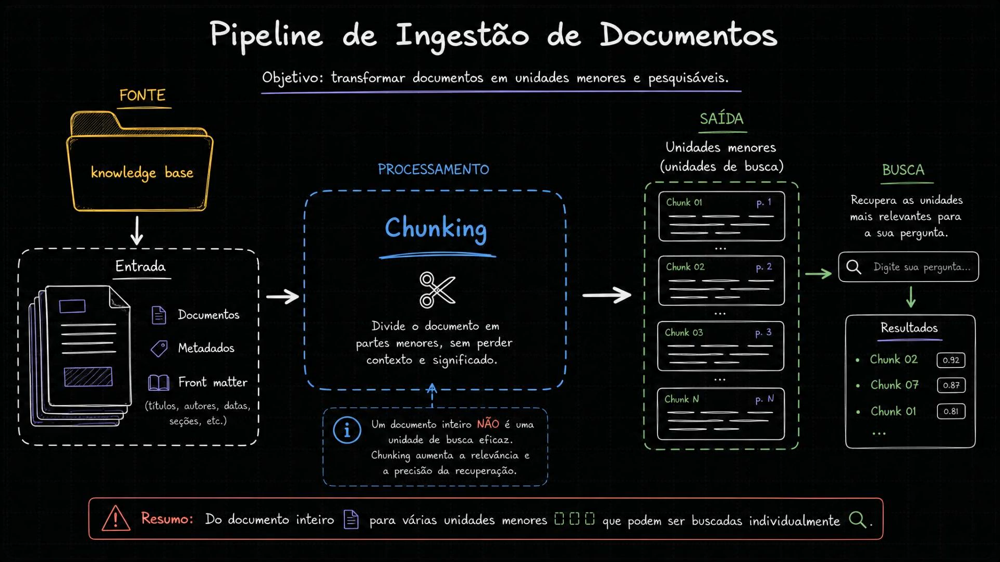
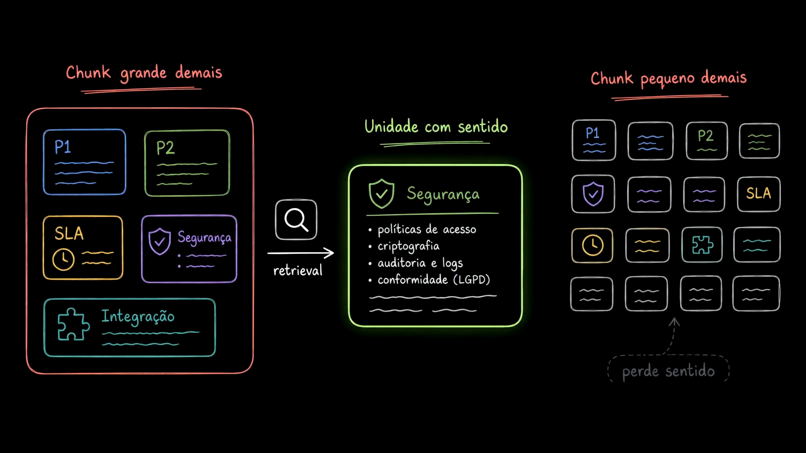
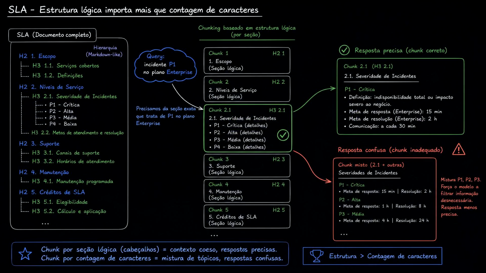
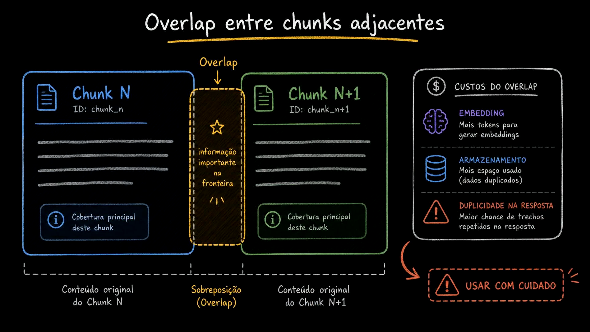
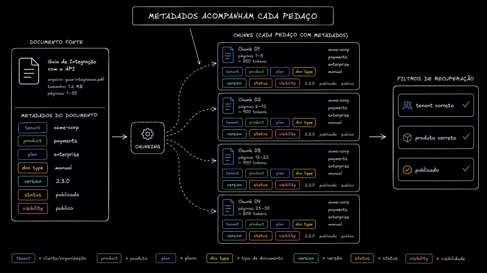
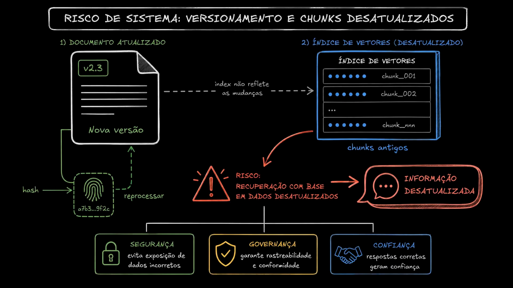
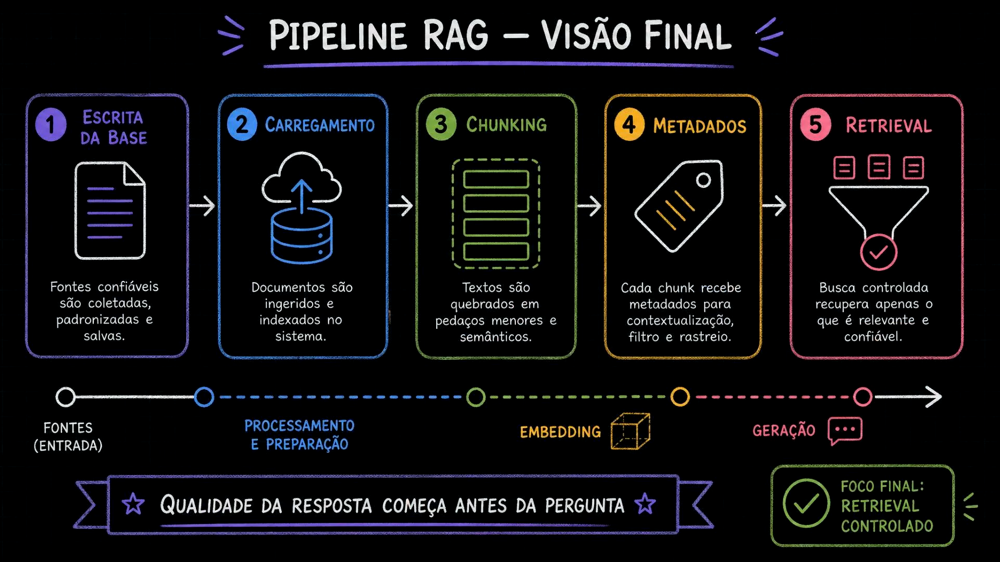

# Aula 11 — Chunking, metadados e versionamento

[Índice do módulo](../README.md)

> Curso: **RAG** · Duração: `06:54`

Depois de validar a leitura dos documentos inteiros na Aula 10, esta aula aprofunda as três decisões de engenharia que determinam se o índice vetorial será útil ou ruidoso: **como dividir os documentos em chunks** (tamanho, estrutura lógica e *overlap*), **como propagar metadados para cada pedaço** e **como evitar que edições nos documentos deixem chunks desatualizados no índice**.

## Resumo

Um documento completo raramente é uma boa unidade de busca: ele mistura vários subtópicos no mesmo vetor e desperdiça tokens no prompt. Por outro lado, fatiar o texto cegamente por contagem fixa de caracteres destrói seções lógicas e separa títulos de suas regras.

Para construir um retrieval controlado, o pipeline de ingestão precisa:

1. **Dividir primeiro pela estrutura lógica** (cabeçalhos Markdown `H1`/`H2`/`H3`) e só usar corte por tamanho (`chunk_size` + `chunk_overlap`) quando uma seção for longa demais.
2. **Copiar os metadados do documento para cada chunk**, somando metadados próprios do pedaço (`chunk_id`, `section`, `chunk_index`, `source_file`).
3. **Controlar versionamento e integridade por hash**, garantindo que atualizar um documento substitua seus chunks antigos no banco vetorial em vez de conviver com dados obsoletos.

## Índice

| # | Imagem | Assunto |
|---|---|---|
| 01 | [Pipeline de ingestão: do documento às unidades de busca](#01--pipeline-de-ingestão-do-documento-às-unidades-de-busca) | Transformação da Knowledge Base em chunks pesquisáveis individualmente |
| 02 | [Equilíbrio do tamanho: grande demais vs pequeno demais](#02--equilíbrio-do-tamanho-chunk-grande-demais-vs-pequeno-demais) | Diluição de tópicos em chunks gigantes vs perda de sentido em fragmentos minúsculos |
| 03 | [Estrutura lógica importa mais que contagem de caracteres](#03--estrutura-lógica-importa-mais-que-contagem-de-caracteres) | Comparação entre corte por cabeçalhos (`H2`/`H3`) e corte cego em um documento de SLA |
| 04 | [Overlap entre chunks adjacentes e seus custos](#04--overlap-entre-chunks-adjacentes-e-seus-custos) | Proteção de informação na fronteira vs custo de embedding, armazenamento e duplicidade |
| 05 | [Metadados acompanham cada pedaço](#05--metadados-acompanham-cada-pedaço) | Herança de `tenant`, `product`, `plan`, `doc_type`, `version`, `status` e `visibility` |
| 06 | [Risco de sistema: versionamento e chunks desatualizados](#06--risco-de-sistema-versionamento-e-chunks-desatualizados) | Detecção por hash, reprocessamento e impactos em segurança, governança e confiança |
| 07 | [Pipeline RAG — Visão final](#07--pipeline-rag--visão-final-qualidade-começa-antes-da-pergunta) | As 5 etapas da escrita da base ao retrieval controlado |

## 01 — Pipeline de ingestão: do documento às unidades de busca



O primeiro diagrama situa o **Chunking** no centro do pipeline de ingestão:

```text
FONTE (knowledge base)
  -> Entrada (Documentos + Metadados + Front matter: títulos, autores, datas, seções)
  -> PROCESSAMENTO: Chunking (divide o documento em partes menores, sem perder contexto e significado)
  -> SAÍDA: Unidades menores / unidades de busca (Chunk 01 p. 1, Chunk 02 p. 2, ..., Chunk N p. N)
  -> BUSCA (recupera as unidades mais relevantes: Chunk 02 [0.92], Chunk 07 [0.87], Chunk 01 [0.81])
```

O destaque central resume o princípio:

> **Um documento inteiro NÃO é uma unidade de busca eficaz.** Chunking aumenta a relevância e a precisão da recuperação.

### Leitura arquitetural

O modelo de embedding comprime todo o texto de entrada em um único vetor de dimensão fixa (por exemplo, `1536` dimensões). Quando você vetoriza um documento inteiro de 10 páginas, esse único vetor representa a "média semântica" de tudo o que está ali. Quebrar em unidades menores faz com que cada vetor represente uma ideia específica, aumentando a nitidez do score de similaridade.

## 02 — Equilíbrio do tamanho: chunk grande demais vs pequeno demais



O segundo quadro ilustra os dois extremos que degradam o RAG e o ponto de equilíbrio ideal:

- **Chunk grande demais (esquerda, em vermelho):** um único bloco engloba `P1`, `P2`, `SLA`, `Segurança` e `Integração`.
  - *Problema:* o embedding fica genérico (diluição semântica) e, quando recuperado, despeja assuntos irrelevantes no prompt do LLM, aumentando o custo e o risco de confusão.
- **Unidade com sentido (centro, em verde):** após o `retrieval`, o chunk recuperado trata especificamente de **Segurança** (`políticas de acesso`, `criptografia`, `auditoria e logs`, `conformidade (LGPD)`).
  - *Vantagem:* o trecho é autocontido e responde diretamente à dúvida sem ruído lateral.
- **Chunk pequeno demais (direita, em vermelho — `perde sentido`):** o texto foi picotado em 16 microfragmentos isolados (`P1` separado da sua descrição, `SLA` separado do relógio de prazo, linhas soltas sem sujeito).
  - *Problema:* uma frase solta como *"Até 1 hora, com atendimento 24x7"* sem dizer a qual severidade ou plano se refere perde completamente o significado tanto para o embedding quanto para o modelo gerador.

## 03 — Estrutura lógica importa mais que contagem de caracteres



Usando um documento de **SLA** como exemplo prático, o slide mostra por que respeitar a hierarquia do Markdown (`H2`, `H3`) supera o corte cego por número de caracteres:

- **Hierarquia do documento (`Markdown-like`):**
  - `H2 1. Escopo` (`H3 1.1. Serviços cobertos`, `H3 1.2. Definições`)
  - `H2 2. Níveis de Serviço` (`H3 2.1. Severidade de Incidentes`: `P1 - Crítica`, `P2 - Alta`, `P3 - Média`, `P4 - Baixa`; `H3 2.2. Metas de atendimento e resolução`)
  - `H2 3. Suporte`, `H2 4. Manutenção`, `H2 5. Créditos de SLA`
- **Query do usuário:** `incidente P1 no plano Enterprise` (*"Precisamos da seção exata que trata de P1 no plano Enterprise"*).

O diagrama compara os dois resultados possíveis na recuperação:

1. **Resposta precisa — chunk correto (verde):** o chunking baseado em estrutura lógica isola o `Chunk 2.1 (H3 2.1 — 2.1. Severidade de Incidentes)` focando em `P1 - Crítica` (definição, meta de resposta Enterprise, meta de resolução e comunicação). O contexto é coeso e o modelo responde com exatidão.
2. **Resposta confusa — chunk inadequado (vermelho):** um chunk cortado por contagem fixa de caracteres gera um `Chunk misto (2.1 + outras)` que mistura `P1 - Crítica`, `P2 - Alta` e `P3 - Média` no mesmo bloco. Isso força o LLM a filtrar prazos de outras severidades (15 min vs 1 h vs 4 h) e aumenta a chance de trocar os números na resposta.

> **Regra de bolso do slide:** `Estrutura > Contagem de caracteres`. Chunk por seção lógica (cabeçalhos) = contexto coeso, respostas precisas. Chunk por contagem de caracteres = mistura de tópicos, respostas confusas.

## 04 — Overlap entre chunks adjacentes e seus custos



Quando uma seção lógica ainda é grande demais e precisa ser dividida por tamanho, surge o problema de **fronteira**: uma ideia importante pode ser cortada exatamente no meio entre o `Chunk N` (`ID: chunk_n`) e o `Chunk N+1` (`ID: chunk_n+1`).

A técnica de **Overlap (sobreposição)** repete os últimos caracteres/tokens do `Chunk N` no início do `Chunk N+1`, preservando a `informação importante na fronteira`. Contudo, o painel lateral direito alerta que overlap não é gratuito (`$ CUSTOS DO OVERLAP` — `USAR COM CUIDADO`):

- **Embedding:** mais tokens totais para vetorizar na indexação.
- **Armazenamento:** mais espaço ocupado no banco vetorial por dados duplicados.
- **Duplicidade na resposta:** se `Chunk N` e `Chunk N+1` forem ambos recuperados no top-$k$, o trecho sobreposto aparecerá duas vezes no prompt enviado ao LLM.

## 05 — Metadados acompanham cada pedaço



Quando o documento-fonte (`Guia de Integração com a API`, `guia-integracao.pdf`, 35 páginas) passa pelo `CHUNKING` e vira `Chunk 01`, `Chunk 02`, `Chunk 03` e `Chunk 04`, **um chunk sozinho não sabe de qual documento veio** a menos que os metadados sejam copiados para ele.

O diagrama mostra todos os 7 atributos do documento replicados em cada pedaço:

| Metadado | Valor no exemplo | Papel arquitetural |
|---|---|---|
| `tenant` | `acme-corp` | Isolamento multi-tenant (cliente/organização) |
| `product` | `payments` | Escopo de produto |
| `plan` | `enterprise` | Recorte por plano contratado |
| `doc_type` | `manual` | Classificação funcional do documento |
| `version` | `2.3.0` | Rastreabilidade de versão da documentação |
| `status` | `publicado` | Governança de ciclo de vida (evita expor rascunhos/obsoletos) |
| `visibility` | `publico` | Controle de visibilidade/acesso |

Graças a essa herança em cada chunk, a etapa de `FILTROS DE RECUPERAÇÃO` (à direita) consegue exigir `tenant correto ✓`, `produto correto ✓` e `publicado ✓` diretamente sobre as linhas do índice vetorial.

## 06 — Risco de sistema: versionamento e chunks desatualizados



O sexto diagrama aborda um problema clássico de operação continuada em RAG: **documentos mudam**.

1. **1) Documento atualizado:** o arquivo recebe uma `Nova versão` (`v2.3`).
2. **2) Índice de vetores (desatualizado):** se o pipeline não detectar a mudança ou apenas inserir novos registros sem apagar os anteriores, o índice continua servindo `chunk_001`, `chunk_002`, ..., `chunk_nnn` (`chunks antigos`).
3. **Risco central:** `RECUPERAÇÃO COM BASE EM DADOS DESATUALIZADOS` $\rightarrow$ `INFORMAÇÃO DESATUALIZADA` (ou pior: mistura de chunks da versão antiga com chunks da versão nova no mesmo prompt).

A solução apontada à esquerda do diagrama é calcular um **`hash`** criptográfico do conteúdo do documento (`a7b3...9f2c`) para detectar alterações e **reprocessar** seletivamente, sustentando três pilares:

- **Segurança:** evita exposição de dados incorretos ou políticas revogadas.
- **Governança:** garante rastreabilidade e conformidade sobre qual versão gerou a resposta.
- **Confiança:** respostas consistentes com a documentação vigente geram confiança no sistema.

## 07 — Pipeline RAG — Visão final: qualidade começa antes da pergunta



O slide de fechamento encadeia as cinco responsabilidades que antecedem a geração da resposta:

1. **Escrita da base (`FONTES / ENTRADA`):** fontes confiáveis são coletadas, padronizadas em Markdown e salvas com front matter.
2. **Carregamento (`PROCESSAMENTO E PREPARAÇÃO`):** documentos são ingeridos e validados no sistema.
3. **Chunking:** textos são quebrados em pedaços menores e semânticos respeitando a estrutura.
4. **Metadados (`EMBEDDING`):** cada chunk recebe metadados para contextualização, filtro e rastreio antes da vetorização.
5. **Retrieval (`GERAÇÃO`):** busca controlada recupera apenas o que é relevante e confiável para o modelo responder.

As duas faixas inferiores sintetizam a lição central da aula:

> **Qualidade da resposta começa antes da pergunta.** Foco final: **Retrieval controlado**.

## Ponte com o projeto prático

Todos os conceitos desenhados nesta aula têm implementação direta em [`mba-ia-rag/app/ingest.py`](../mba-ia-rag/app/ingest.py), [`mba-ia-rag/app/manifest.py`](../mba-ia-rag/app/manifest.py) e [`mba-ia-rag/app/index.py`](../mba-ia-rag/app/index.py):

1. **Estrutura lógica + limite de tamanho com overlap ([`03.png`](#03--estrutura-lógica-importa-mais-que-contagem-de-caracteres) e [`04.png`](#04--overlap-entre-chunks-adjacentes-e-seus-custos)):**
   Em `chunk_document()`, o código aplica dois splitters em sequência — primeiro quebra pelos cabeçalhos Markdown (`#`, `##`, `###`) com `MarkdownHeaderTextSplitter` e depois aplica `RecursiveCharacterTextSplitter(chunk_size=900, chunk_overlap=150)` apenas nas seções que excederem 900 caracteres.
2. **Herança de metadados + metadados do chunk ([`05.png`](#05--metadados-acompanham-cada-pedaço)):**
   Cada chunk copia `dict(post.metadata)` (os 8 campos do front matter) e adiciona `chunk_id`, `source_file`, `chunk_index`, `section` (extraído da hierarquia `h3 -> h2 -> h1`) e `content_length`.
3. **Cabeçalho de contexto no texto do chunk (`CONTEXT_HEADER_FIELDS`):**
   Além de gravar os metadados no JSON para filtro SQL (`WHERE`), o código final de `app/ingest.py` prepende um cabeçalho textual (`Document title`, `Document type`, `Product`, `Plan`, `Version`, `Section`) ao `content` de cada chunk. Isso resolve o problema da perda de contexto: quando o chunk é vetorizado, o embedding sabe exatamente a qual documento, plano e seção aquele parágrafo pertence.
4. **Hash de documento e reindexação incremental ([`06.png`](#06--risco-de-sistema-versionamento-e-chunks-desatualizados)):**
   Em [`app/manifest.py`](../mba-ia-rag/app/manifest.py), `document_hash(raw)` calcula o SHA-256 do arquivo completo. O `chunk_id` no código final inclui os 12 primeiros caracteres desse hash (`f"{path.stem}-{metadata['document_hash'][:12]}-{index:04d}"`), e o [`app/index.py`](../mba-ia-rag/app/index.py) compara o hash atual com `data/index_manifest.json` para deletar os chunks antigos e reindexar apenas documentos `new` ou `changed` (aprofundado nas Aulas 28–30).

## Ideia-chave

Chunking eficaz respeita a estrutura semântica do documento antes de olhar para o número de caracteres, carrega os metadados de governança em cada fragmento e vincula o ciclo de vida dos chunks ao hash da versão do documento-fonte.

## Complemento de estudo: por que metadados no JSON não entram automaticamente no embedding?

Um erro conceitual frequente ao trabalhar com `Document(page_content=..., metadata=...)` no LangChain é achar que a chamada de embedding vetoriza o objeto inteiro. Na prática:

- **O modelo de embedding recebe apenas `page_content` (string).** O dicionário `metadata` é salvo em colunas/JSONB ao lado do vetor no Postgres para filtragem (`WHERE`), mas **não altera as coordenadas do vetor**.
- Imagine uma tabela ou subseção em [`product-support-sla.md`](../mba-ia-rag/knowledge_base/product-support-sla.md) cujo título é `### Plano Enterprise` e o corpo diz apenas:
  `- P1: resposta em até 1 hora, com atendimento 24x7.`
- Se o `MarkdownHeaderTextSplitter` extrair `Plano Enterprise` para `piece.metadata["h3"]` e deixar apenas a linha `- P1: resposta em até 1 hora...` no `page_content`, o texto do chunk perderá as palavras `"SLA"` e `"Plano Enterprise"`.
- É por isso que o projeto prático combina as duas estratégias:
  1. Guarda `plan`, `doc_type` e `section` em `metadata` para filtros exatos e montagem de fontes.
  2. Preenche o **cabeçalho de contexto** no início do `content` (`build_context_header`), garantindo que tanto o modelo de embedding quanto o LLM leiam o título do documento, o plano e a seção junto com o trecho.

## Pergunta de revisão

Se um documento de política comercial tiver uma seção de 500 caracteres atualizada (gerando apenas 3 chunks novos, enquanto a versão anterior daquela seção era longa e havia gerado 5 chunks), o que aconteceria no banco vetorial se reindexássemos usando IDs sequenciais simples (`commercial-policy-0`, `commercial-policy-1`...) apenas com `UPSERT`, sem remover os IDs antigos do manifesto?
