# Aula 12 — Gerando chunks com metadados

[Índice do módulo](../README.md)

> Curso: **RAG** · Duração: `11:50`

Esta aula coloca em prática os conceitos da Aula 11 evoluindo o script `app/ingest.py`. O objetivo é transformar os documentos Markdown validados da `knowledge_base/` em unidades menores de busca (*chunks*), preservando a hierarquia de seções (`H1`, `H2`, `H3`), enriquecendo cada pedaço com os metadados do documento mais os metadados próprios do chunk e persistindo o resultado em `data/chunks.jsonl`.

## Resumo

Para sair da validação de documentos inteiros (Aula 10) e chegar a um artefato pronto para indexação vetorial, `app/ingest.py` passa por quatro evoluções principais:

1. **Adoção do `python-frontmatter`:** substitui o `split("---", 2)` manual por `frontmatter.loads(raw)`, mantendo todas as validações de contrato (`REQUIRED_METADATA`).
2. **Chunking em dois estágios com LangChain:** aplica primeiro `MarkdownHeaderTextSplitter` (quebra semântica por `#`, `##`, `###`) e em seguida `RecursiveCharacterTextSplitter` (`chunk_size=900`, `chunk_overlap=150`) para garantir teto de tamanho.
3. **Enriquecimento de metadados por chunk:** combina os 8 metadados do front matter com 5 metadados específicos da unidade (`chunk_id`, `source_file`, `chunk_index`, `section`, `content_length`).
4. **Serialização em JSON Lines (`data/chunks.jsonl`):** grava um objeto JSON por linha com `ensure_ascii=False`, facilitando a inspeção visual dos chunks antes de gastar tokens com embeddings.

## Índice

| # | Imagem | Assunto |
|---|---|---|
| 01 | [Imports, caminhos e cabeçalhos Markdown](#01--imports-caminhos-e-configuração-de-cabeçalhos-markdown) | `frontmatter`, splitters do LangChain, `OUTPUT_PATH` e `HEADERS_TO_SPLIT_ON` |
| 02 | [Parâmetros de tamanho e overlap](#02--parâmetros-de-tamanho-do-chunk-e-overlap) | Definição de `CHUNK_SIZE = 900` e `CHUNK_OVERLAP = 150` |
| 03 | [Visão consolidada das constantes de chunking](#03--visão-consolidada-das-constantes-e-início-de-load_document) | Relação entre `REQUIRED_METADATA`, `HEADERS_TO_SPLIT_ON` e limites de caracteres |
| 04 | [Carregamento com `frontmatter.loads`](#04--carregamento-e-validação-com-frontmatterloads) | Função `load_document(path: Path) -> frontmatter.Post` completa |
| 05 | [Lista de documentos e resolução da seção (`section_of`)](#05--carregamento-da-coleção-e-resolução-da-seção-mais-específica) | `load_documents()` retornando `(Path, Post)` e precedência `h3 -> h2 -> h1` |
| 06 | [Início de `chunk_document` e primeiro splitter](#06--início-de-chunk_document-e-configuração-do-splitter-de-markdown) | Instanciação do `MarkdownHeaderTextSplitter` |
| 07 | [Composição dos dois splitters](#07--composição-do-markdownheadertextsplitter-com-recursivecharactertextsplitter) | Configuração conjunta do splitter estrutural e do splitter por tamanho |
| 08 | [Execução do split em duas fases e montagem dos metadados](#08--execução-do-split-em-duas-fases-e-enriquecimento-de-metadados) | `split_text`, `split_documents` e construção do dicionário de cada chunk |
| 09 | [Persistência em JSONL e amostragem no terminal](#09--persistência-em-jsonl-save_chunks-e-amostragem-print_sample) | Funções `save_chunks()` e `print_sample()` |
| 10 | [Orquestração do pipeline em `main()`](#10--orquestração-do-pipeline-na-função-main) | Fluxo completo de leitura, chunking, salvamento e exibição de amostras |
| 11 | [Entrypoint do script `app/ingest.py`](#11--fechamento-do-script-e-entrypoint-__main__) | Bloco `if __name__ == "__main__": main()` |
| 12 | [Disparo do comando `python -m app.ingest`](#12--disparo-do-comando-python--m-appingest-no-terminal) | Execução do módulo a partir da raiz do projeto |
| 13 | [Saída no terminal e metadados em `data/chunks.jsonl`](#13--saída-da-execução-e-inspeção-dos-metadados-em-datachunksjsonl) | 106 chunks gerados e visualização das chaves de `metadata` no arquivo JSONL |
| 14 | [Inspeção do conteúdo (`content`) em `data/chunks.jsonl`](#14--inspeção-do-conteúdo-dos-chunks-em-datachunksjsonl) | Verificação dos recortes por seção do documento `billing-policy.md` |

## 01 — Imports, caminhos e configuração de cabeçalhos Markdown

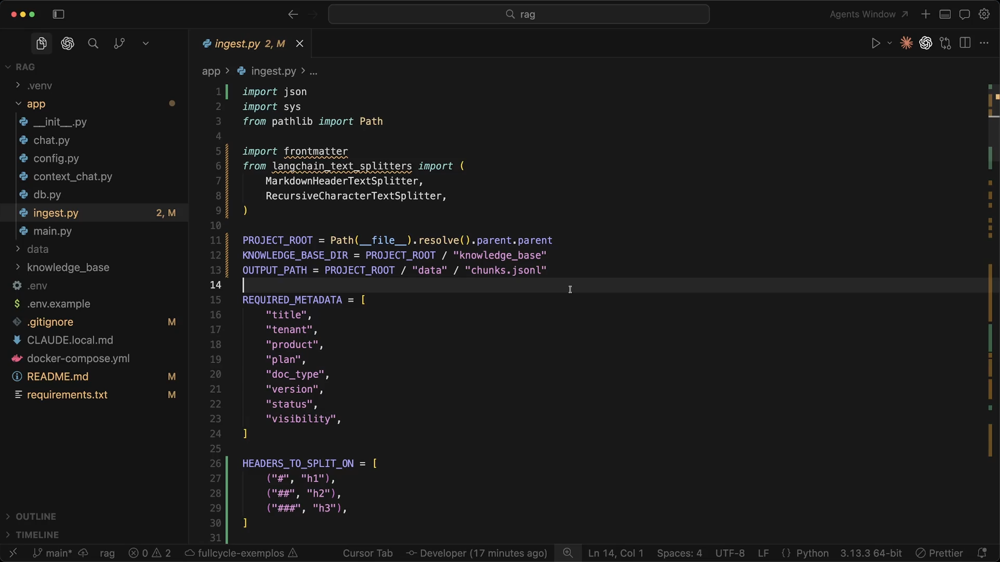

O primeiro print mostra as novas dependências e constantes no topo de `app/ingest.py` (linhas 1 a 30):

```python
import json
import sys
from pathlib import Path

import frontmatter
from langchain_text_splitters import (
    MarkdownHeaderTextSplitter,
    RecursiveCharacterTextSplitter,
)

PROJECT_ROOT = Path(__file__).resolve().parent.parent
KNOWLEDGE_BASE_DIR = PROJECT_ROOT / "knowledge_base"
OUTPUT_PATH = PROJECT_ROOT / "data" / "chunks.jsonl"
```

Logo abaixo de `REQUIRED_METADATA`, surge `HEADERS_TO_SPLIT_ON`:

```python
HEADERS_TO_SPLIT_ON = [
    ("#", "h1"),
    ("##", "h2"),
    ("###", "h3"),
]
```

### Leitura técnica

Essa lista de tuplas instrui o `MarkdownHeaderTextSplitter` a reconhecer títulos de nível 1, 2 e 3 e a injetar o texto de cada título no dicionário `metadata` do fragmento sob as chaves `"h1"`, `"h2"` e `"h3"`.

## 02 — Parâmetros de tamanho do chunk e overlap

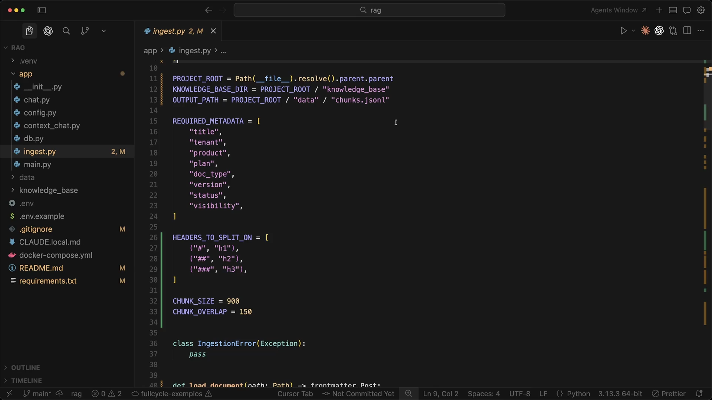

O segundo print destaca as constantes que controlam o segundo estágio de divisão (linhas 32 e 33):

```python
CHUNK_SIZE = 900
CHUNK_OVERLAP = 150
```

### Leitura técnica

- **`CHUNK_SIZE = 900` (caracteres):** define um teto confortável (~200 a 250 tokens em português) para que cada chunk caiba com folga no prompt final e mantenha foco semântico.
- **`CHUNK_OVERLAP = 150` (~16,6% do tamanho máximo):** garante que, se uma seção longa precisar ser quebrada em dois pedaços, os últimos 150 caracteres do primeiro pedaço sejam repetidos no início do segundo, preservando o contexto na fronteira.

## 03 — Visão consolidada das constantes e início de `load_document`

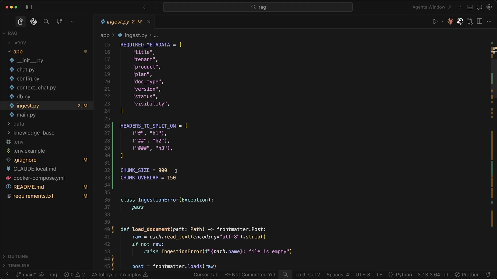

O terceiro print mostra a transição entre as constantes globais (`REQUIRED_METADATA`, `HEADERS_TO_SPLIT_ON`, `CHUNK_SIZE`, `CHUNK_OVERLAP`), a exceção `IngestionError` e a nova assinatura `def load_document(path: Path) -> frontmatter.Post:` (que substitui a antiga `parse_document` da Aula 10).

## 04 — Carregamento e validação com `frontmatter.loads`

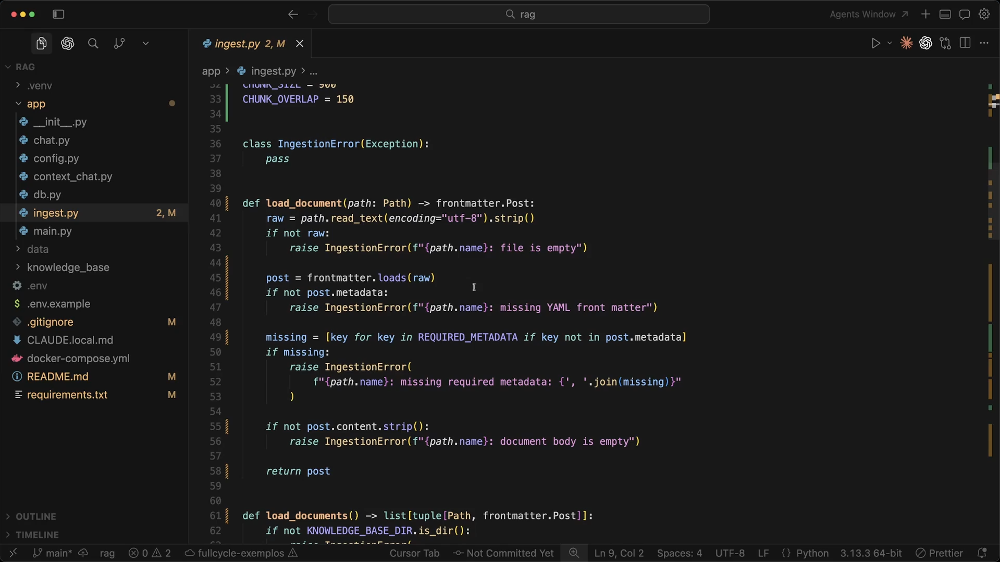

O quarto print exibe a função `load_document` completa (linhas 40 a 58):

```python
def load_document(path: Path) -> frontmatter.Post:
    raw = path.read_text(encoding="utf-8").strip()
    if not raw:
        raise IngestionError(f"{path.name}: file is empty")

    post = frontmatter.loads(raw)
    if not post.metadata:
        raise IngestionError(f"{path.name}: missing YAML front matter")

    missing = [key for key in REQUIRED_METADATA if key not in post.metadata]
    if missing:
        raise IngestionError(
            f"{path.name}: missing required metadata: {', '.join(missing)}"
        )

    if not post.content.strip():
        raise IngestionError(f"{path.name}: document body is empty")

    return post
```

### Leitura técnica

A biblioteca `python-frontmatter` encapsula a separação entre cabeçalho YAML e corpo Markdown em um objeto `frontmatter.Post` com dois atributos claros: `post.metadata` (dicionário Python) e `post.content` (corpo do documento sem o front matter). O contrato de validação da Aula 10 permanece intacto.

## 05 — Carregamento da coleção e resolução da seção mais específica

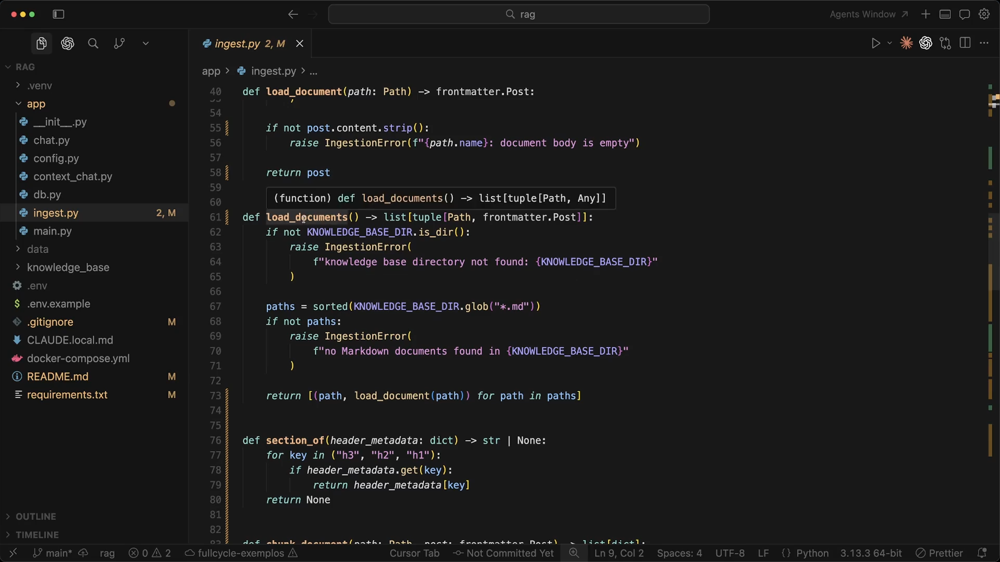

O quinto print mostra `load_documents()` e `section_of()` (linhas 61 a 80):

```python
def load_documents() -> list[tuple[Path, frontmatter.Post]]:
    ...
    return [(path, load_document(path)) for path in paths]


def section_of(header_metadata: dict) -> str | None:
    for key in ("h3", "h2", "h1"):
        if header_metadata.get(key):
            return header_metadata[key]
    return None
```

### Leitura técnica

- **Por que `("h3", "h2", "h1")` nessa ordem?** Quando o `MarkdownHeaderTextSplitter` processa uma subseção `### P1 — Crítico` dentro de `## Severidades` e `# SLA de Suporte ao Produto`, o dicionário do fragmento contém simultaneamente `{"h1": "SLA de Suporte ao Produto", "h2": "Severidades", "h3": "P1 — Crítico"}`. Ao testar primeiro `h3`, depois `h2` e por fim `h1`, `section_of` captura sempre **o título mais específico** onde aquele parágrafo está situado.

## 06 — Início de `chunk_document` e configuração do splitter de Markdown

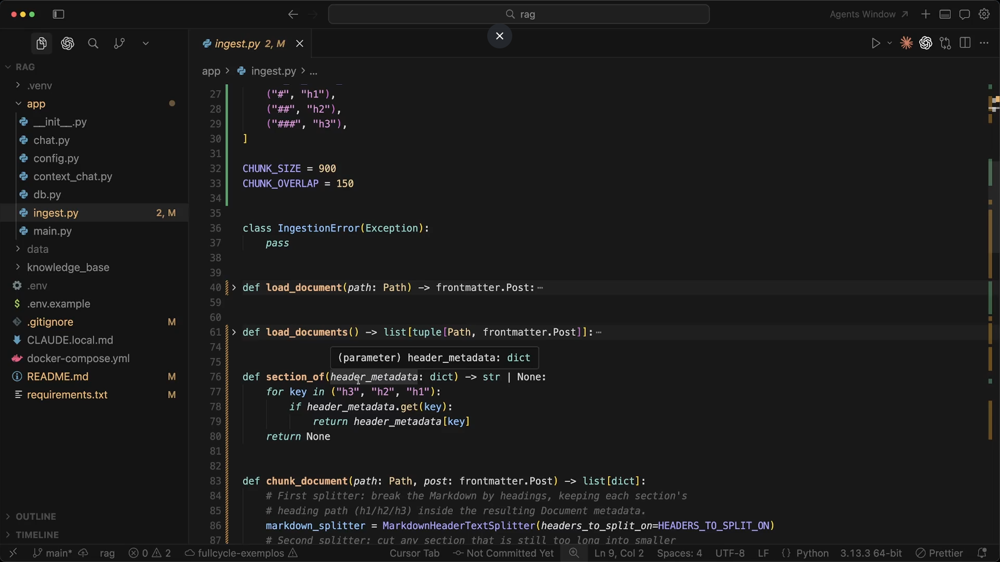

Com `load_document` e `load_documents` recolhidas no editor, o sexto print foca na relação entre `section_of(header_metadata: dict)` e o início de `chunk_document(path: Path, post: frontmatter.Post) -> list[dict]`, onde o primeiro splitter (`MarkdownHeaderTextSplitter`) é instanciado.

## 07 — Composição do `MarkdownHeaderTextSplitter` com `RecursiveCharacterTextSplitter`

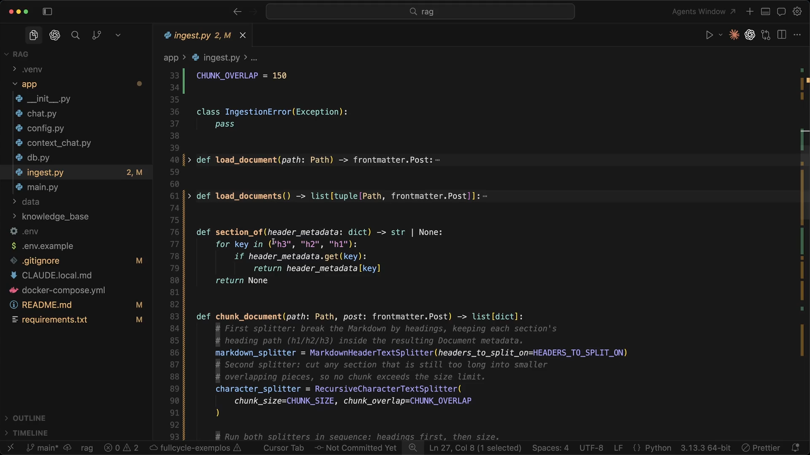

O sétimo print detalha a criação dos dois splitters comentando o papel de cada um (linhas 83 a 91):

```python
# First splitter: break the Markdown by headings, keeping each section's
# heading path (h1/h2/h3) inside the resulting Document metadata.
markdown_splitter = MarkdownHeaderTextSplitter(headers_to_split_on=HEADERS_TO_SPLIT_ON)
# Second splitter: cut any section that is still too long into smaller
# overlapping pieces, so no chunk exceeds the size limit.
character_splitter = RecursiveCharacterTextSplitter(
    chunk_size=CHUNK_SIZE, chunk_overlap=CHUNK_OVERLAP
)
```

### Leitura técnica

Essa combinação em dois estágios materializa a regra vista na Aula 11 (`Estrutura > Contagem de caracteres`):

1. Se uma seção `### Cartão de Crédito` tiver 340 caracteres (menor que `CHUNK_SIZE = 900`), o `MarkdownHeaderTextSplitter` a isola e o `RecursiveCharacterTextSplitter` **não a corta** — ela vira um único chunk íntegro.
2. Só quando uma seção inteira ultrapassa 900 caracteres é que o `RecursiveCharacterTextSplitter` entra em ação, tentando quebrar primeiro por parágrafos (`\n\n`), depois por quebras de linha (`\n`), espaços (` `) e caracteres, respeitando o `chunk_overlap=150`.

## 08 — Execução do split em duas fases e enriquecimento de metadados

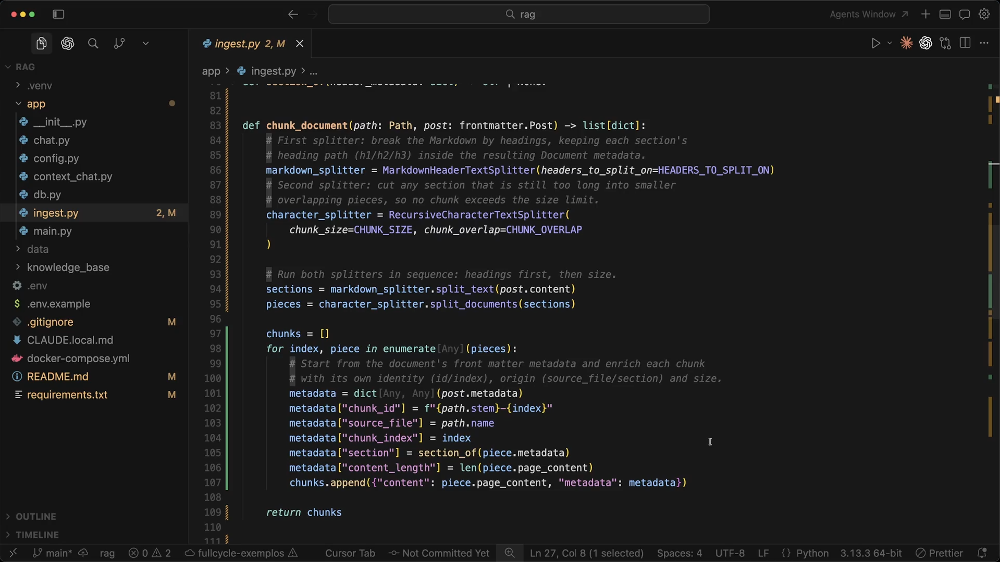

O oitavo print mostra o corpo completo de `chunk_document` (linhas 83 a 109):

```python
sections = markdown_splitter.split_text(post.content)
pieces = character_splitter.split_documents(sections)

chunks = []
for index, piece in enumerate(pieces):
    metadata = dict(post.metadata)
    metadata["chunk_id"] = f"{path.stem}-{index}"
    metadata["source_file"] = path.name
    metadata["chunk_index"] = index
    metadata["section"] = section_of(piece.metadata)
    metadata["content_length"] = len(piece.page_content)
    chunks.append({"content": piece.page_content, "metadata": metadata})

return chunks
```

### Leitura técnica

Observe o cuidado ao fazer `metadata = dict(post.metadata)` dentro do loop: cria-se uma **cópia rasa** do dicionário de metadados do documento para cada chunk. Se mutássemos `post.metadata` diretamente, todos os chunks apontariam para a mesma referência em memória e terminariam com o `chunk_id` e a `section` do último pedaço.

Cada chunk passa a carregar **13 campos de metadados**:

- **8 herdados do documento:** `title`, `tenant`, `product`, `plan`, `doc_type`, `version`, `status`, `visibility`.
- **5 próprios do chunk:** `chunk_id` (ex.: `billing-policy-0`), `source_file` (`billing-policy.md`), `chunk_index` (`0`), `section` (`Política de Faturamento`) e `content_length`.

## 09 — Persistência em JSONL (`save_chunks`) e amostragem (`print_sample`)

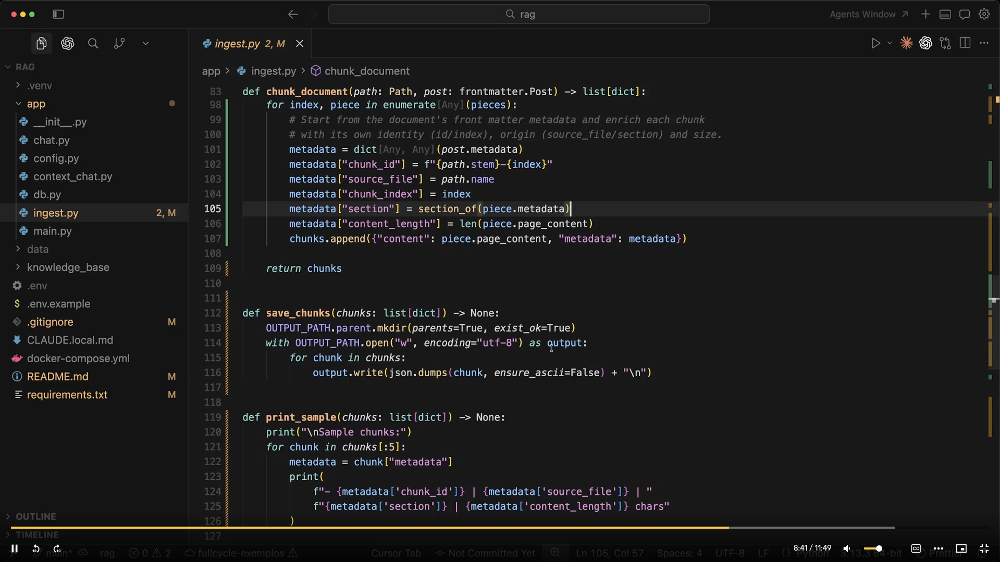

O nono print apresenta as funções de saída (linhas 112 a 126):

```python
def save_chunks(chunks: list[dict]) -> None:
    OUTPUT_PATH.parent.mkdir(parents=True, exist_ok=True)
    with OUTPUT_PATH.open("w", encoding="utf-8") as output:
        for chunk in chunks:
            output.write(json.dumps(chunk, ensure_ascii=False) + "\n")


def print_sample(chunks: list[dict]) -> None:
    print("\nSample chunks:")
    for chunk in chunks[:5]:
        metadata = chunk["metadata"]
        print(
            f"- {metadata['chunk_id']} | {metadata['source_file']} | "
            f"{metadata['section']} | {metadata['content_length']} chars"
        )
```

### Leitura técnica

- **Por que `.jsonl` (JSON Lines) e não um único array `.json`?** Em pipelines de dados e RAG, o formato JSONL permite leitura e escrita em *streaming* linha a linha, inspeção rápida com ferramentas de terminal (`head`, `wc -l`, `jq`) e diffs limpos, sem precisar carregar um array gigante inteiro na memória.
- **`ensure_ascii=False`:** preserva caracteres acentuados do português (`Política`, `Cobrança`, `Crédito`) legíveis no arquivo, em vez de escapá-los como `\u00ed`.

## 10 — Orquestração do pipeline na função `main()`

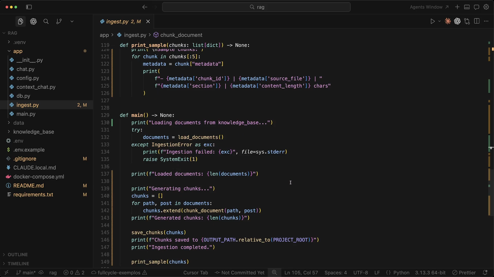

O décimo print mostra a função `main()` (linhas 129 a 149) encadeando todas as etapas:

1. Chama `load_documents()` dentro de `try / except IngestionError`.
2. Imprime o total de documentos carregados (`Loaded documents: ...`).
3. Percorre `for path, post in documents:` acumulando os chunks com `chunks.extend(chunk_document(path, post))`.
4. Imprime o total de chunks gerados (`Generated chunks: ...`), salva em `data/chunks.jsonl` e exibe os 5 primeiros exemplos com `print_sample(chunks)`.

## 11 — Fechamento do script e entrypoint `__main__`

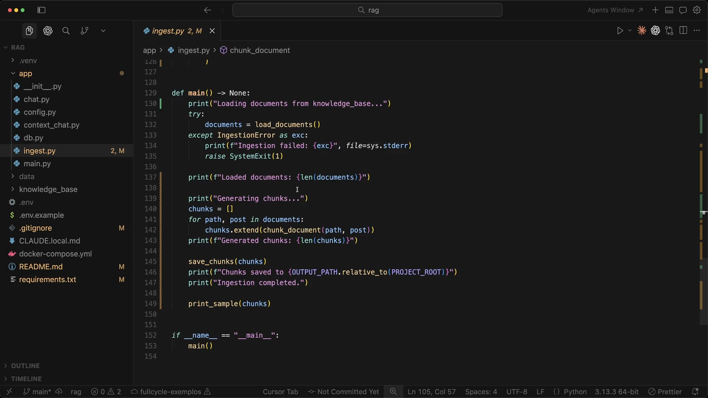

O décimo primeiro print mostra o final do arquivo (linhas 152 e 153) com `if __name__ == "__main__": main()`, permitindo rodar o módulo diretamente via `python -m app.ingest`.

## 12 — Disparo do comando `python -m app.ingest` no terminal

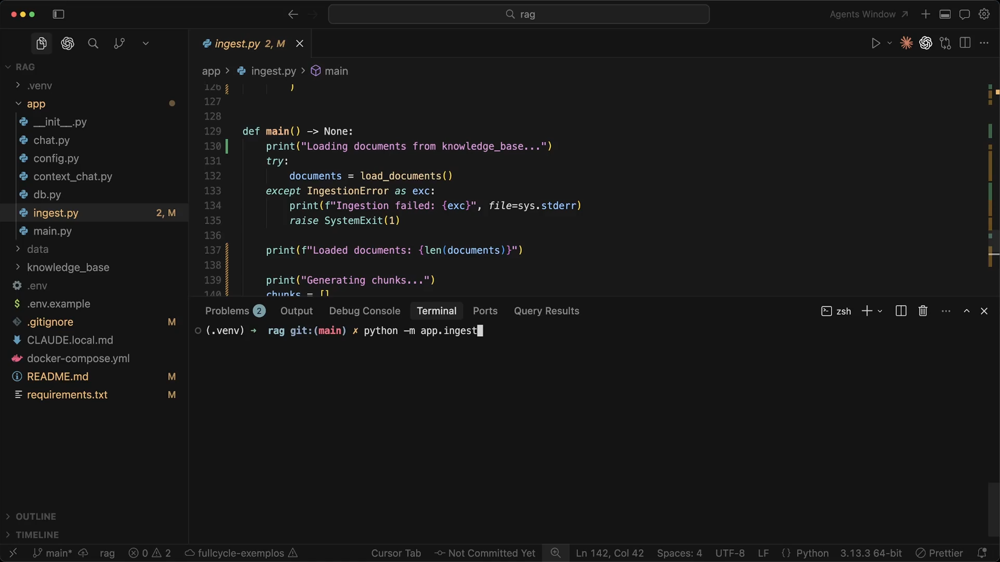

Com o código pronto, o terminal integrado na base da IDE é aberto no ambiente virtual (`.venv`) para executar `python -m app.ingest`.

## 13 — Saída da execução e inspeção dos metadados em `data/chunks.jsonl`

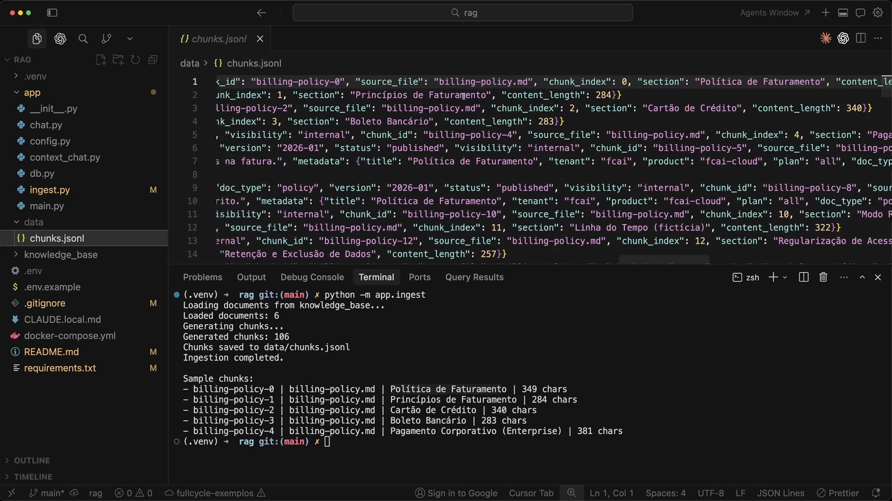

O décimo terceiro print mostra o resultado imediato no terminal e o arquivo `data/chunks.jsonl` aberto no editor superior (rolado horizontalmente para exibir o objeto `"metadata"`):

```text
Loading documents from knowledge_base...
Loaded documents: 6
Generating chunks...
Generated chunks: 106
Chunks saved to data/chunks.jsonl
Ingestion completed.

Sample chunks:
- billing-policy-0 | billing-policy.md | Política de Faturamento | 349 chars
- billing-policy-1 | billing-policy.md | Princípios de Faturamento | 284 chars
- billing-policy-2 | billing-policy.md | Cartão de Crédito | 340 chars
- billing-policy-3 | billing-policy.md | Boleto Bancário | 283 chars
- billing-policy-4 | billing-policy.md | Pagamento Corporativo (Enterprise) | 381 chars
```

No editor acima do terminal, vê-se que cada linha de `data/chunks.jsonl` carrega a combinação exata dos metadados do front matter (`"title": "Política de Faturamento"`, `"tenant": "fcai"`, `"product": "fcai-cloud"`, `"plan": "all"`, `"doc_type": "policy"`, `"version": "2026-01"`, `"status": "published"`, `"visibility": "internal"`) com os metadados calculados pelo splitter (`"chunk_id"`, `"source_file"`, `"chunk_index"`, `"section"`, `"content_length"`).

## 14 — Inspeção do conteúdo dos chunks em `data/chunks.jsonl`

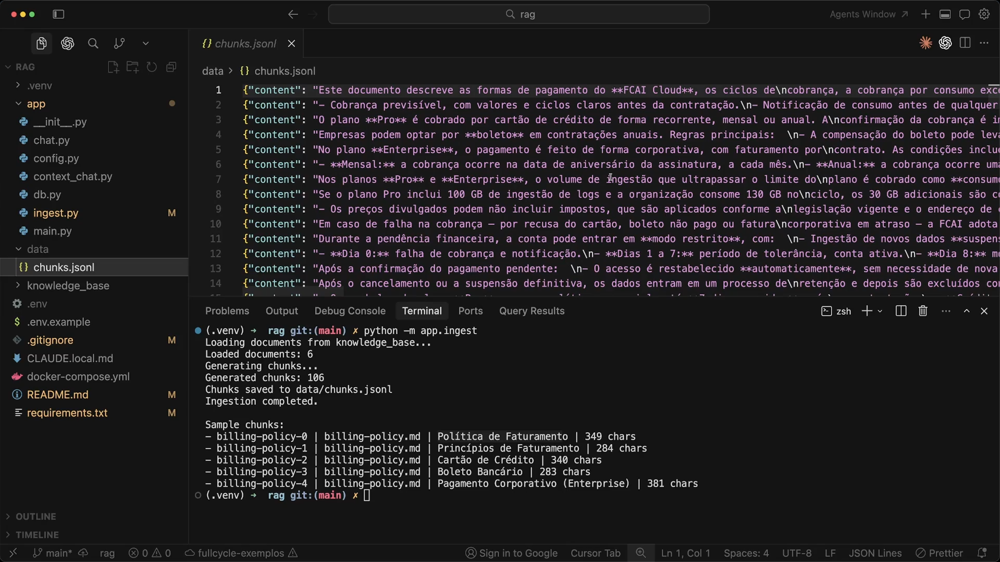

O último print rola o arquivo `data/chunks.jsonl` de volta para a esquerda (coluna 1), permitindo conferir o campo `"content"` das primeiras 14 linhas geradas a partir de [`billing-policy.md`](../mba-ia-rag/knowledge_base/billing-policy.md):

- **Linha 1 (`billing-policy-0`, seção `Política de Faturamento`):** `"Este documento descreve as formas de pagamento do **FCAI Cloud**, os ciclos de\ncobrança, a cobrança por consumo exc..."`
- **Linha 2 (`billing-policy-1`, seção `Princípios de Faturamento`):** `"- Cobrança previsível, com valores e ciclos claros antes da contratação.\n- Notificação de consumo antes de qualquer..."`
- **Linha 3 (`billing-policy-2`, seção `Cartão de Crédito`):** `"O plano **Pro** é cobrado por cartão de crédito de forma recorrente, mensal ou anual. A\nconfirmação da cobrança é i..."`
- **Linha 4 (`billing-policy-3`, seção `Boleto Bancário`):** `"Empresas podem optar por **boleto** em contratações anuais. Regras principais:\n- A compensação do boleto pode leva..."`
- **Linha 5 (`billing-policy-4`, seção `Pagamento Corporativo (Enterprise)`):** `"No plano **Enterprise**, o pagamento é feito de forma corporativa, com faturamento por\ncontrato. As condições inclu..."`

Cada linha corresponde exatamente a uma seção lógica do Markdown original, sem misturar regras de cartão de crédito com boleto bancário ou faturamento corporativo.

## Ponte com o projeto prático

Ao abrir [`mba-ia-rag/app/ingest.py`](../mba-ia-rag/app/ingest.py) no repositório final do curso, você verá todo o código construído nesta aula acrescido de **duas melhorias arquiteturais** que entram nas aulas posteriores de refinamento de busca (Aula 20) e de indexação incremental (Aulas 28–30):

| Funcionalidade | Estado nos prints da Aula 12 | Estado final em `mba-ia-rag/app/ingest.py` |
|---|---|---|
| **Base `knowledge_base/`** | `6` documentos (`106` chunks gerados) | `8` documentos — adicionados [`pro-plan.md`](../mba-ia-rag/knowledge_base/pro-plan.md) e [`starter-plan.md`](../mba-ia-rag/knowledge_base/starter-plan.md) |
| **Texto em `"content"`** | Apenas `piece.page_content` (texto puro da seção) | Por padrão, prefixa `build_context_header(metadata)` (`CONTEXT_HEADER_FIELDS`: título, tipo, produto, plano, versão e seção). Aceita a flag `--no-context-header` para reproduzir exatamente o comportamento da Aula 12 |
| **Hash do documento** | Ainda não calculado | Calcula `post.metadata["document_hash"] = document_hash(raw)` via [`app/manifest.py`](../mba-ia-rag/app/manifest.py) (SHA-256 do arquivo completo) |
| **Formato do `chunk_id`** | `f"{path.stem}-{index}"` (ex.: `billing-policy-0`) | `f"{path.stem}-{metadata['document_hash'][:12]}-{index:04d}"` (ex.: `billing-policy-a1b2c3d4e5f6-0000`), tornando o ID determinístico em relação ao conteúdo |

Para testar no código final exatamente o formato de `content` sem cabeçalho mostrado na imagem [`14.png`](#14--inspeção-do-conteúdo-dos-chunks-em-datachunksjsonl), basta executar:

```bash
python -m app.ingest --no-context-header
```

E para gerar os chunks com o cabeçalho de contexto embutido no texto (padrão recomendado para o indexador):

```bash
python -m app.ingest
```

## Ideia-chave

Persistir os chunks enriquecidos em um arquivo intermediário (`data/chunks.jsonl`) desacopla a **engenharia de texto** (split por cabeçalhos, tamanho, overlap e metadados) da **indexação vetorial** (custo de API de embeddings e banco de dados), permitindo inspecionar e depurar a qualidade dos recortes em segundos.

## Complemento de estudo: como o `MarkdownHeaderTextSplitter` lida com os títulos?

Por padrão, o `MarkdownHeaderTextSplitter(headers_to_split_on=...)` do LangChain utiliza `strip_headers=True`. Isso significa que:

1. A linha do cabeçalho Markdown (por exemplo, `### Boleto Bancário`) é **removida** do `page_content` e movida para `piece.metadata["h3"] = "Boleto Bancário"`.
2. Como vimos na imagem [`14.png`](#14--inspeção-do-conteúdo-dos-chunks-em-datachunksjsonl), o `content` da linha 3 (`Cartão de Crédito`) começa direto em `"O plano **Pro** é cobrado por cartão de crédito..."`. Nesse caso a palavra `"cartão de crédito"` se repete no parágrafo, mas em seções onde o termo principal aparece **apenas no título** (como uma seção `### Plano Enterprise` cujo corpo diz apenas `- P1: resposta em até 1 hora`), remover o título do `content` faz com que o embedding perca essa informação crucial.
3. É exatamente essa observação prática sobre o `data/chunks.jsonl` gerado nesta aula que motiva a criação de `CONTEXT_HEADER_FIELDS` e `build_context_header()` na evolução do `app/ingest.py`, reinserindo `Document title`, `Plan` e `Section` no topo do `content` antes de gerar o embedding.

## Exercício

1. Execute `python -m app.ingest --no-context-header` e depois `python -m app.ingest` na pasta [`mba-ia-rag/`](../mba-ia-rag/). Compare a primeira linha de `data/chunks.jsonl` e os valores de `content_length` nos dois casos.
2. Inspecione os chunks gerados para [`product-support-sla.md`](../mba-ia-rag/knowledge_base/product-support-sla.md) dentro de `data/chunks.jsonl`. Encontre o chunk da seção `Plano Enterprise` e explique por que, sem o cabeçalho de contexto no `content`, o texto puro daquele chunk seria ambíguo se fosse lido isoladamente.
