# Aula 13 — Indexando chunks no Postgres com pgvector

[Índice do módulo](../README.md)

> Curso: **RAG** · Duração: `12:01`

## Resumo

Com os documentos validados, divididos em chunks e salvos em `data/chunks.jsonl` na etapa de ingestão, o próximo passo do pipeline RAG é transformar cada chunk em um vetor numérico (*embedding*) e persistir texto, vetor e metadados no PostgreSQL usando a extensão `pgvector`.

Esta aula constrói e executa o módulo `app/index.py`, demonstrando como carregar os chunks do arquivo JSONL, descobrir dinamicamente a dimensão do modelo de embeddings (*dimension probe*), inicializar a tabela vetorial `fcai_knowledge_base` com chave primária determinística (`chunk_id`) via `PGEngine` e `PGVectorStore`, e inspecionar os registros gerados diretamente no banco de dados.

## Índice

| # | Imagem | Assunto |
|---|---|---|
| 01 | [Carregamento e validação dos chunks (`load_chunks`)](#01--carregamento-e-validação-dos-chunks-load_chunks) | Leitura de `data/chunks.jsonl` e conversão para `Document` do LangChain |
| 02 | [Configuração da tabela e *dimension probe*](#02--configuração-da-tabela-e-dimension-probe) | Constantes do índice, `OpenAIEmbeddings` e descoberta dinâmica da dimensão vetorial |
| 03 | [Origem do `chunk_id` determinístico no `ingest.py`](#03--origem-do-chunk_id-determinístico-no-ingestpy) | Como a ingestão nomeia cada chunk a partir do arquivo e posição |
| 04 | [Inicialização da tabela vetorial com `PGEngine`](#04--inicialização-da-tabela-vetorial-com-pgengine) | Criação da tabela no Postgres e conexão do `PGVectorStore` |
| 05 | [Gravação dos chunks com IDs explícitos (`add_documents`)](#05--gravação-dos-chunks-com-ids-explícitos-add_documents) | Persistência usando `chunk_id` como chave primária da linha |
| 06 | [Fluxo completo da função `main()`](#06--fluxo-completo-da-função-main) | Orquestração da leitura, extensão `vector` e indexação |
| 07 | [Executando a indexação pelo terminal](#07--executando-a-indexação-pelo-terminal) | Disparo do módulo `python -m app.index` |
| 08 | [Resultado da indexação e visão geral da tabela no Postgres](#08--resultado-da-indexação-e-visão-geral-da-tabela-no-postgres) | Os 106 chunks gravados em `fcai_knowledge_base` |
| 09 | [Inspecionando a coluna `langchain_metadata` (JSON)](#09--inspecionando-a-coluna-langchain_metadata-json) | Estrutura dos metadados persistidos junto ao chunk |
| 10 | [Inspecionando a coluna `embedding` (`vector`)](#10--inspecionando-a-coluna-embedding-vector) | Representação numérica densa gerada pelo modelo de embeddings |
| 11 | [Inspecionando a coluna `content` (`text`)](#11--inspecionando-a-coluna-content-text) | Texto bruto do chunk armazenado para recuperação e montagem do prompt |
| 12 | [Revisão do ciclo de indexação em `index_chunks`](#12--revisão-do-ciclo-de-indexação-em-index_chunks) | Consolidação do fluxo entre aplicação, OpenAI e PostgreSQL |

---

## 01 — Carregamento e validação dos chunks (`load_chunks`)

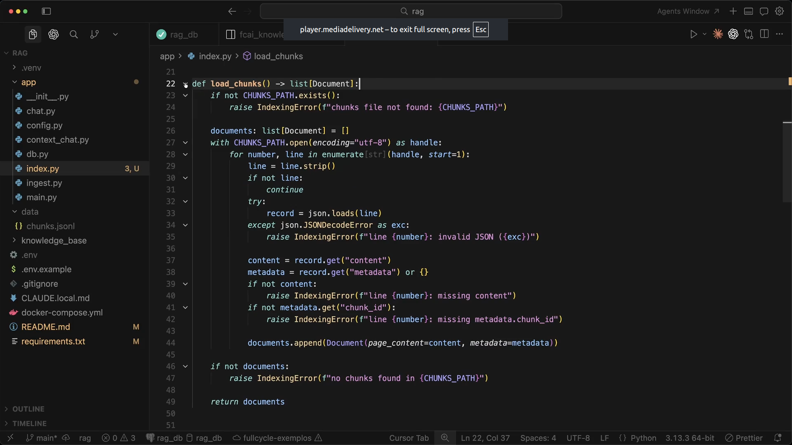

A primeira etapa de `app/index.py` é ler o artefato `data/chunks.jsonl` gerado pelo script de ingestão (`app/ingest.py`). A função `load_chunks() -> list[Document]` aplica validações defensivas antes de qualquer chamada externa ao banco ou à API da OpenAI:

1. Verifica se `CHUNKS_PATH` existe; caso contrário, lança `IndexingError`.
2. Percorre o arquivo linha a linha (`enumerate(handle, start=1)`), ignorando linhas em branco e validando a sintaxe JSON de cada registro.
3. Extrai `content` e `metadata`, exigindo que o texto não esteja vazio (`missing content`) e que o identificador `metadata["chunk_id"]` esteja presente (`missing metadata.chunk_id`).
4. Converte cada linha validada em um objeto `Document(page_content=content, metadata=metadata)` do `langchain_core.documents`.

Separar a ingestão (`ingest.py` → arquivo `.jsonl`) da indexação (`index.py` → banco vetorial) permite inspecionar e validar os chunks em disco antes de gastar tokens de embedding.

---

## 02 — Configuração da tabela e *dimension probe*

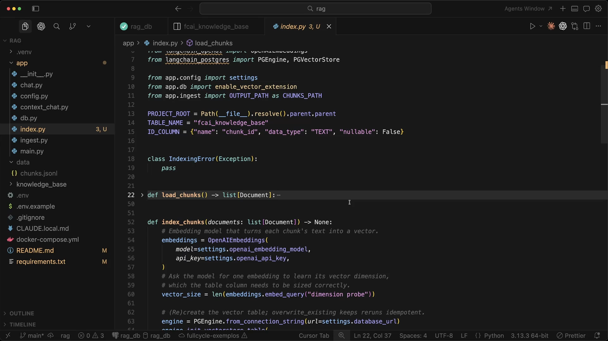

No topo de `app/index.py`, são definidas as configurações estruturais do índice:

- **`TABLE_NAME = "fcai_knowledge_base"`**: nome da tabela que armazenará os chunks no PostgreSQL.
- **`ID_COLUMN = {"name": "chunk_id", "data_type": "TEXT", "nullable": False}`**: instrui o `langchain-postgres` a usar uma coluna textual chamada `chunk_id` como chave primária da tabela.

Ao iniciar `index_chunks(documents)`, o código instancia `OpenAIEmbeddings` com o modelo configurado no `.env` (`settings.openai_embedding_model`) e executa uma técnica importante:

```python
vector_size = len(embeddings.embed_query("dimension probe"))
```

No `pgvector`, a coluna do tipo `vector(N)` exige dimensão fixa no momento do `CREATE TABLE`. Em vez de fixar `1536` no código, a aplicação faz uma chamada mínima (`"dimension probe"`) para descobrir dinamicamente o tamanho do vetor retornado pelo modelo configurado. Assim, se o modelo de embeddings for trocado no `.env`, a criação da tabela se adapta automaticamente à nova dimensão.

---

## 03 — Origem do `chunk_id` determinístico no `ingest.py`

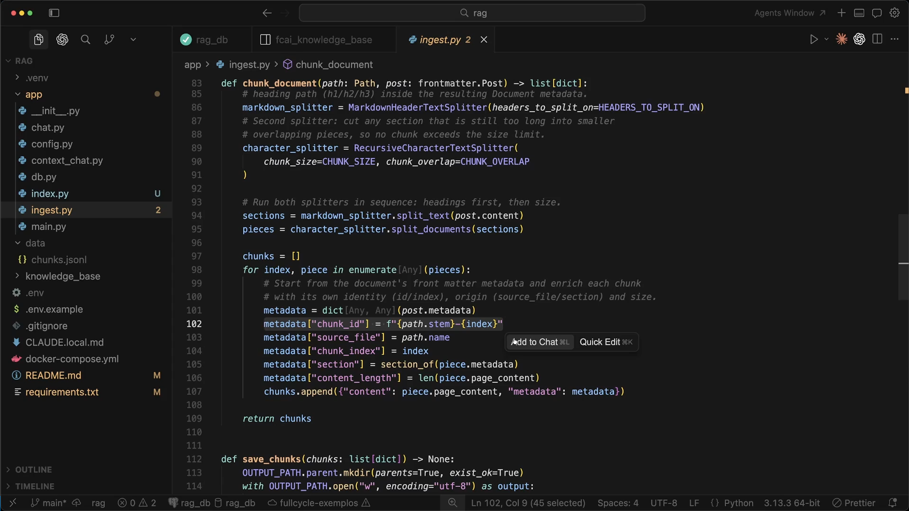

O print retorna rapidamente ao `app/ingest.py` (linha 102) para destacar de onde vem o `chunk_id` exigido pela indexação neste estágio do curso:

```python
metadata["chunk_id"] = f"{path.stem}-{index}"
```

Cada chunk recebe um identificador determinístico formado pelo nome do arquivo sem extensão (`path.stem`, como `billing-policy`) concatenado ao índice sequencial do chunk dentro daquele documento (`0`, `1`, `2`...). Isso evita o uso de UUIDs aleatórios a cada execução e permite rastrear imediatamente de qual documento e posição um registro do banco veio.

---

## 04 — Inicialização da tabela vetorial com `PGEngine`

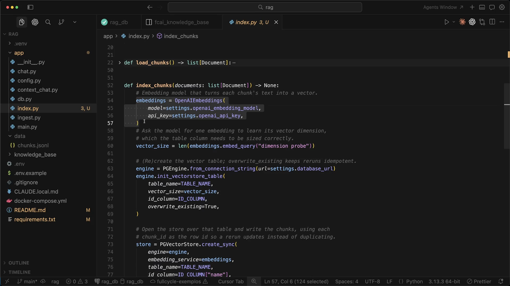

Em seguida, `index_chunks` conecta ao PostgreSQL usando a API moderna da integração `langchain-postgres`:

```python
engine = PGEngine.from_connection_string(url=settings.database_url)
engine.init_vectorstore_table(
    table_name=TABLE_NAME,
    vector_size=vector_size,
    id_column=ID_COLUMN,
    overwrite_existing=True,
)
```

- **`PGEngine.from_connection_string(...)`**: gerencia o pool de conexões com o Postgres.
- **`engine.init_vectorstore_table(...)`**: executa o DDL de criação da tabela `fcai_knowledge_base` com a coluna de vetor dimensionada por `vector_size` e a coluna de identificação `chunk_id`. Nesta primeira versão da aula, `overwrite_existing=True` recria a tabela do zero a cada execução para manter o script idempotente sem duplicar registros.
- **`PGVectorStore.create_sync(...)`**: abre a interface do vector store apontando para a tabela recém-inicializada e associando o serviço de embeddings (`embedding_service=embeddings`).

---

## 05 — Gravação dos chunks com IDs explícitos (`add_documents`)

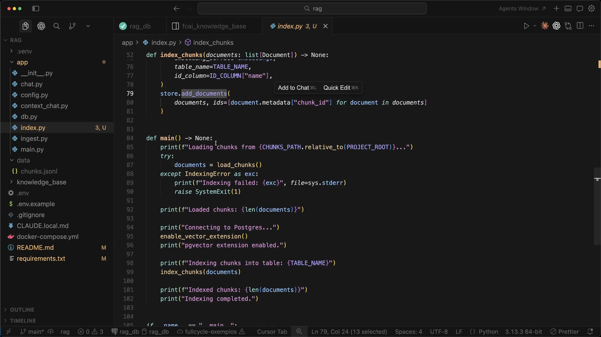

Com o `store` instanciado, a gravação dos documentos acontece nas linhas 79–81:

```python
store.add_documents(
    documents, ids=[document.metadata["chunk_id"] for document in documents]
)
```

Internamente, `store.add_documents(...)` realiza duas operações:
1. Envia o `page_content` de todos os `documents` em lote para a API de embeddings da OpenAI, recebendo um vetor numérico para cada chunk.
2. Executa o `INSERT` no PostgreSQL preenchendo a chave primária com a lista explícita `ids=[...]`, o texto em `content`, o vetor em `embedding` e o dicionário `metadata` serializado em JSON na coluna `langchain_metadata`.

---

## 06 — Fluxo completo da função `main()`

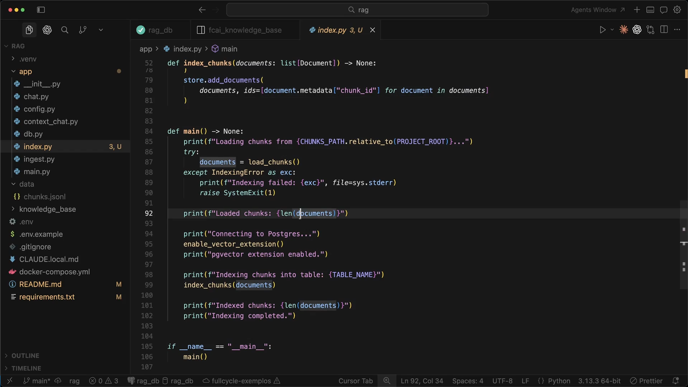

A função `main()` (linhas 84–106) amarra o ciclo de vida da execução via CLI:

1. Carrega e valida os chunks do disco (`documents = load_chunks()`), encerrando com código de erro `1` (`raise SystemExit(1)`) se houver qualquer inconsistência.
2. Exibe a contagem de chunks carregados (`Loaded chunks: ...`).
3. Garante que a extensão `vector` está habilitada no banco (`enable_vector_extension()`, que executa `CREATE EXTENSION IF NOT EXISTS vector`).
4. Chama `index_chunks(documents)` para criar a tabela, gerar os embeddings e gravar as linhas.
5. Imprime o resumo final (`Indexed chunks` e `Indexing completed.`).

---

## 07 — Executando a indexação pelo terminal

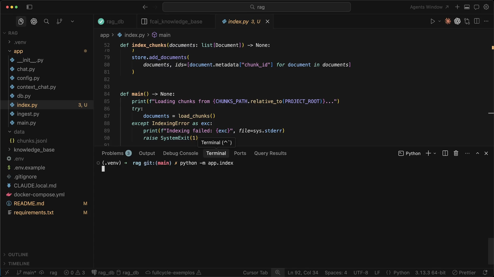

No terminal integrado, com o ambiente virtual `.venv` ativo e o container do PostgreSQL rodando, o indexador é disparado como módulo Python:

```bash
python -m app.index
```

---

## 08 — Resultado da indexação e visão geral da tabela no Postgres

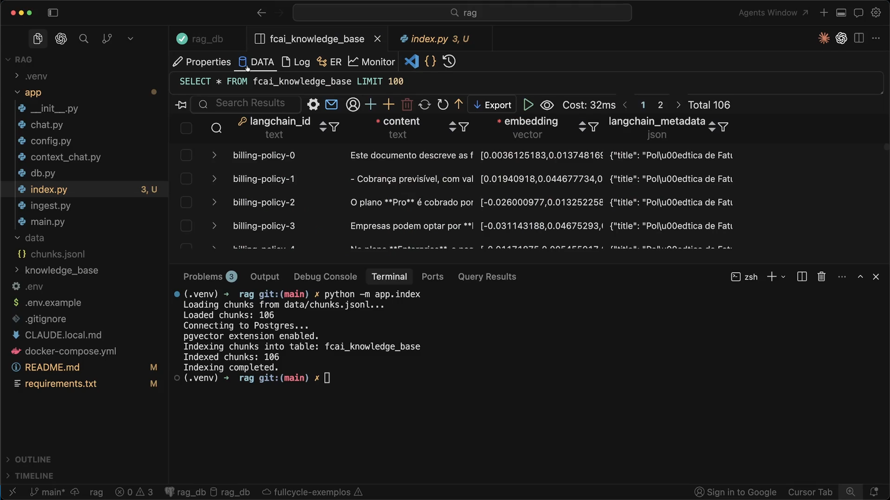

A execução conclui com sucesso e exibe no terminal:

```text
Loading chunks from data/chunks.jsonl...
Loaded chunks: 106
Connecting to Postgres...
pgvector extension enabled.
Indexing chunks into table: fcai_knowledge_base
Indexed chunks: 106
Indexing completed.
```

Na parte superior da tela, a consulta `SELECT * FROM fcai_knowledge_base LIMIT 100` mostra `Total 106` registros distribuídos em quatro colunas:
- **`chunk_id`** (ou `langchain_id` antes de atualizar o schema na interface gráfica, tipo `text`): chave primária (`billing-policy-0`, `billing-policy-1`, `billing-policy-2`...).
- **`content`** (`text`): o conteúdo textual do chunk.
- **`embedding`** (`vector`): o vetor numérico de 1536 posições.
- **`langchain_metadata`** (`json`): todos os metadados herdados do front matter do documento somados aos metadados do chunk.

---

## 09 — Inspecionando a coluna `langchain_metadata` (JSON)

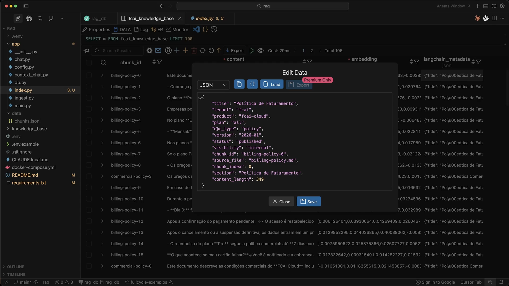

Ao abrir a coluna `langchain_metadata` do primeiro registro (`billing-policy-0`), vemos exatamente como o contexto estrutural acompanha cada fragmento no banco:

```json
{
  "title": "Política de Faturamento",
  "tenant": "fcai",
  "product": "fcai-cloud",
  "plan": "all",
  "doc_type": "policy",
  "version": "2026-01",
  "status": "published",
  "visibility": "internal",
  "chunk_id": "billing-policy-0",
  "source_file": "billing-policy.md",
  "chunk_index": 0,
  "section": "Política de Faturamento",
  "content_length": 349
}
```

Esses campos permitem que o retrieval combine **busca vetorial** (na coluna `embedding`) com **filtros determinísticos de negócio e segurança** (na coluna `langchain_metadata`, como `tenant`, `product`, `plan`, `doc_type` e `status`).

---

## 10 — Inspecionando a coluna `embedding` (`vector`)

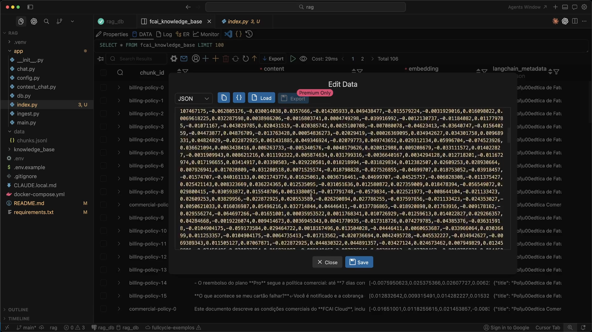

Ao abrir a coluna `embedding` de uma linha, observa-se a lista densa de números em ponto flutuante (ex.: `0.0069618225, 0.032287598, 0.0038986206, -0.0016803741...`).

Cada vetor possui `1536` dimensões (padrão do modelo `text-embedding-3-small`) e posiciona o significado semântico daquele trecho no espaço vetorial. É sobre essa coluna que o `pgvector` calcula distância de cosseno ou produto interno durante a busca por similaridade.

---

## 11 — Inspecionando a coluna `content` (`text`)

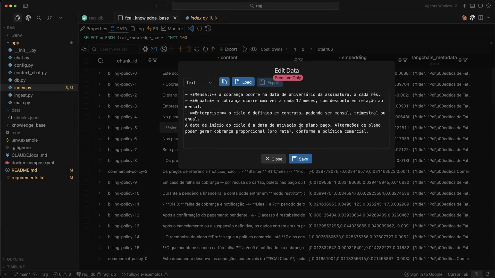

Ao inspecionar a coluna `content` do registro `billing-policy-5`, vê-se o trecho Markdown extraído da seção de ciclos de cobrança:

```markdown
- **Mensal:** a cobrança ocorre na data de aniversário da assinatura, a cada mês.
- **Anual:** a cobrança ocorre uma vez a cada 12 meses, com desconto em relação ao mensal.
- **Enterprise:** o ciclo é definido em contrato, podendo ser mensal, trimestral ou anual.
A data de início do ciclo é a data de ativação do plano pago. Alterações de plano podem gerar cobrança proporcional (pro rata), conforme a política comercial.
```

> **Observação importante sobre a evolução da base:** neste ponto do curso (Aula 13), `content` contém apenas o texto puro da seção. Note que o texto acima fala de *"Mensal"*, *"Anual"* e *"Enterprise"*, mas não menciona explicitamente no corpo que se trata da **Política de Faturamento** do produto **fcai-cloud**. Nas aulas seguintes (Aula 20), o `ingest.py` passará a prefixar um **cabeçalho de contexto** (`Document title`, `Document type`, `Product`, `Plan`, `Version`, `Section`) diretamente no `content` para enriquecer o embedding semântico.

---

## 12 — Revisão do ciclo de indexação em `index_chunks`

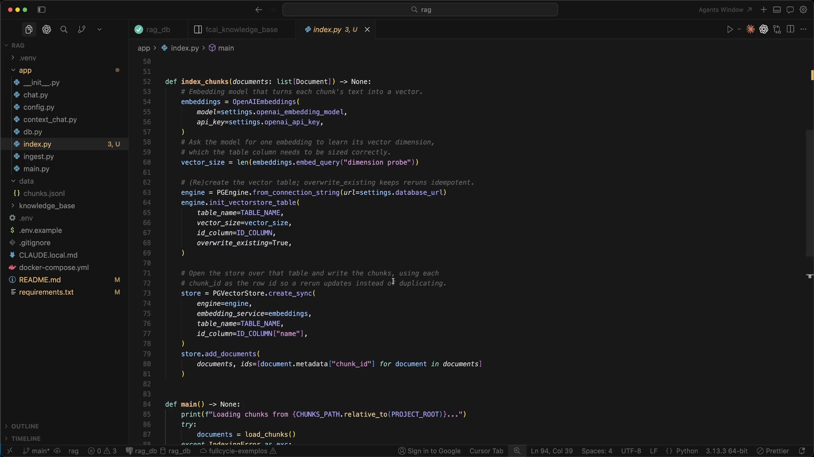

O encerramento da aula revisa `index_chunks` ponta a ponta:
1. Instancia o modelo de embeddings (`OpenAIEmbeddings`).
2. Descobre a dimensão do vetor com `"dimension probe"`.
3. Inicializa a tabela no Postgres (`PGEngine` + `init_vectorstore_table`).
4. Conecta o `PGVectorStore` e grava os documentos usando `chunk_id` como identificador primário.

---

## Ponte com o projeto prático

No estado final do repositório em [`../mba-ia-rag/app/index.py`](../mba-ia-rag/app/index.py), a base construída nesta aula foi evoluída (nas Aulas 28–30) para suportar **indexação incremental baseada em manifest**:

| Aspecto | Versão da Aula 13 (inicial) | Versão final em `mba-ia-rag/app/index.py` |
|---|---|---|
| **Formato do `chunk_id`** | `{stem}-{index}` (ex.: `billing-policy-0`) | `{stem}-{document_hash[:12]}-{index:04d}` (inclui prefixo SHA-256 do documento) |
| **Cabeçalho no `content`** | Texto puro da seção Markdown (equivalente a `python -m app.ingest --no-context-header`) | Prefixado por padrão com `Document title`, `Document type`, `Product`, `Plan`, `Version` e `Section` |
| **Recriação da tabela** | Sempre recria (`overwrite_existing=True` em toda execução) | Só recria na primeira execução (sem manifest ou sem tabela); execuções seguintes atualizam incrementalmente |
| **Controle de mudanças** | Reindexa todos os chunks sempre | Compara `document_hash` com `data/index_manifest.json` (`new`, `changed`, `removed`, `unchanged`) e só gera embeddings do que mudou (ou tudo com `--force`) |

Comandos para executar no projeto prático:

```bash
python -m app.ingest          # gera data/chunks.jsonl
python -m app.index           # indexa incrementalmente no pgvector
python -m app.index --force   # força a reindexação completa de todos os chunks
```

## Ideia-chave

Indexar no RAG não é apenas jogar texto em um banco vetorial: é persistir em conjunto **identidade determinística (`chunk_id`)**, **conteúdo textual (`content`)**, **representação semântica (`embedding`)** e **metadados estruturados (`langchain_metadata`)**, garantindo que a dimensão da coluna vetorial reflita exatamente o modelo de embeddings em uso.

## Complemento de estudo

1. **Acoplamento entre coluna `vector(N)` e modelo de embeddings:**
   Um vetor gerado por `text-embedding-3-small` (1536 dimensões) e um gerado por outro modelo (mesmo que também tenha 1536 dimensões) habitam espaços vetoriais incompatíveis. Se você trocar `OPENAI_EMBEDDING_MODEL`, é obrigatório recriar/reindexar todos os chunks antes de buscar — nunca misture vetores de modelos diferentes na mesma tabela.
2. **Metadados não entram automaticamente no vetor:**
   O `PGVectorStore` envia apenas `document.page_content` para `embeddings.embed_documents(...)`. Tudo o que está em `document.metadata` vai para a coluna JSON (`langchain_metadata`) e serve para filtragem (`WHERE`), mas **não altera o vetor** a menos que também seja concatenado ao `page_content` (como o projeto faz posteriormente com o *context header*).
3. **Índices vetoriais aproximados (HNSW / IVFFlat) vs busca exata:**
   Para uma base pequena (106 chunks), o cálculo exato de distância (scan sequencial ou pós-filtro de metadados) leva poucos milissegundos. Quando a tabela cresce para centenas de milhares ou milhões de chunks, adiciona-se um índice HNSW (`USING hnsw (embedding vector_cosine_ops)`) combinado a índices B-tree/GIN nas chaves de metadados mais filtradas (`tenant`, `product`, `status`).

## Pergunta de revisão

Por que o `PGVectorStore` grava os metadados na coluna `langchain_metadata` separada do `embedding`, e qual é a consequência prática disso quando um chunk do meio de um documento não repete o nome do plano ou do documento no próprio texto?
