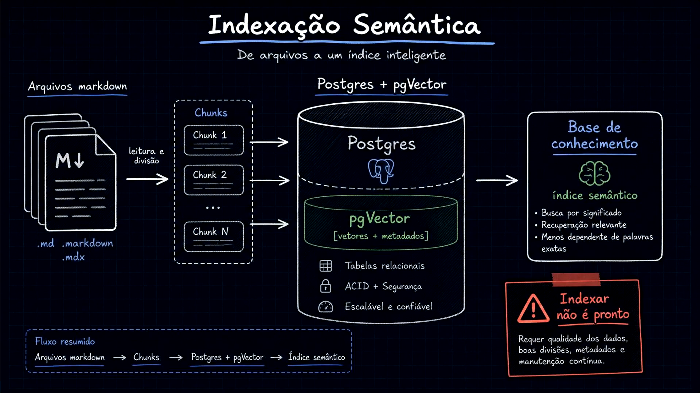
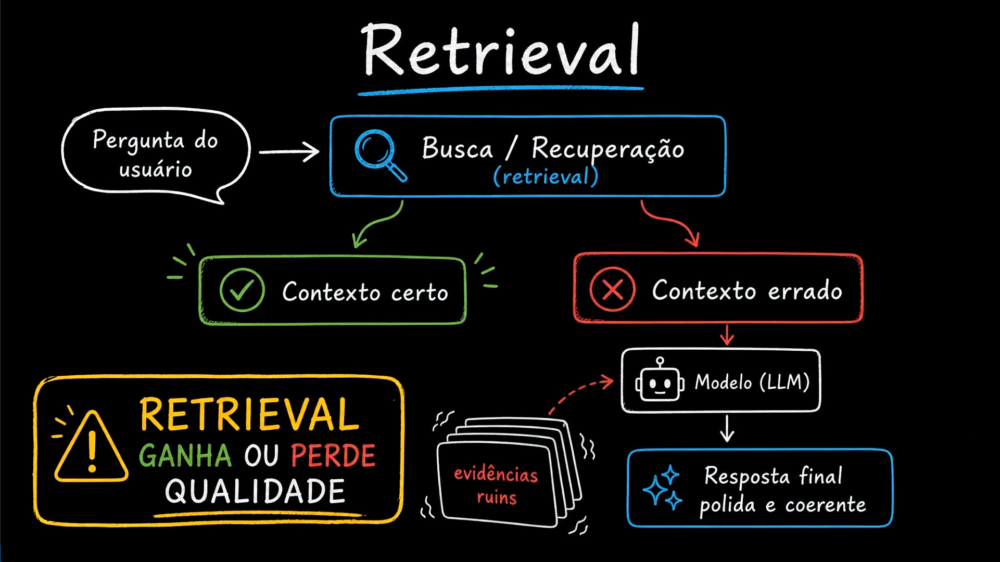
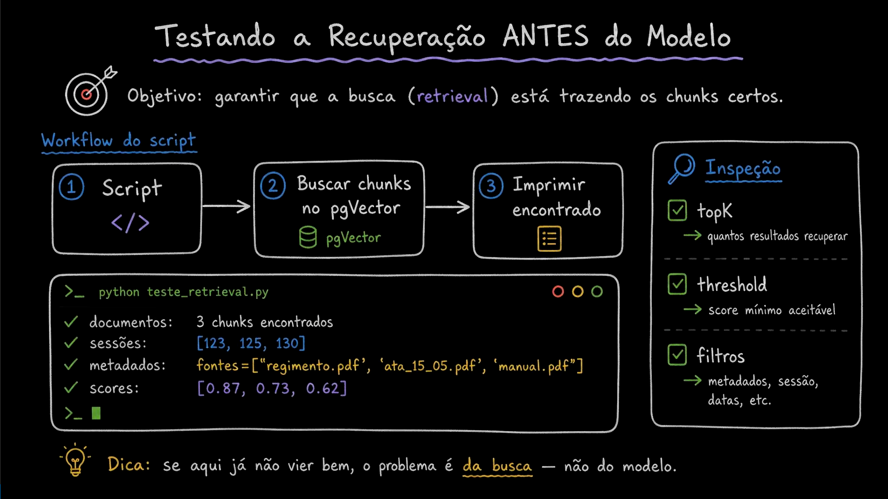
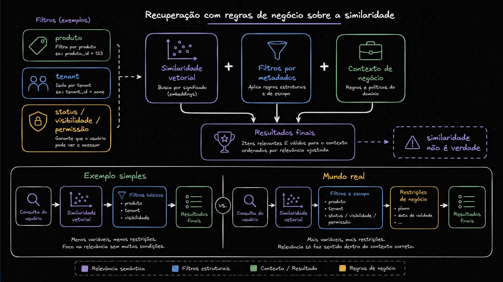
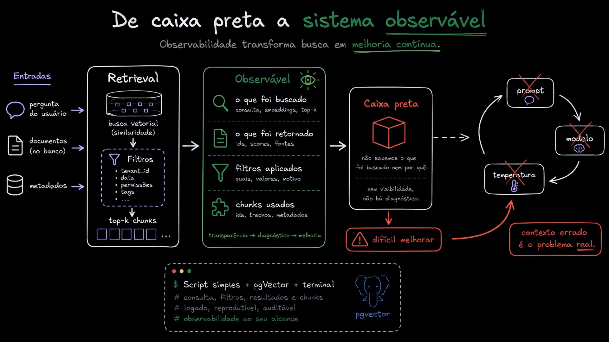

# Aula 14 — Retrieval onde o RAG ganha ou perde

[Índice do módulo](../README.md)

> Curso: **RAG** · Duração: `05:33`

## Resumo

Com os chunks já indexados no PostgreSQL com `pgvector`, é comum achar que o trabalho pesado do RAG terminou e partir direto para a montagem do prompt e geração da resposta. Esta aula mostra por que essa pressa é um erro arquitetural: **é na etapa de retrieval (recuperação) que um sistema RAG ganha ou perde qualidade**.

Se a busca recuperar evidências erradas ou incompletas, um LLM moderno continuará produzindo uma resposta bem escrita, polida e coerente — porém materialmente incorreta. Por isso, o retrieval precisa ser testado de forma isolada antes do modelo, combinado a filtros determinísticos de negócio e tratado como um componente observável.

## Índice

| # | Imagem | Assunto |
|---|---|---|
| 01 | [Da indexação semântica ao aviso: indexar não é pronto](#01--da-indexação-semântica-ao-aviso-indexar-não-é-pronto) | Visão completa da ingestão ao índice no Postgres + `pgvector` e seus pré-requisitos de qualidade |
| 02 | [Retrieval: onde o RAG ganha ou perde qualidade](#02--retrieval-onde-o-rag-ganha-ou-perde-qualidade) | Como um contexto errado produz respostas finais polidas, coerentes e erradas |
| 03 | [Testando a recuperação antes do modelo](#03--testando-a-recuperação-antes-do-modelo) | Script de inspeção isolada de `topK`, `threshold`, `metadados` e `scores` |
| 04 | [Recuperação com regras de negócio sobre a similaridade](#04--recuperação-com-regras-de-negócio-sobre-a-similaridade) | Por que *"similaridade não é verdade"* e a diferença entre exemplo simples e mundo real |
| 05 | [De caixa preta a sistema observável](#05--de-caixa-preta-a-sistema-observável) | O ciclo vicioso de mexer em prompt/modelo/temperatura quando o problema real é o contexto |

---

## 01 — Da indexação semântica ao aviso: indexar não é pronto



O primeiro quadro recapitula o caminho percorrido até aqui sob o título **Indexação Semântica — De arquivos a um índice inteligente**:

```text
Arquivos markdown (.md, .markdown, .mdx)
  ──[leitura e divisão]──> Chunks (Chunk 1, Chunk 2, ..., Chunk N)
  ──> Postgres + pgVector ([vetores + metadados], Tabelas relacionais, ACID + Segurança, Escalável e confiável)
  ──> Base de conhecimento (índice semântico: busca por significado, recuperação relevante, menos dependente de palavras exatas)
```

No canto inferior direito, porém, surge o alerta arquitetural que guia a transição da indexação para a busca:

> **⚠️ Indexar não é pronto**
> Requer qualidade dos dados, boas divisões, metadados e manutenção contínua.

Ter 106 linhas gravadas no `pgvector` significa apenas que os vetores foram armazenados; não prova que uma pergunta real trará os trechos certos.

---

## 02 — Retrieval: onde o RAG ganha ou perde qualidade



O segundo diagrama ilustra a bifurcação central de qualquer arquitetura RAG a partir da `Pergunta do usuário` $\rightarrow$ `Busca / Recuperação (retrieval)`:

- **Caminho verde (`✔ Contexto certo`):** os chunks recuperados contêm a regra aplicável ao usuário; o modelo tem matéria-prima confiável para responder.
- **Caminho vermelho (`✖ Contexto errado`):** a busca traz `evidências ruins` (de outro plano, de outra política ou apenas superficialmente parecidas). Essas evidências alimentam o `Modelo (LLM)`, que entrega uma **`Resposta final polida e coerente`** — mas **errada**.

Daí vem a máxima destacada no quadro amarelo:

> **⚠️ RETRIEVAL GANHA OU PERDE QUALIDADE**

Como modelos de linguagem são treinados para gerar texto fluente e convincente a partir do contexto fornecido, a fluência da resposta final **mascara falhas de recuperação** quando o engenheiro avalia apenas a resposta do chat.

---

## 03 — Testando a recuperação antes do modelo



Para não ser enganado pela eloquência do LLM, a recomendação arquitetural é **testar a recuperação ANTES de envolver o modelo gerador**:

- **Objetivo:** garantir que a busca (*retrieval*) está trazendo os chunks certos.
- **Workflow do script:**
  1. `Script </ >` (recebe a query e parâmetros de linha de comando)
  2. `Buscar chunks no pgVector` (executa a busca vetorial e filtros direto no banco)
  3. `Imprimir encontrado` (exibe os candidatos brutos no terminal)
- **Inspeção sistemática:**
  - `☑ topK` $\rightarrow$ quantos resultados recuperar.
  - `☑ threshold` $\rightarrow$ score mínimo aceitável.
  - `☑ filtros` $\rightarrow$ metadados, sessão, datas, etc.

No exemplo ilustrativo de terminal (`python teste_retrieval.py`), o desenvolvedor verifica imediatamente quantos chunks vieram, de quais fontes/seções (`fontes=["regimento.pdf", "ata_15_05.pdf", "manual.pdf"]`) e com quais scores (`[0.87, 0.73, 0.62]`).

> **💡 Dica do slide:** *"se aqui já não vier bem, o problema é **da busca** — não do modelo."*

---

## 04 — Recuperação com regras de negócio sobre a similaridade



O quarto diagrama aprofunda por que a busca semântica pura não basta em sistemas corporativos, resumindo a arquitetura de recuperação na equação:

$$\text{Similaridade vetorial} + \text{Filtros por metadados} + \text{Contexto de negócio} \longrightarrow \text{Resultados finais}$$

| Componente | Papel na recuperação | Exemplos no diagrama |
|---|---|---|
| **Similaridade vetorial** | Busca por significado (*embeddings*) | Proximidade semântica com a pergunta |
| **Filtros por metadados** | Aplica regras estruturais e de escopo | `produto` (`produto_id = 123`), `tenant` (`tenant_id = acme`), `status / visibilidade / permissão` |
| **Contexto de negócio** | Regras e políticas do domínio | Restrições de plano, vigência/data de validade |
| **Resultados finais** | Itens relevantes **E** válidos para o contexto, ordenados por relevância ajustada | Chunks prontos para uso seguro |

O aviso à direita resume a armadilha mais comum de quem começa com bancos vetoriais:

> **⚠️ similaridade não é verdade**

Um documento rascunho (`draft`), revogado, pertencente a outro cliente (`tenant`) ou exclusivo do plano `Enterprise` pode ter altíssima similaridade semântica com a pergunta de um cliente `Starter`, mas é **inválido como verdade para aquele contexto**.

Na base do slide, a comparação entre **Exemplo simples** (*Consulta $\rightarrow$ Similaridade vetorial $\rightarrow$ Filtros básicos $\rightarrow$ Resultados*) e **Mundo real** (*Consulta $\rightarrow$ Similaridade vetorial $\rightarrow$ Filtros e escopo $\rightarrow$ Restrições de negócio $\rightarrow$ Resultados*) reforça que **relevância só faz sentido dentro do contexto correto**.

---

## 05 — De caixa preta a sistema observável



O último slide contrasta duas posturas de engenharia diante do RAG:

1. **Sistema Observável (painel verde):**
   Ao registrar e inspecionar quatro dimensões explícitas:
   - **o que foi buscado:** consulta, embeddings, `top-k`;
   - **o que foi retornado:** `ids`, `scores`, fontes;
   - **filtros aplicados:** quais, valores, motivo;
   - **chunks usados:** `ids`, trechos, metadados;
   obtém-se a cadeia virtuosa: **`transparência → diagnóstico → melhoria`**.

2. **Caixa Preta (painel vermelho):**
   Quando não sabemos o que foi buscado nem por quê, não há diagnóstico. O time cai no ciclo improdutivo ilustrado à direita (todos riscados com `✕` vermelho):
   - altera o **`prompt`** $\rightarrow$ troca o **`modelo`** $\rightarrow$ mexe na **`temperatura`** $\rightarrow$ volta ao **`prompt`**...
   - ...enquanto o **`contexto errado é o problema real`**.

Como mostra o quadro inferior (`$ Script simples + pgVector + terminal`), a observabilidade começa com um utilitário de linha de comando simples, logado, reprodutível e auditável — exatamente o que será construído na Aula 15.

---

## Ponte com o projeto prático

No projeto [`mba-ia-rag`](../mba-ia-rag/README.md), os conceitos desta aula se materializam em quatro pontos da arquitetura:

1. **Script de teste isolado de retrieval (`app/retrieve.py`):** permite testar qualquer pergunta e combinação de filtros (`--tenant`, `--product`, `--plan`, `--doc-type`, `--status`, `--top-k`) diretamente contra o `pgvector`, sem chamar o LLM (tema prático da Aula 15).
2. **Filtros de segurança e escopo fixos na aplicação (`SAFE_FILTERS`):** em [`app/query_planner.py`](../mba-ia-rag/app/query_planner.py), `{"tenant": "fcai", "product": "fcai-cloud", "status": "published"}` garante que similaridade vetorial nunca atropele isolamento de tenant, produto ou status de publicação.
3. **Inspeção visual em tempo de execução (`--debug`):** em [`app/rag_chat.py`](../mba-ia-rag/app/rag_chat.py) e na API (`debug=true`), a aplicação expõe a consulta planejada, os filtros aplicados, a lista de chunks recuperados com scores e os `chunk_ids` efetivamente usados na resposta.
4. **Logs estruturados (`app/rag_pipeline.py`):** cada requisição emite um JSON auditável com `request_id`, contagens de chunks recuperados/selecionados, `source_files`, tempos por etapa (`retrieval_ms`) e uso de tokens.

## Ideia-chave

O LLM não conserta um retrieval ruim: ele apenas escreve um texto convincente em cima das evidências erradas. Por isso, **similaridade semântica precisa ser subordinada a filtros de negócio**, e **a busca deve ser testada e observada isoladamente antes da geração**.

## Complemento de estudo

Ao diagnosticar a qualidade do retrieval, convém separar duas métricas clássicas de recuperação de informação:

- **Recall (revocação) no `top-k`:** entre todos os chunks da base que contêm a evidência necessária para responder à pergunta, quantos apareceram dentro dos `k` resultados retornados pelo banco?
  - *O que derruba o recall:* `top-k` muito baixo, filtros de metadados restritivos demais (ex.: filtrar `doc_type="plan"` quando a resposta estava em um documento `doc_type="sla"`), chunks sem cabeçalho contextual ou termos técnicos/siglas (`P1`, `SCIM`) diluídos no embedding.
- **Precision (precisão) no `top-k`:** entre os `k` chunks retornados pelo retrieval, quantos realmente ajudam a responder à pergunta sem introduzir ruído de outros planos ou assuntos?
  - *O que derruba a precisão:* ausência de filtros quando a pergunta é específica de um plano, `chunk_size` grande demais misturando vários tópicos no mesmo vetor, ou `top-k` alto enviado direto ao prompt final sem etapa de seleção/reranking.

Na arquitetura final do projeto (`mba-ia-rag`), o retrieval trabalha com `TOP_K = 8` e filtros generosos para **maximizar o recall**, enquanto o `rerank.py` atua na sequência selecionando até 4 chunks para **maximizar a precisão** no prompt enviado ao modelo de resposta.

## Pergunta de revisão

Por que ajustar repetidamente o prompt de sistema ou reduzir a `temperature` do LLM para `0` não resolve o problema quando o usuário recebe uma resposta incorreta causada por um chunk de outro plano comercial recuperado no `top-k`?
