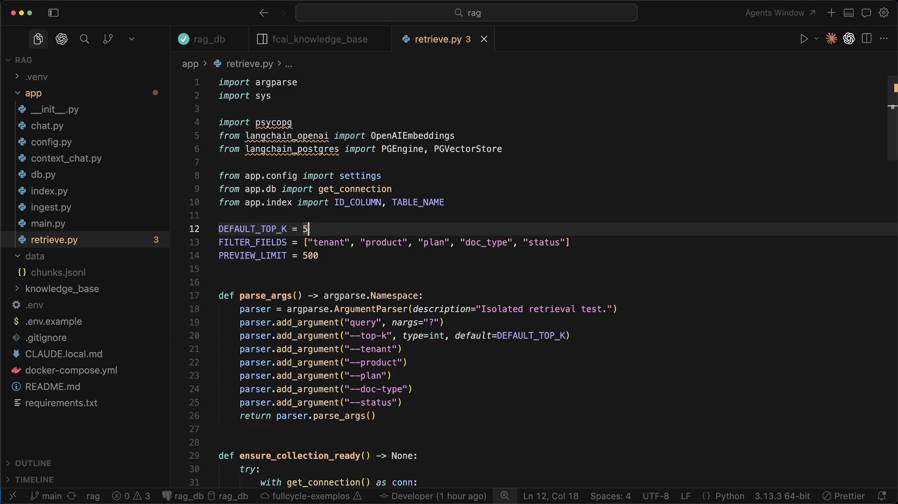
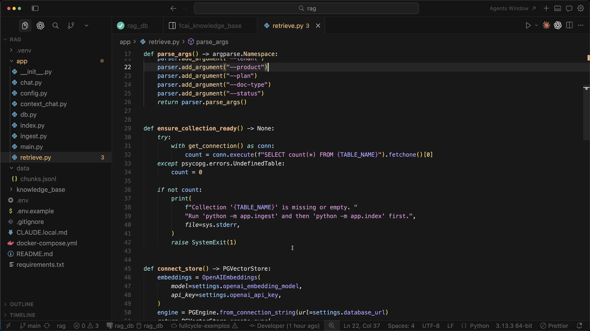
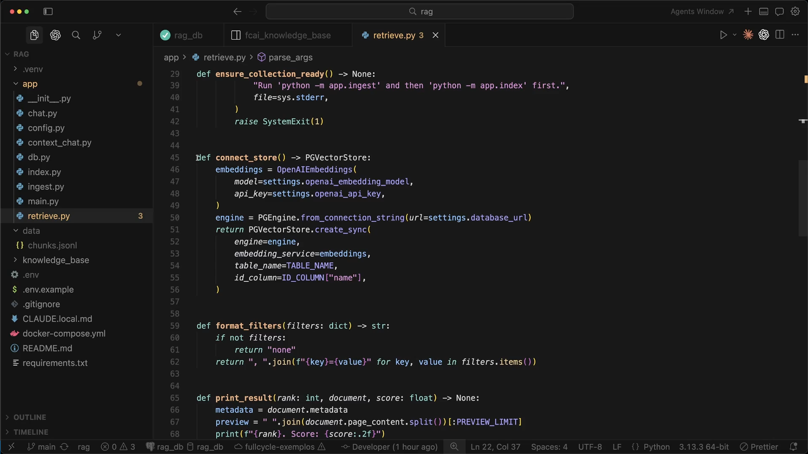
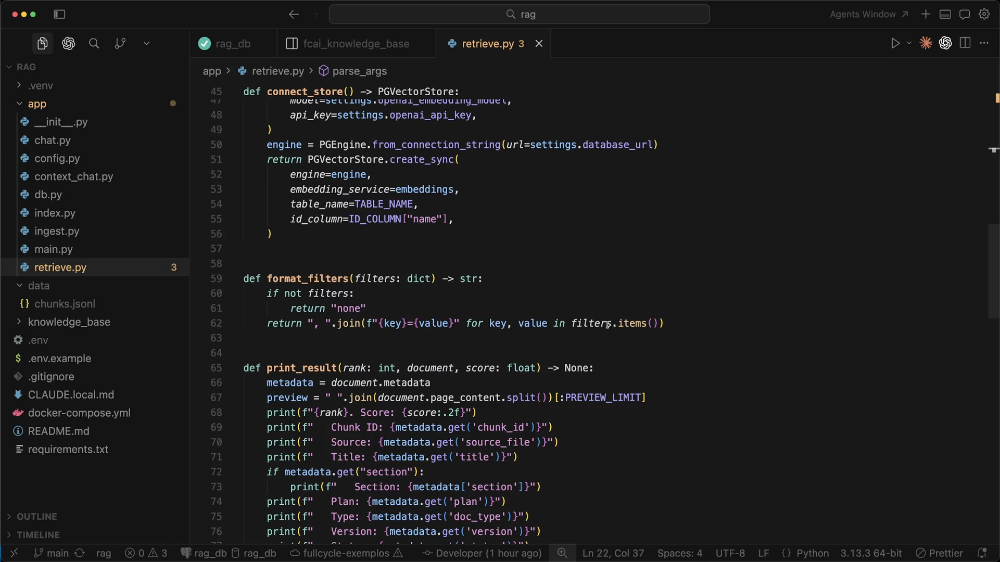
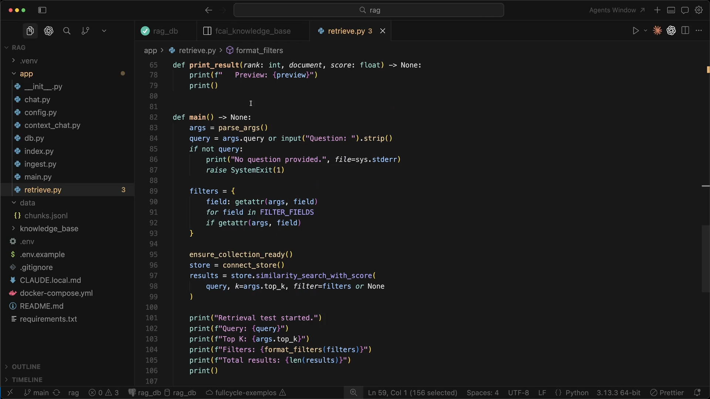
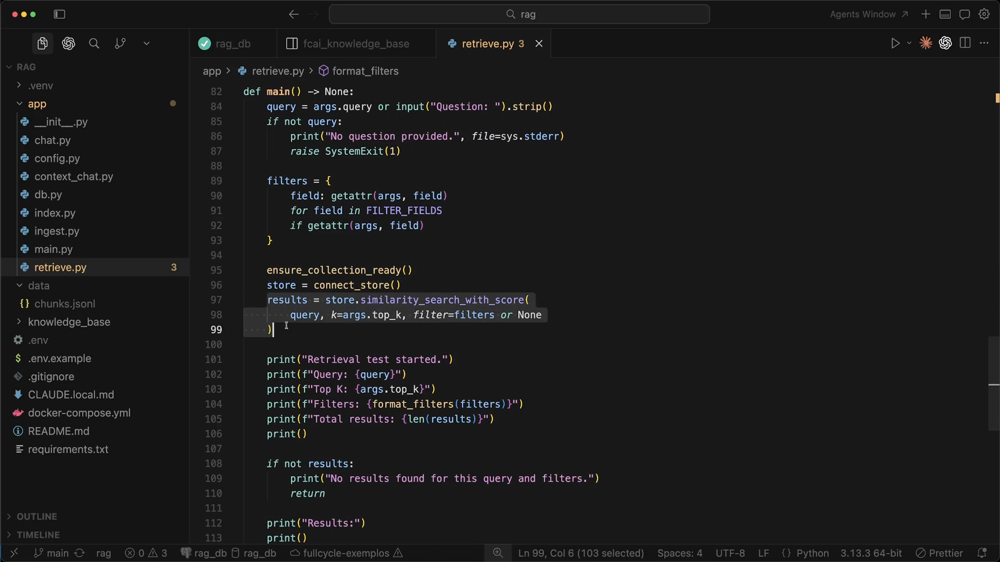

# Aula 15 — Testando retrieval isolado

[Índice do módulo](../README.md)

> Curso: **RAG** · Duração: `12:20`

## Resumo

Colocando em prática o princípio arquitetural da aula anterior — **testar a recuperação antes de chamar o modelo gerador** —, esta aula constrói e analisa o utilitário de linha de comando `app/retrieve.py`.

O objetivo do script é executar consultas diretamente contra a tabela `fcai_knowledge_base` no PostgreSQL com `pgvector`, permitindo variar o `top-k` e aplicar filtros de metadados (`tenant`, `product`, `plan`, `doc_type`, `status`) para inspecionar quais chunks retornam, em qual ordem, com qual score e qual trecho de conteúdo, sem custo nem interferência do LLM de chat.

## Índice

| # | Imagem | Assunto |
|---|---|---|
| 01 | [Estrutura inicial e argumentos CLI (`parse_args`)](#01--estrutura-inicial-e-argumentos-cli-parse_args) | Imports, constantes (`DEFAULT_TOP_K`, `FILTER_FIELDS`, `PREVIEW_LIMIT`) e flags de linha de comando |
| 02 | [Verificação prévia da coleção (`ensure_collection_ready`)](#02--verificação-prévia-da-coleção-ensure_collection_ready) | Checagem defensiva da existência e população da tabela no Postgres |
| 03 | [Conexão com `PGVectorStore` e formatação de filtros](#03--conexão-com-pgvectorstore-e-formatação-de-filtros) | Funções `connect_store()` e `format_filters()` |
| 04 | [Impressão detalhada de cada resultado (`print_result`)](#04--impressão-detalhada-de-cada-resultado-print_result) | Exibição de ranking, score, `chunk_id`, metadados e preview textual |
| 05 | [Orquestração da busca em `main()`](#05--orquestração-da-busca-em-main) | Leitura da pergunta, montagem dinâmica do dicionário `filters` e cabeçalho do teste |
| 06 | [Execução de `similarity_search_with_score` e tratamento de lista vazia](#06--execução-de-similarity_search_with_score-e-tratamento-de-lista-vazia) | Chamada ao `pgvector` combinando busca vetorial e filtros de metadados |

---

## 01 — Estrutura inicial e argumentos CLI (`parse_args`)



O módulo `app/retrieve.py` importa `TABLE_NAME` e `ID_COLUMN` diretamente de `app.index` para garantir que a leitura use exatamente a mesma tabela (`fcai_knowledge_base`) e chave primária (`chunk_id`) criadas na indexação.

Nas linhas 12–14, três constantes definem o comportamento padrão do utilitário:
- **`DEFAULT_TOP_K = 5`**: quantidade padrão de chunks retornados na versão inicial da aula.
- **`FILTER_FIELDS = ["tenant", "product", "plan", "doc_type", "status"]`**: campos de metadados expostos como filtros explícitos.
- **`PREVIEW_LIMIT = 500`**: número máximo de caracteres do `page_content` impressos no terminal por resultado.

Em seguida, `parse_args()` configura o `argparse.ArgumentParser` aceitando:
- `query` posicional e opcional (`nargs="?"`), permitindo passar a pergunta direto no comando ou digitá-la interativamente;
- `--top-k` (inteiro, default `DEFAULT_TOP_K`);
- `--tenant`, `--product`, `--plan`, `--doc-type` e `--status` para testar filtros isolados ou combinados.

---

## 02 — Verificação prévia da coleção (`ensure_collection_ready`)



Antes de instanciar o modelo de embeddings ou disparar a busca, `ensure_collection_ready()` verifica se o índice vetorial existe e possui dados:

```python
def ensure_collection_ready() -> None:
    try:
        with get_connection() as conn:
            count = conn.execute(f"SELECT count(*) FROM {TABLE_NAME}").fetchone()[0]
    except psycopg.errors.UndefinedTable:
        count = 0

    if not count:
        print(
            f"Collection '{TABLE_NAME}' is missing or empty. "
            "Run 'python -m app.ingest' and then 'python -m app.index' first.",
            file=sys.stderr,
        )
        raise SystemExit(1)
```

Se o desenvolvedor tentar testar o retrieval antes de rodar a ingestão e a indexação (ou se a tabela estiver vazia), o script captura `psycopg.errors.UndefinedTable` e falha rapidamente com uma instrução clara no `stderr`, sem fazer chamadas desnecessárias à OpenAI.

---

## 03 — Conexão com `PGVectorStore` e formatação de filtros



A função `connect_store() -> PGVectorStore` (linhas 45–56) conecta à tabela existente:

```python
def connect_store() -> PGVectorStore:
    embeddings = OpenAIEmbeddings(
        model=settings.openai_embedding_model,
        api_key=settings.openai_api_key,
    )
    engine = PGEngine.from_connection_string(url=settings.database_url)
    return PGVectorStore.create_sync(
        engine=engine,
        embedding_service=embeddings,
        table_name=TABLE_NAME,
        id_column=ID_COLUMN["name"],
    )
```

Repare em dois detalhes fundamentais:
1. **Mesmo modelo de embeddings da indexação:** o `retrieve.py` lê `settings.openai_embedding_model` para converter a pergunta do usuário em vetor no mesmo espaço vetorial dos chunks armazenados.
2. **Apenas leitura:** diferentemente do `index.py`, aqui **não** se chama `engine.init_vectorstore_table(...)`, apenas `PGVectorStore.create_sync(...)` sobre a tabela já pronta.

Logo abaixo, `format_filters(filters: dict) -> str` formata o dicionário de filtros ativos para exibição no cabeçalho do terminal (retornando `"none"` quando nenhum filtro foi passado ou `"key=value, ..."` quando há filtros ativos).

---

## 04 — Impressão detalhada de cada resultado (`print_result`)



Para que o desenvolvedor possa auditar se o chunk recuperado faz sentido, `print_result(rank: int, document, score: float)` exibe tanto a relevância numérica quanto a identidade completa do fragmento:

- **`rank` e `Score: {score:.2f}`**: posição no ranking e pontuação de similaridade retornada pelo `PGVectorStore`.
- **Rastreabilidade documental**: `Chunk ID`, `Source` (`source_file`), `Title` e `Section` (quando presente).
- **Metadados de escopo e governança**: `Plan`, `Type` (`doc_type`), `Version` e `Status`.
- **Preview do conteúdo**: nesta versão da aula, a linha `preview = " ".join(document.page_content.split())[:PREVIEW_LIMIT]` colapsa quebras de linha em espaços para mostrar os primeiros 500 caracteres em formato compacto.

---

## 05 — Orquestração da busca em `main()`



Na função `main()` (linhas 82–107):

1. Lê os argumentos com `args = parse_args()`.
2. Obtém a pergunta da CLI (`args.query`) ou solicita via `input("Question: ").strip()`, abortando com erro se continuar vazia.
3. Constrói dinamicamente o dicionário `filters` apenas com as flags efetivamente informadas na linha de comando:

   ```python
   filters = {
       field: getattr(args, field)
       for field in FILTER_FIELDS
       if getattr(args, field)
   }
   ```

   Assim, `--doc-type sla --plan all` vira `{"doc_type": "sla", "plan": "all"}`, enquanto argumentos omitidos (`None`) ficam de fora.
4. Valida a tabela (`ensure_collection_ready()`), abre o `store = connect_store()` e executa a busca.

---

## 06 — Execução de `similarity_search_with_score` e tratamento de lista vazia



O coração da recuperação acontece nas linhas 97–99:

```python
results = store.similarity_search_with_score(
    query, k=args.top_k, filter=filters or None
)
```

Ao executar esse método, o `PGVectorStore`:
1. Chama `OpenAIEmbeddings.embed_query(query)` para transformar a pergunta do usuário em um vetor de 1536 dimensões.
2. Monta a query SQL no PostgreSQL aplicando `filter` sobre a coluna JSON `langchain_metadata` (comportamento eliminatório de `WHERE`) e ordenando os registros sobreviventes pela proximidade vetorial na coluna `embedding` até o limite `k=args.top_k`.
3. Retorna uma lista de tuplas `(Document, score)`.

Se nenhum registro satisfizer os filtros informados (`if not results:`), o script informa claramente `"No results found for this query and filters."`; caso contrário, percorre `enumerate(results, start=1)` imprimindo cada candidato.

---

## Ponte com o projeto prático

No código consolidado em [`../mba-ia-rag/app/retrieve.py`](../mba-ia-rag/app/retrieve.py), o script mantém exatamente essa estrutura, com três pequenos refinamentos introduzidos ao longo das aulas seguintes para reutilização pelo pipeline completo (`app/rag_chat.py`):

| Ponto | Versão exibida na Aula 15 | Versão final em `mba-ia-rag/app/retrieve.py` |
|---|---|---|
| **`DEFAULT_TOP_K`** | `5` | `30` (para permitir inspecionar uma janela ampla do ranking quando `--top-k` não é informado) |
| **`format_filters()`** | Formata pares simples `key=value` | Também formata operadores `$in` (`isinstance(value, dict)` $\rightarrow$ `" or ".join(value["$in"])`), pois é reutilizada por `rag_chat.py` para exibir filtros do Query Planner |
| **`print_result` $\rightarrow$ `print_chunk`** | Achata o preview em uma linha (`" ".join(document.page_content.split())`) | Renomeada para `print_chunk` (reutilizada no `--debug` do chat) e preserva as quebras de linha (`document.page_content[:preview_limit].splitlines()`) para exibir com clareza o cabeçalho de contexto prefixado no chunk |

Exemplos de comandos executáveis no projeto prático:

```bash
# Busca aberta sem filtros de metadados
python -m app.retrieve "Qual é o SLA para incidentes P1 no plano Enterprise?" --top-k 5

# Busca combinando top-k e filtros de metadados
python -m app.retrieve "Qual é o SLA para P1?" --top-k 5 --doc-type sla --plan all

# Demonstração do efeito eliminatório de um filtro incompatível com o documento onde está a resposta
python -m app.retrieve "Qual é o SLA para P1?" --top-k 5 --doc-type policy
```

## Ideia-chave

Um utilitário de **retrieval isolado** separa falhas de recuperação de falhas de geração: em segundos e com custo desprezível (apenas um embedding da pergunta), você comprova se o chunk que responde à pergunta está subindo para o topo do ranking ou se está sendo escondido por chunking, falta de contexto no texto ou filtros de metadados.

## Complemento de estudo

### O caráter eliminatório dos filtros de metadados

Vale observar o que acontece no PostgreSQL quando passamos `filter={"doc_type": "policy"}` para `similarity_search_with_score`:

1. O filtro de metadados **não é um peso suave** no score; ele funciona como predicado booleano (`WHERE`).
2. Se a resposta para *"Qual é o SLA para incidentes P1?"* mora em `product-support-sla.md` (cujo `doc_type` é `"sla"`) e em `enterprise-plan.md` (cujo `doc_type` é `"plan"`), filtrar por `--doc-type policy` **elimina 100% dos chunks que contêm a resposta antes da ordenação vetorial**.
3. O `pgvector` ainda retornará os `k` chunks mais similares **dentro de `policy`** (`billing-policy.md`, `commercial-policy.md`), o que explica por que um filtro mal escolhido não necessariamente retorna lista vazia — muitas vezes ele retorna `k` chunks do tipo errado que parecem vagamente relacionados à pergunta.

É exatamente essa observação prática em `app/retrieve.py` que motivará, nas Aulas 21–23, o design do **Query Planner** com listas generosas de `doc_types` (`plan IN [plano, "all"]` e múltiplos `doc_types` candidatos).

## Exercício / Pergunta de revisão

Execute `python -m app.retrieve "Qual é o e-mail de suporte?" --top-k 5` sem filtros e, em seguida, com `--doc-type company` e com `--doc-type sla`. O que muda nos chunks recuperados e por que testar essas variações sem o LLM ajuda a calibrar os filtros que a aplicação usará em produção?
