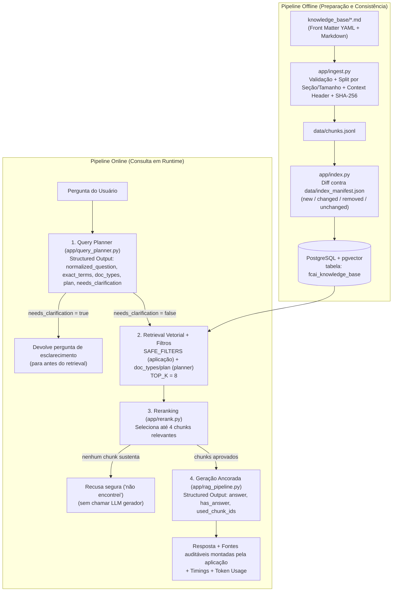

# 06 — RAG (Retrieval-Augmented Generation)

[Arquitetura](../README.md) · [Anterior: Cache](../05-cache/README.md) · [Próximo: Observabilidade](../07-observability/README.md)

Este módulo reúne 34 aulas sobre arquitetura de sistemas **RAG**, partindo dos fundamentos e limites da técnica até a construção de um pipeline completo com ingestão e validação de Markdown, chunking enriquecido por metadados, indexação incremental no PostgreSQL (`pgvector`), planejamento de busca (*Query Planner*), *reranking*, exposição via API HTTP e auditoria de fontes, tempos e consumo de tokens.

O projeto executável do módulo está em [`mba-ia-rag/`](mba-ia-rag/README.md). As aulas **01 a 15** contam com registros visuais completos (83 prints) e notas detalhadas imagem por imagem. As aulas **16 a 34** preservam título e duração na trilha, ainda aguardando a adição dos prints correspondentes, mas todo o código-fonte dessas etapas já está consolidado e documentado no projeto [`mba-ia-rag`](mba-ia-rag/README.md).

## Roteiro de estudo

| Aula | Assunto | Duração | Foco e evidência local |
|---|---|---|---|
| 01 | [O que é RAG](01-what-is-rag/README.md) | `05:50` | Conceito, tríade Retrieval-Augmented-Generation e cascata de falhas (5 prints) |
| 02 | [O que RAG não resolve](02-what-rag-does-not-solve/README.md) | `06:24` | Fronteira com DB/API, ações, alucinação com dado antigo e permissão pré-busca (6 prints) |
| 03 | [RAG vs outras estratégias arquiteturais](03-rag-vs-other-architectural-strategies/README.md) | `06:09` | Comparação com SQL/API, Prompt grande, Cache, Tool Calling e Fine-tuning (6 prints) |
| 04 | [Entendendo o Projeto Prático](04-understanding-the-practical-project/README.md) | `05:25` | Visão geral do FCAI Knowledge Chat, arquitetura em camadas e casos de teste (4 prints) |
| 05 | [Estrutura dos arquivos iniciais](05-initial-file-structure/README.md) | `03:35` | Docker Compose com `pgvector`, `.env`, `config.py`, `db.py` e `main.py` (8 prints) |
| 06 | [Criando a base de documentos em Markdown](06-creating-the-document-base-in-markdown/README.md) | `02:17` | Estrutura de `knowledge_base/` e contrato de front matter YAML (3 prints) |
| 07 | [Perguntando ao modelo sem RAG](07-asking-the-model-without-rag/README.md) | `02:16` | Linha de base sem contexto externo em `app/chat.py` (1 print) |
| 08 | [Colocando documento inteiro no prompt e entendendo o limite](08-putting-the-entire-document-in-the-prompt-and-understanding-the-limit/README.md) | `05:13` | `app/context_chat.py`, acerto em documento único e limites de escala/tokens (7 prints) |
| 09 | [Arquitetura do RAG - ingestão, índice, retrieval e geração](09-rag-architecture-ingestion-index-retrieval-and-generation/README.md) | `05:39` | Separação entre pipeline offline (ingestão/indexação) e online (consulta) (5 prints) |
| 10 | [Pipeline de ingestão inicial](10-initial-ingestion-pipeline/README.md) | `06:17` | Leitura, validação de front matter e falhas explícitas na ingestão (4 prints) |
| 11 | [Chunking, metadados e versionamento](11-chunking-metadata-and-versioning/README.md) | `06:54` | Corte estrutural + tamanho, overlap, metadados herdáveis e cabeçalho de contexto (7 prints) |
| 12 | [Gerando chunks com metadados](12-generating-chunks-with-metadata/README.md) | `11:50` | Implementação de `app/ingest.py` e inspeção de `data/chunks.jsonl` (14 prints) |
| 13 | [Indexando chunks no Postgres com pgvector](13-indexing-chunks-in-postgres-with-pgvector/README.md) | `12:01` | `PGEngine`, `PGVectorStore`, `dimension probe` e tabela `fcai_knowledge_base` (12 prints) |
| 14 | [Retrieval onde o RAG ganha ou perde](14-retrieval-where-rag-wins-or-loses/README.md) | `05:33` | Busca semântica, `top_k`, filtros eliminatórios e armadilhas de similaridade (5 prints) |
| 15 | [Testando retrieval isolado](15-testing-retrieval-in-isolation/README.md) | `12:20` | Uso de `app/retrieve.py`, impacto do cabeçalho de contexto e filtros por CLI (6 prints) |
| 16 | [Montagem do contexto e prompt final](16-assembling-context-and-final-prompt/README.md) | `06:30` | Estruturação dos trechos recuperados e instruções de ancoragem |
| 17 | [Primeira resposta com RAG](17-first-response-with-rag/README.md) | `06:45` | Integração retrieval + geração em `app/rag_chat.py` |
| 18 | [Resposta com fontes, recusa e debug](18-response-with-sources-refusal-and-debug/README.md) | `08:56` | Saída estruturada (`has_answer`, `used_chunk_ids`) e fontes montadas pela aplicação |
| 19 | [Por que RAG simples falha](19-why-simple-rag-fails/README.md) | `05:47` | Perguntas coloquiais, termos exatos perdidos e mistura de planos |
| 20 | [Melhorando uma busca ruim](20-improving-a-poor-search/README.md) | `08:02` | Reescrita de consulta, preservação de literais e planejamento pré-retrieval |
| 21 | [Intenção da pergunta antes do retrieval](21-question-intent-before-retrieval/README.md) | `05:04` | Normalização, inferência de filtros e detecção de ambiguidade |
| 22 | [Demonstrando Query Planner](22-demonstrating-query-planner/README.md) | `10:12` | Execução prática do planner com `--debug` e perguntas ambíguas |
| 23 | [Entendendo o Código do Query Planner](23-understanding-query-planner-code/README.md) | `12:09` | `app/query_planner.py`, `SAFE_FILTERS` e validação de contrato com o índice |
| 24 | [Reranking e seleção final do contexto](24-reranking-and-final-context-selection/README.md) | `05:55` | Busca ampla para *recall* (`TOP_K=8`) e seleção enxuta para *precisão* (`max 4`) |
| 25 | [Aplicando reranking simples nos chunks recuperados](25-applying-simple-reranking-to-retrieved-chunks/README.md) | `09:27` | Comparação prática com e sem `--no-rerank` |
| 26 | [Entendendo o código do Rerank](26-understanding-rerank-code/README.md) | `04:00` | `app/rerank.py`, `RerankResult` e portão de segurança antes da geração |
| 27 | [Reranking sem chamar o modelo novamente](27-reranking-without-calling-the-model-again/README.md) | `05:16` | Alternativas determinísticas, heurísticas léxicas e *cross-encoders* dedicados |
| 28 | [Documentos mudam - consistência e reindexação](28-documents-change-consistency-and-reindexing/README.md) | `05:41` | Chunks órfãos, duplicação e necessidade de identidade determinística |
| 29 | [Manifest, hash e reindexação idempotente](29-manifest-hash-and-idempotent-reindexing/README.md) | `09:30` | `document_hash` (SHA-256), `data/index_manifest.json` e estados `new/changed/removed/unchanged` |
| 30 | [Entendendo código de Indexação](30-understanding-indexing-code/README.md) | `06:23` | Leitura detalhada de `app/manifest.py` e `app/index.py` |
| 31 | [Expondo o Knowledge Chat como API](31-exposing-knowledge-chat-as-an-api/README.md) | `06:11` | `app/api.py` (FastAPI), `app/rag_pipeline.py` e contratos HTTP |
| 32 | [Logs, tempos e resposta auditável](32-logs-timings-and-auditable-response/README.md) | `07:53` | `request_id`, `timings` por etapa, `model_usage` e log JSON estruturado |
| 33 | [Soluções prontas de providers e decisão build vs buy](33-provider-solutions-and-build-vs-buy-decision/README.md) | `08:50` | File Search / Knowledge Bases gerenciadas vs pipeline próprio |
| 34 | [Checklist arquitetural de RAG](34-rag-architectural-checklist/README.md) | `06:28` | Revisão de ponta a ponta para produção |

---

## Arquitetura do projeto prático (`mba-ia-rag`)

O projeto consolidado em [`mba-ia-rag/`](mba-ia-rag/README.md) separa estritamente o **pipeline offline de preparação** (`app.ingest` + `app.index`) do **pipeline online de consulta** (`app.rag_pipeline`, consumido tanto pelo CLI `app.rag_chat` quanto pela API HTTP `app.api`):

---

## Princípios arquiteturais consolidados no módulo

1. **Metadados filtram; cabeçalho de contexto orienta o embedding:**
   Metadados salvos em colunas JSON/relacionais no `pgvector` servem para o `WHERE` (filtro eliminatório), mas não entram automaticamente no cálculo do vetor. Por isso, o `app/ingest.py` prefixa cada chunk com `Document title`, `Document type`, `Product`, `Plan`, `Version` e `Section`.
2. **Controle de acesso é responsabilidade da aplicação (`SAFE_FILTERS`), nunca do modelo:**
   O *Query Planner* pode sugerir filtros de conteúdo (`doc_types` e `plan`), mas filtros de governança (`tenant`, `product`, `status="published"`) são fixados pela aplicação e aplicados **antes** da busca vetorial.
3. **Recall no retrieval, precisão no reranking:**
   A busca vetorial traz candidatos com folga (`TOP_K=8`) para não perder a evidência correta; o *reranker* filtra ruído selecionando no máximo 4 chunks antes de montar o prompt final.
4. **Fontes são montadas pela aplicação, não redigidas livremente pelo LLM:**
   O modelo gerador devolve apenas os `used_chunk_ids` em saída estruturada. A aplicação cruza esses IDs com os chunks efetivamente enviados ao prompt, descartando IDs inventados e formatando `source_file`, `title`, `section` e `version` de forma determinística.
5. **Indexação incremental e idempotente por hash:**
   Calcular o SHA-256 do documento completo (`document_hash`), gerar `chunk_id`s determinísticos (`{stem}-{hash[:12]}-{index:04d}`) e registrar o estado em `data/index_manifest.json` permite atualizar apenas documentos novos ou modificados e remover chunks órfãos de documentos editados ou excluídos.

---

## Perguntas para revisão do módulo

- Por que colocar `tenant` ou `status="published"` apenas no prompt do sistema não impede vazamento de documentos restritos?
- Qual é o efeito prático de desabilitar o cabeçalho de contexto (`--no-context-header`) sobre um chunk retirado do meio de uma seção longa?
- Por que um filtro de `doc_type` restritivo demais no *Query Planner* pode derrubar o *recall* a zero mesmo quando a resposta existe na base?
- O que acontece no índice vetorial quando um documento é editado e reindexado sem apagar os `chunk_id`s da versão anterior?
- Por que a aplicação monta a lista final de `Sources` a partir dos metadados dos `used_chunk_ids` em vez de pedir ao LLM que escreva as citações em texto livre?
