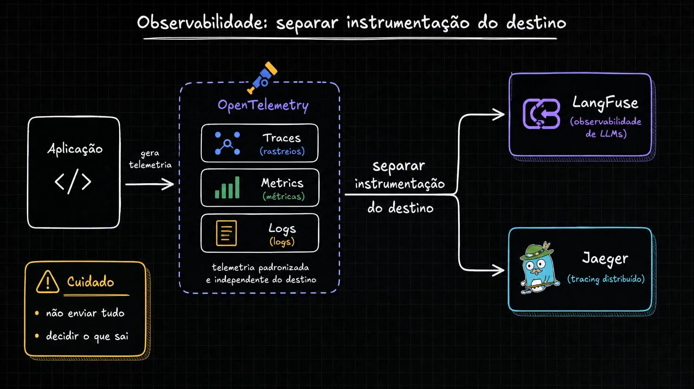
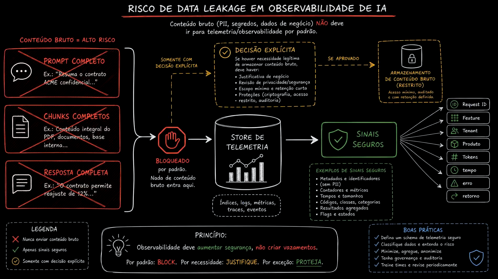
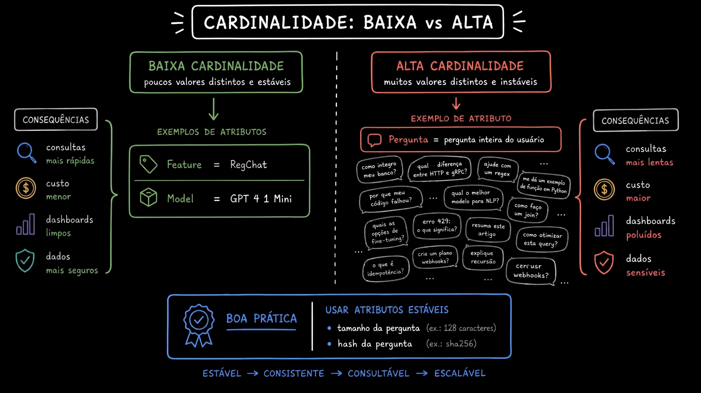
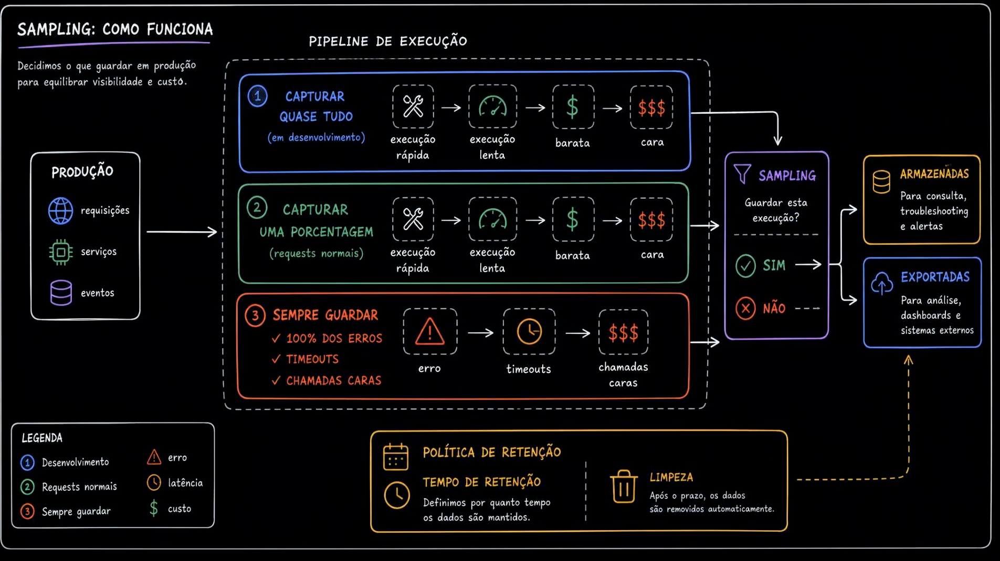
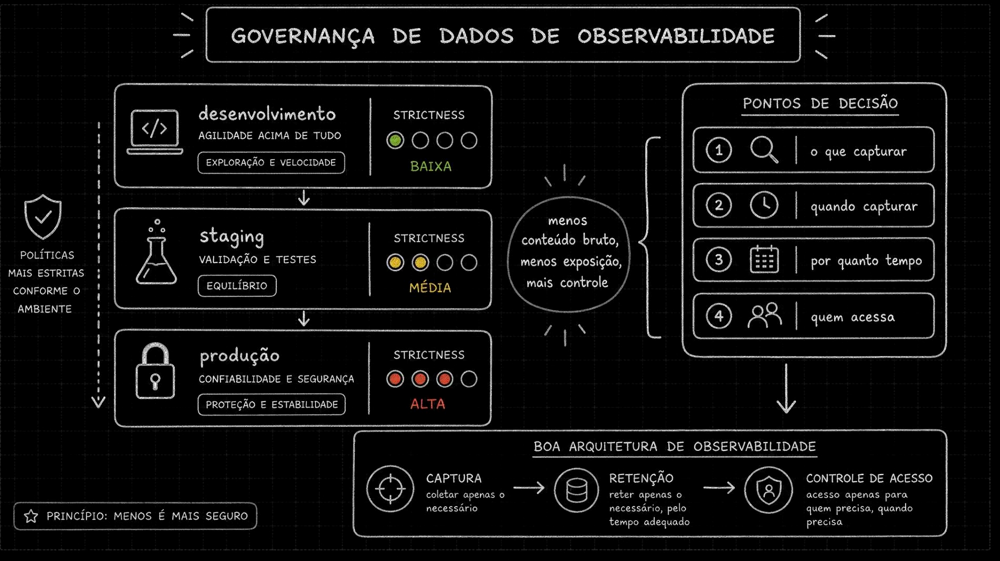

# Aula 10 — Privacidade, cardinalidade, sampling e retenção

> Curso: **Observabilidade** · Duração: `06:28`

[Índice do módulo](../README.md)

Esta aula trata telemetria como um fluxo de dados que precisa de propósito, orçamento e
controle. Os cinco quadros mostram instrumentação, exposição de conteúdo, cardinalidade,
amostragem e governança por ambiente. Capturar mais não significa observar melhor.

## 01 — Separar instrumentação de destino

A aplicação instrumentada produz sinais que podem ser encaminhados a backends diferentes.
OpenTelemetry é a camada de instrumentação e transporte de telemetria; o destino oferece
armazenamento e consulta. O diagrama aproxima Langfuse e Jaeger, sem afirmar que ambos
armazenem todos os tipos de sinal da mesma forma. Confira suporte e configuração de cada exporter.

## 02 — Conteúdo bruto e risco de exposição

O quadro bloqueia por padrão prompt, chunks e resposta integrais, privilegiando sinais
operacionais como tempo, tokens, classe de erro e identificadores. Uma exceção para depuração
precisa ter finalidade, escopo, acesso e retenção definidos. Metadados também podem identificar
pessoas ou organizações: chamar um atributo de metadado não o torna automaticamente seguro.

## 03 — Cardinalidade: corrigindo a sugestão de hash

Cada combinação de labels pode gerar uma série em um backend de métricas. Feature e modelo
costumam ter vocabulário limitado; pergunta livre e request ID variam muito. O quadro sugere
hash da pergunta como atributo estável, mas hash preserva aproximadamente a quantidade de
valores distintos. Portanto não resolve alta cardinalidade nem assegura anonimização.
Use labels de domínio limitado para métricas e guarde identificadores de correlação em
traces/logs adequados ao propósito. Comprimento da pergunta pode ser agregado em histograma,
em vez de criar uma série para cada tamanho.

## 04 — Sampling e retenção são decisões diferentes

A amostragem escolhe quais traces guardar; retenção define por quanto tempo mantê-los.
O quadro propõe guardar erros, timeouts e chamadas caras, mas isso exige um mecanismo que
conheça esses resultados. Head sampling probabilístico decide no início e pode descartar
um trace que depois falha. Tail sampling permite decidir com informação posterior, com
custo e limites de buffer/tempo. Nenhum desenho garante captura integral durante perda
ou sobrecarga do pipeline.

## 05 — Política por ambiente

Desenvolvimento, staging e produção podem ter níveis de captura diferentes. Um ambiente de
desenvolvimento que contém dados reais continua precisando de proteção. Estabeleça o que
capturar, quando, por quanto tempo e quem pode consultar. A exclusão deve alcançar o destino
e suas cópias segundo a política operacional definida; registrar uma variável de retenção
na aplicação não comprova que os dados foram apagados.

## Complemento e aplicação atual

> Revisão em **19/11/2026**.

O [OpenTelemetry orienta minimizar e revisar dados sensíveis](https://opentelemetry.io/docs/security/handling-sensitive-data/)
e distingue [head e tail sampling](https://opentelemetry.io/docs/concepts/sampling/).
O [Prometheus recomenda evitar labels de alta cardinalidade](https://prometheus.io/docs/practices/naming/).

No [exemplo local de observabilidade](../../project-for-exemple/observability/app/observability.py),
`sample_rate()` usa 100% em desenvolvimento e taxa configurada nos outros ambientes;
`_build_sampler()` monta `ParentBased(TraceIdRatioBased(...))`. Isso é head sampling, sem
política que retenha retroativamente todos os erros. A captura de conteúdo é permitida
somente em desenvolvimento e precisa da opção explícita. A existência dessas regras foi
conferida no código, sem execução do pipeline nesta revisão.

**Exercício proposto:** defina três métricas com labels limitados, um trace de erro com
correlação e um teste que confirme ausência de prompt/conteúdo sensível no payload exportado.
Verifique também o que acontece quando o exporter fica indisponível.

### Limite da proteção de conteúdo no exemplo

A regra de captura restringe os eventos explícitos de debug, mas não garante ausência de
dados em todos os caminhos. O helper `span()` também registra `str(exc)` no status de erro.
Mensagens de exceção podem incluir conteúdo da requisição ou do provider. Ao evoluir o
exemplo, revise e sanitize esses erros antes de exportar, mantendo detalhes sensíveis apenas
no destino apropriado. Essa observação vem da leitura do helper, sem teste de vazamento executado.
