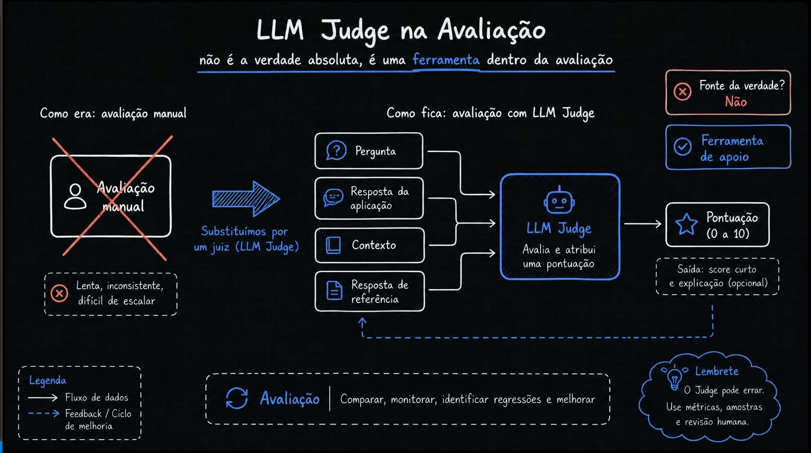
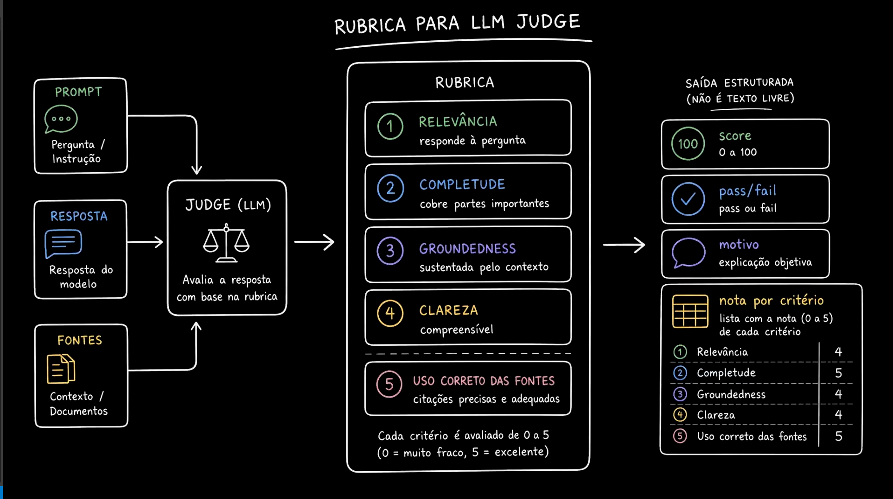
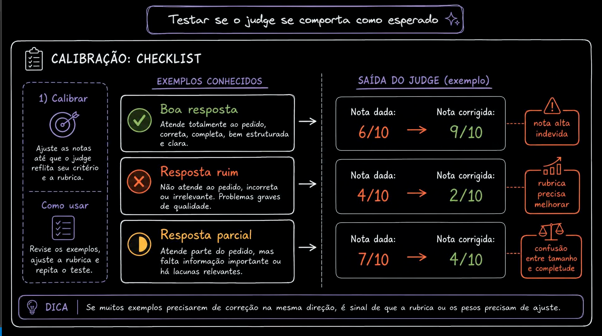
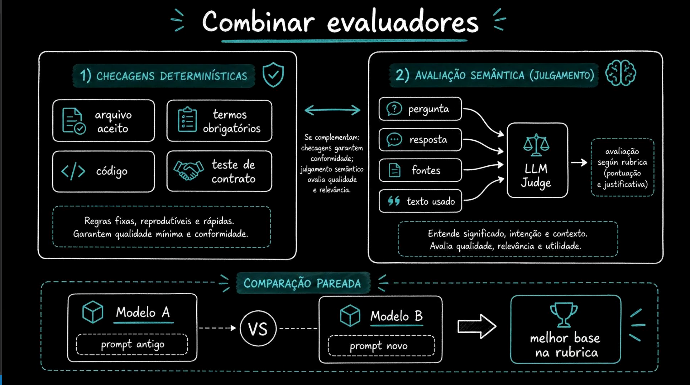
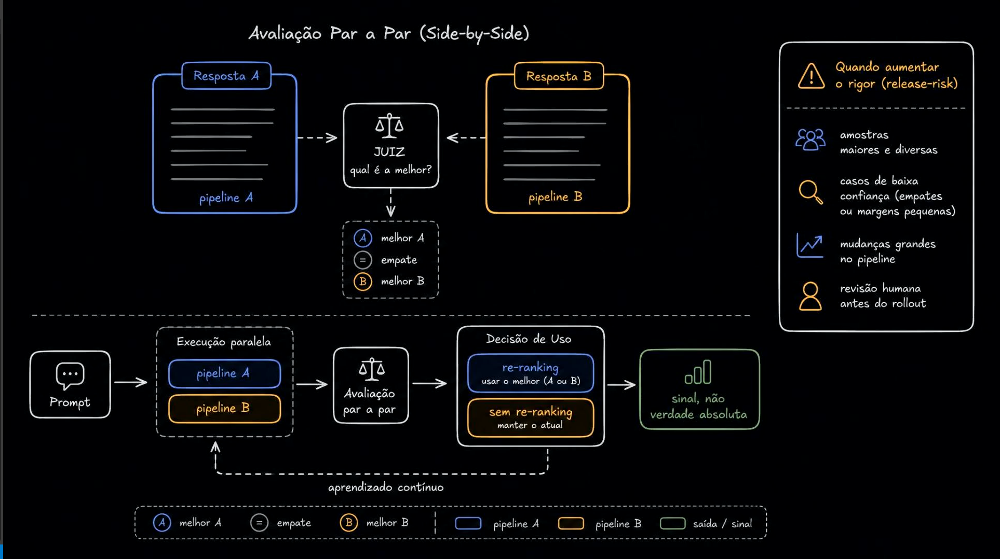
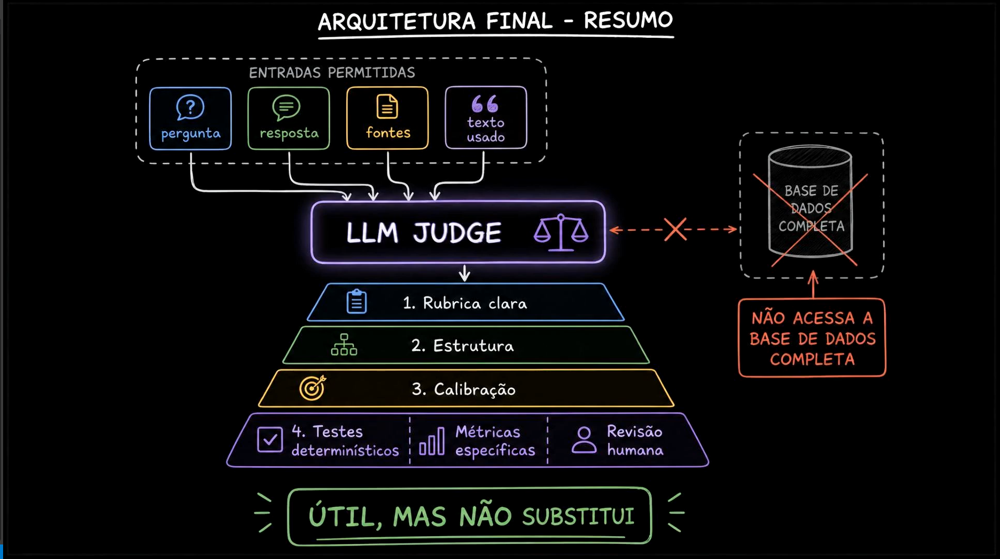

# Aula 15 — LLM-as-a-judge: rubricas e calibração

> Curso: **Testes e Evaluation** · Duração: `06:29`

[Índice do módulo](../README.md)

Usar um LLM para avaliar respostas amplia cobertura de revisão, mas adiciona outro sistema
que também pode errar. A aula mostra como tornar esse julgamento explícito por rubrica,
saída estruturada e calibração, combinando-o com testes e leitura humana.

## 01 — Juiz como ferramenta de avaliação

O juiz recebe pergunta, resposta, contexto e, quando aplicável, referência. Sua nota é um
sinal segundo critérios definidos, não uma fonte independente da verdade. Automatizar parte
da leitura não elimina revisão humana, especialmente nos desacordos e casos de maior impacto.

## 02 — Rubrica e escalas de pontuação

O quadro propõe relevância, completude, groundedness, clareza e uso das fontes. Nota global,
pass/fail e justificativa devem ter definição explícita. As imagens alternam escalas 0–10,
0–100 e 0–5 para ilustrar possibilidades: escolha uma escala consistente no experimento.
Um schema valida campos e faixas, sem provar que o julgamento é correto.

## 03 — Calibração com respostas conhecidas

Compare casos bons, ruins e parciais com a avaliação esperada. Revise quando o juiz confunde
texto longo com resposta completa ou favorece um estilo sem sustentação. A anotação lateral
“nota alta indevida” não descreve corretamente a primeira seta 6/10 → 9/10, que representa
subavaliação inicial de uma resposta boa. Os valores são ilustrações, não resultados medidos.
Ajuste a rubrica, não as expectativas apenas para encaixar o resultado do modelo.

## 04 — Combinar checagens

Formato, código, contrato e campos obrigatórios podem ser verificados deterministicamente.
O juiz complementa essas verificações com critérios semânticos. Uma resposta não deve receber
aprovação de uma ação proibida só porque a nota de clareza ou relevância é alta. Defina
falhas que bloqueiam independentemente da média.

## 05 — Comparação pareada

A e B respondem à mesma entrada; o juiz aplica uma rubrica e pode registrar empate. A
preferência não equivale a aprovação absoluta. Alterne a ordem das respostas, inspecione
margens pequenas e valide uma amostra humana. O desenho de gerar duas respostas e escolher
em runtime aumenta chamadas e latência; comparação offline não precisa usar esse custo em
cada requisição do produto.

## 06 — Contexto limitado e fronteiras do juiz

O último quadro limita o juiz aos insumos autorizados, sem acesso irrestrito à base. Ele
avalia a evidência recebida, por isso não detecta automaticamente tudo que ficou fora do
retrieval. Separe recuperação incompleta, geração sem apoio e avaliação errada para localizar
a falha no componente correspondente.

## Complemento e aplicação atual

> Revisão em **19/11/2026**.

No [eval_judge.py local](../../project-for-exemple/evaluation/app/eval_judge.py),
`JudgeVerdict` usa scores de 0 a 1 e a rubrica tem versão `2`. O
[dataset de calibração](../../project-for-exemple/evaluation/evals/judge_calibration.jsonl)
inclui resposta sustentada, invenção, desvio de assunto, incompletude, prolixidade e fonte
inadequada. Este último registra uma lacuna conhecida: nomes de arquivo sem atribuição
por trecho não permitem conferir completamente a relação fonte-afirmação.

A [documentação atual do LangSmith](https://docs.langchain.com/langsmith/llm-as-judge)
permite configurar avaliadores com critérios explícitos. O desenho continua exigindo
validação da rubrica para seu domínio, independentemente da plataforma.

**Exercício proposto:** anote casos de calibração, separe casos de teste, fixe versões do
gerador/juiz e avalie concordância por classe de erro. Conte falhas de execução/parsing
separadamente. Groundedness com base contaminada pode ser alta: a confiança na origem dos
documentos precisa de controle próprio.
