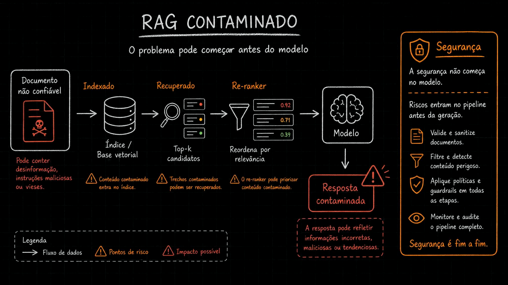

# Aula 12 — Provenance e confiança antes do retrieval

> Curso: **Segurança** · Duração: `08:56`

[Índice do módulo](../README.md)

A imagem fecha a sequência mostrando que a confiança precisa ser avaliada antes de o
conteúdo disputar relevância. Um documento contaminado pode ser indexado, recuperado e
priorizado pelo reranker justamente porque parece responder bem à pergunta.

## 01 — Origem confiável e relevância são propriedades diferentes

O fluxo é documento → índice → top-k → reranker → modelo → resposta. Cada seta pode preservar
conteúdo adulterado. Um score alto de relevância não valida autoria, integridade, vigência ou
permissão de divulgação. O quadro propõe controles ao longo do pipeline; sanitização e
guardrails reduzem risco, sem garantir remoção de toda instrução maliciosa.

## Complemento e aplicação atual

> Revisão em **19/11/2026**.

No [provenance.py local](../../project-for-exemple/security/app/provenance.py),
`classify_source()` resolve o caminho antes de conferir se pertence a uma root autorizada.
Isso evita aceitar um diretório irmão por prefixo textual e um symlink que aponta para fora.
Os campos de proveniência são reservados à aplicação; o documento não pode conceder a si
mesmo confiança. O [teste de ingestão](../../project-for-exemple/security/tests/test_trusted_ingestion.py)
contém esses cenários, sem ter sido executado nesta revisão.

Essa política responde quem pode fornecer conhecimento; não comprova que todo conteúdo da
root é verdadeiro ou seguro. Ela depende de controlar quem escreve nessa origem e não
substitui autorização de leitura: uma fonte confiável ainda pode conter dados que o caller
não tem permissão de receber.

**Extensão proposta:** registre origem obtida pelo conector, identidade do publicador,
revisão, hash do conteúdo, validade e política de acesso. Defina quarentena e reindexação
para documentos revogados, incluindo invalidação de caches derivados. Esses campos são uma
proposta de evolução; não são todos implementados pelo projeto local.
